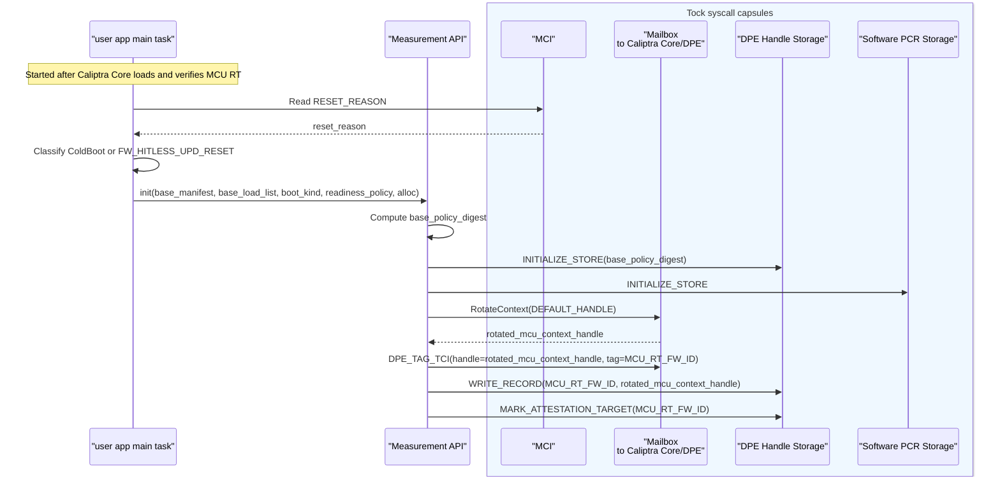
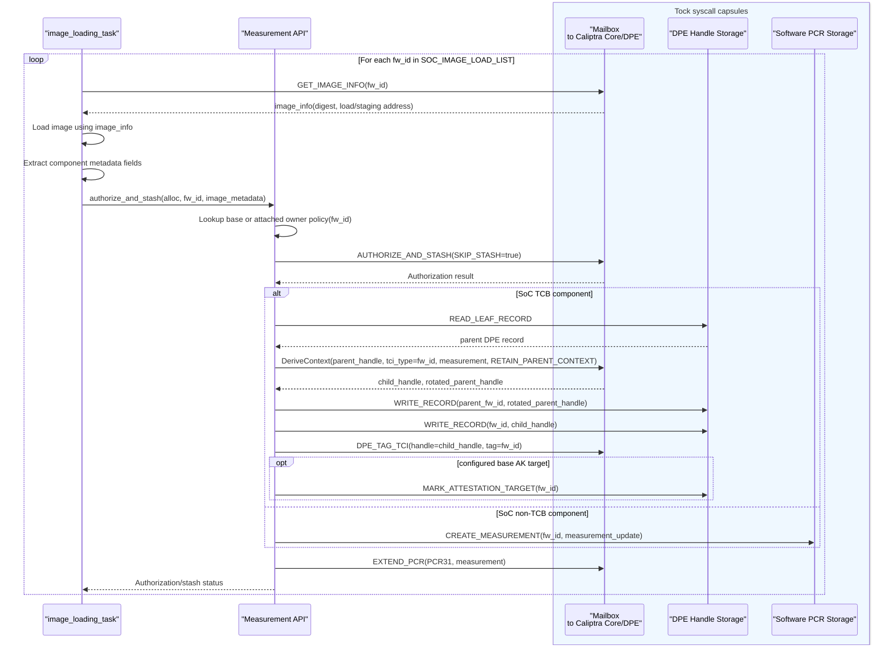
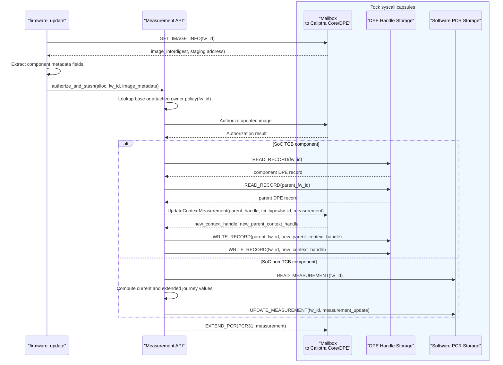
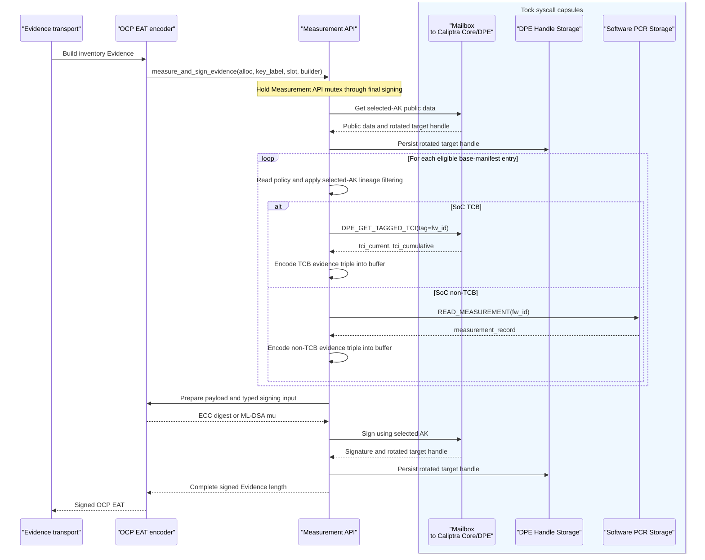

# Measurement API

This document describes the MCU Runtime measurement API used to collect, store, and report SoC measurements for attestation.

The measurement API manages SoC measurement state according to the integrator-configured measurement policy. It provides a unified userspace interface for image loading, firmware updates, authorization and policy measurements, and signed Evidence generation. Callers do not need to manipulate Caliptra DPE handles or Software PCR Storage records directly.

The software-layer responsibilities and measurement flow are summarized in [Implementation Design](./attestation-implementation-design.md).

This API is internal to MCU Runtime tasks. Requester-facing signed-Evidence retrieval is provided through transport-specific interfaces. The requester boundary differs by transport:

* BMC/pRoT style requesters use SPDM over MCTP.
* PCIe DOE requesters, such as confidential-compute PCIe devices, use SPDM over DOE.
* SoC-local requesters can use the MCU mailbox `GET_ATTESTATION` path.

SPDM can carry the signed OCP EAT through `GET_MEASUREMENTS` measurement block index `0xFD` or through the Caliptra `GET_ATTESTATION` SPDM VDM command. `GET_ATTESTATION` also supports PCR Quote when enabled. The requester-facing formats and transport APIs are described in [Common Caliptra Commands](./caliptra_common_commands.md) and are outside the scope of this document.

## Implementation status

This document distinguishes implemented Measurement API behavior from remaining owner integration and open policy decisions. Describing an intended owner flow does not mean that all of its callers are wired up.

| Area | Status |
| --- | --- |
| Base configuration, measurement stores, and component measurement operations | Implemented. |
| Owner Measurement Policy parsing/attachment and base-plus-owner policy lookup for authorization | Implemented. Attachment does not initialize or clear the stores. |
| Vendor key, owner-manifest preamble, owner-policy, and owner-key measurements | Implemented, including preserved-policy checks during hitless update. |
| Loading and activating firmware from the owner load list | Remaining integration. Flash and PLDM boot currently load the base list only. |
| Combined base/owner Evidence and completion gating | Remaining integration. Evidence enumeration, read-side policy lookup, and load-completion checks remain base-only. |
| Owner-aware update transactions and per-component SVN/version handoff | Remaining integration; final SVN claim semantics are an open decision. |


## API entry points

| Interface | Caller | Purpose |
| --- | --- | --- |
| `init(manifest_bytes, soc_image_load_fw_ids, boot_kind, readiness_policy, alloc)` | Main user-app startup | Initializes the library-owned Measurement API instance from the base policy. Cold boot initializes stores and the MCU Runtime root record; hitless update validates preserved state. |
| `policy_contains_component(fw_id)` | Boot/image loading | Tests membership in the base policy or an attached owner policy. |
| `validate_and_set_owner_policy(owner_policy_bytes)` | Image loading | Parses and attaches already-authenticated `MOAM`/`MOLL` bytes. It does not authenticate the bytes or reset base state. |
| `measure_vendor_auth_key(alloc, digest, boot_kind)` | Measurement boot initialization | Creates or synchronizes the Vendor Authorization Key control measurement. |
| `measure_owsm(alloc, preamble_digest, svn, boot_kind)` | Image loading | Creates or synchronizes the MCU-managed Owner Authorization Manifest preamble measurement. |
| `measure_owner_measurement_policy(alloc, policy_digest, boot_kind)` | Image loading | Creates the owner-policy measurement on cold boot; verifies it is unchanged on hitless update. |
| `measure_owner_auth_key(alloc, digest, boot_kind)` | Image loading | Creates or synchronizes the Owner Authorization Key control measurement. |
| `authorize_and_stash(alloc, fw_id, image_metadata)` | Image loading and firmware update | Requests Caliptra authorization, then records the accepted component measurement through DPE or Software PCR Storage. |
| `mark_initial_soc_load_complete()` | Image loading | Validates records for the base load list and transitions to `Active`. It does not yet validate owner-list completion. |
| `disable_attestation()` | Boot/loading failure paths | Transitions the API to `Error`, blocking normal measurement and Evidence operations. |
| `encode_measurement_evidence(alloc, buffer)` | Evidence builder | Encodes eligible base-manifest measurements as concise evidence. Returns the encoded length or an error such as `EvidenceBufferTooSmall`, not a required buffer size. |
| `measure_and_sign_evidence(alloc, key_label, pki_entity_slot, evidence_builder)` | Signed-Evidence provider | Serializes selected-AK identification, concise-evidence encoding, payload construction, and signing under one Measurement API lock. |
| `leaf_cert_size(alloc, profile, key_label)` | SPDM cert store | Returns the DPE leaf certificate size and persists the rotated target handle. |
| `leaf_cert_slice(alloc, profile, key_label, cert_offset, buffer)` | SPDM cert store | Returns one DPE leaf certificate slice and persists the rotated target handle. |
| `leaf_kid(alloc, key_label, kid)` | ECC Evidence provider | Computes the ECC selected-AK `kid` and persists the rotated target handle. The combined Evidence operation also handles ML-DSA key identification. |
| `sign(alloc, key_label, signing_input, signature)` | Signing callers | Signs a typed input with the selected AK, persists its rotated handle, and returns the signature length. |
| `export_cdi_and_stash(alloc, profile, cert_out)` | Exported-CDI consumers | Derives an exported CDI, stores its handle, persists the rotated target handle, and returns the certificate length. |
| `read_exported_cdi(cdi_out)` | Exported-CDI consumers | Reads the stored handle; rejects an all-zero, not-yet-derived handle. |

The table omits Rust types and generics. `alloc` implements `ScratchAlloc`; bounded work buffers come from the caller's task scratch. Base configuration and attached owner-policy bytes must remain valid for the lifetime of the library-owned instance.

Only the measurement API layer owns mutation of DPE Handle Storage capsule and Software PCR Storage capsule state. Image loading, firmware update, OCP EAT generation, and SPDM responders must not write those stores directly.

The Measurement API library owns a single MCU Runtime measurement state instance behind an asynchronous mutex. User app startup initializes it with the authenticated base configuration and reset classification. Image loading later attaches the authenticated owner policy. SPDM, Evidence providers, image loading, and firmware update use the library surface instead of passing DPE handles or store records between tasks.

The Tock capsule syscall drivers and reserved SRAM layout used by these APIs are described in [Tock Capsules](./attestation-tock-capsules.md).

## Data interfaces

The Measurement API uses base/owner measurement policy for component classification, authenticated SoC component metadata for authorization/loading, and caller-provided operation metadata for initial image load or component update. Authorization manifests and measurement policies have different responsibilities.

### Firmware id source

`GET_IMAGE_INFO(fw_id)` looks up the SoC Manifest Image Metadata Entry for the firmware id of the image. It does not enumerate which images should be loaded.

The caller gets `fw_id` from the flow it owns:

| Caller | `fw_id` source |
| --- | --- |
| Image loader | The base `SOC_IMAGE_LOAD_LIST` today. The owner `MOLL` is the required source for the remaining owner-firmware loading integration. |
| Firmware update | Update package metadata or update flow state for the component being updated. The update flow uses this `fw_id` to call `GET_IMAGE_INFO(fw_id)` before authorizing the update. |
| OCP EAT encoder | Does not need to know the `fw_id` list. It asks the Measurement API to encode configured measurement claims into the EAT payload buffer. SPDM is one transport path that can carry the resulting Evidence. |

The `fw_id` values used by these flows must match the applicable measurement policy and the SoC component metadata returned by `GET_IMAGE_INFO(fw_id)`. Authorization policy lookup checks the base manifest and then the attached owner manifest. Unknown IDs are rejected. Evidence read-side lookup has not yet been extended to the owner manifest.

In this document, `fw_id` represents the `fw_id` field in the SoC Manifest image metadata. It identifies a load instance, not merely a payload. Distinct `fw_id`s may refer to the same `component_id`/firmware payload; those instances must not be collapsed during loading or inventory enumeration.

### Base and owner attestation configuration

The base Attestation Manifest (`MCAM`) and ordered `SOC_IMAGE_LOAD_LIST` are embedded in the authenticated MCU Runtime image. The Owner Measurement Policy is a separate authenticated component, `0x0000_0005`, containing the Owner Attestation Manifest (`MOAM`) and ordered Owner SoC Image Load List (`MOLL`). It arrives through flash or PLDM rather than being compiled into MCU Runtime. Their formats and validation rules are defined in [Attestation Configuration](./attestation_configuration.md).

The Measurement API uses policy entries to route each component to DPE or Software PCR Storage. Base policy also permits selection of an attestation target, subject to the implementation constraints below.

| Field | Description |
| --- | --- |
| `fw_id` | Component firmware identifier used as the lookup key. |
| `SOC_TCB_DPE` | Flag selecting DPE storage for TCB components; otherwise the component uses Software PCR Storage. |
| `AK_TARGET` | Selects a TCB component as the attestation target. Currently supported only through the base manifest. |

Classification and AK selection are not supplied in `ImageMetadata` and are not derived from `GET_IMAGE_INFO(fw_id)`. There is no serialized `inventory_evidence` flag. Current Evidence encoding considers base-manifest entries and omits TCB measurements on the selected AK lineage.

Each layer requires unique IDs and agreement between its authorization metadata, measurement policy, and load list. Owner policy parsing enforces mandatory TCB entries for the policy (`0x5`) and Owner Authorization Key (`0x6`), excludes those controls from `MOLL`, and checks owner firmware list/manifest parity. Complete cross-layer admission checks, authorization-domain selection, and combined capacity checks remain integration work.

The base policy binding computed by `measurement_boot_init()` is:

```text
base_policy_digest = SHA384(canonical_MCAM_bytes || ordered_base_load_list_bytes)
owner_policy_digest = SHA384(complete_Owner_Measurement_Policy_payload)
```

Cold boot stores the base digest in the DPE Handle Storage header's `attestation_policy_digest` field. The owner digest is the current DPE measurement of component `0x5`, not an additional store-header field or part of the base digest. Both bindings must remain unchanged during hitless update; policy changes require cold boot.

### SoC component image metadata

`GET_IMAGE_INFO(fw_id)` remains the source for SoC component image metadata used by authorization and loading. Existing fields such as component ID, digest, load address, staging address, and related authorization metadata are used by the image loading and authorization paths.

`GET_IMAGE_INFO(fw_id)` is not used to classify components or select the attestation target.

The Measurement API does not need to issue `GET_IMAGE_INFO(fw_id)` again in the normal authorize/stash path. The image loader or firmware update flow already needs that response to locate and load the image, so it passes the required component metadata fields into `authorize_and_stash()`.

**Remaining integration:** owner firmware needs explicit, consistent selection of the intended base or owner authorization domain for metadata lookup and authorization. The current MCU `AUTHORIZE_AND_STASH` request has no manifest-selector field. Its `accept_owner_only` helper option controls accepted response codes, not manifest selection; Measurement API currently sets it to `false`. Attaching `MOAM` therefore does not by itself complete owner firmware authorization.

### Caller-provided operation metadata

`authorize_and_stash()` receives image metadata from image loading for `InitialLoad` or from firmware update for `ComponentUpdate`:

| Field | Description |
| --- | --- |
| `operation` | `InitialLoad` for boot-time image loading or `ComponentUpdate` for firmware update. |
| `source` | Image source, such as load address, staging address, or digest-in-request. |
| `image_size` | Image size when the source is an address. |
| `measurement` | Component measurement digest. |
| `svn` | SVN passed to Caliptra authorization and initial DPE derivation, or stored in a Software PCR record. |
| `version` | `u32` component version retained in Software PCR records; not currently emitted by concise-evidence encoding. |
| `flags` | `ImageMetadataFlags`; currently only `EMPTY` is defined. |

`ImageMetadata` does not contain the complete image-info response or a caller-supplied journey digest. Measurement API computes the journey value. It supplies `SKIP_STASH` itself so that Core authorizes the image without independently stashing the MCU-managed measurement.

**Remaining integration:** initial-load constructors and the current boot loader supply zero SVN/version values. These placeholders do not establish a per-component rollback or version-reporting policy.

### DPE tagging

For SoC TCB components, DPE `tci_type` is the component `fw_id`. The Measurement API also tags each newly created SoC TCB DPE context with `DPE_TAG_TCI(handle=<context_handle>, tag=fw_id)`.

The tag gives the read path a stable way to retrieve TCI values for that component later. DPE context handles can rotate after derive/update operations, but the tag remains associated with the DPE context. When inventory Evidence is generated, the Measurement API can call `DPE_GET_TAGGED_TCI(tag=fw_id)` to read the tagged context's current and cumulative TCI values without requiring the caller to know the current DPE handle.

## Boot initialization

On cold boot, persistent DPE/PCR state is treated as stale. `init(manifest_bytes, soc_image_load_fw_ids, boot_kind, readiness_policy, alloc)` constructs the library-owned instance and runs boot initialization. It validates the base load list against `MCAM`, computes the base-policy digest, initializes both stores, rotates and tags the MCU Runtime DPE context, writes its root record, and marks it as the initial AK target.



The MCU Runtime root DPE record contains:

| Field | Value |
| --- | --- |
| `fw_id` | `MCU_RT_FW_ID` |
| `parent_fw_id` | `None` |
| `context_handle` | Rotated MCU Runtime DPE context handle |
| `tci_tag` | `MCU_RT_FW_ID` |
| `flags` | Reserved; initialized to zero |

The target marker is in the store header, not the root record.

On `FW_HITLESS_UPD_RESET`, the stores are not reset or reinitialized. Boot initialization recomputes the base-policy digest, validates both store headers, and checks the preserved MCU Runtime root, readable active leaf, and attestation target. The preserved target must match the target selected by the unchanged cold-boot policy, whether `MCU_RT` or a downstream TCB. Failure leaves the API in `Error`; it does not create replacement state or reselect the AK target. Owner-policy validation occurs later in the image-loading path.

### Readiness and failure gating

| State | Measurement operations | Evidence and AK operations |
| --- | --- | --- |
| `Uninitialized` | Blocked | Blocked |
| `InitialMeasurementsPending` | Initial-load and component-update operations allowed | Blocked |
| `Active` | Allowed | Allowed |
| `Error` | Blocked | Blocked |

`ReadyAfterBootInit` selects `Active` immediately after successful initialization. `RequireInitialSocLoadComplete` selects `InitialMeasurementsPending` until `mark_initial_soc_load_complete()` succeeds. The production boot configuration currently uses the former; selected SPDM attestation test features use the latter.

The completion call checks only the base load list. **Remaining integration:** require accepted owner artifacts, required control measurements, both firmware load lists, and valid preserved state before enabling complete owner inventory attestation. Failure paths must block partial Evidence rather than treating base completion as owner completion.

## Owner artifacts and control measurements

The image loader owns flash/PLDM retrieval and Owner Authorization Manifest installation. Measurement API owns measurement state, not artifact transport or manifest signature verification.

For the owner-enabled cold-boot flow:

1. Boot initialization measures the Vendor Authorization Key (`0x4`) when configured in `MCAM`. The owner flow requires this TCB control before `OWSM`.
2. The loader installs the Owner Authorization Manifest with `SET_OWNER_AUTH_MANIFEST`, retaining the preamble bytes submitted to the successful command.
3. The loader reads component `0x5`, computes its SHA-384 digest, and compares it with `GET_IMAGE_INFO(0x5).digest` from the installed authorization metadata.
4. `validate_and_set_owner_policy()` parses and attaches the authenticated policy. The retained bytes have static lifetime; existing base records are not cleared.
5. The loader measures the retained preamble through `measure_owsm()`, then calls `measure_owner_measurement_policy()` and `measure_owner_auth_key()`.

These calls establish the control chain in the following order:

```text
MCU_RT (0x2) -> Vendor Auth Key (0x4) -> OWSM (0x3)
            -> Owner Measurement Policy (0x5) -> Owner Auth Key (0x6)
```

Cold-boot helpers derive from the active DPE leaf, so caller ordering is significant. `OWSM` is the MCU-managed preamble measurement below MCU Runtime, distinct from the Caliptra-managed `SOMO` context above it. The preamble and authorization keys are control measurements, not loadable firmware. `MOAM` requires policy/key entries `0x5` and `0x6`; `MOLL` excludes them.

On hitless update, the loader authenticates and attaches the policy, then calls `measure_owner_measurement_policy()` **before** changing the MCU-managed `OWSM` or Owner Authorization Key measurement. The policy digest must match its preserved current DPE measurement. A mismatch or missing baseline returns an error; it must not be replaced by fresh state.

| Measurement | Hitless behavior |
| --- | --- |
| Owner Measurement Policy | `VerifyUnchanged`: matching digest preserves state without another PCR31 extension; a mismatch rejects the flow. |
| Vendor key, `OWSM`, owner key | `UpdateIfChanged`: matching digest preserves state; a changed accepted digest updates the existing context and extends PCR31 once. |
| Firmware component update | `AlwaysRecord`: records the accepted update, including when its digest matches the previous value. |

Owner-policy immutability is separate from changes to an accepted authorization key or manifest preamble. It does not permit appending firmware entries or resizing policy during hitless update.

## Attestation key operations

The Measurement API owns DPE handle lifecycle for attestation-key operations. Callers that need the configured attestation key do not invoke DPE `CertifyKeyChunks`, `CertifyKey`, or `Sign` directly when those commands operate on Measurement API-managed contexts. Instead, they call Measurement API operations that read the current attestation target record, issue one DPE command, persist the returned handle, and then return the command result.

The Measurement API exposes these operations through its library-owned measurement state instance. This keeps SPDM certificate assembly, SPDM signing, OCP EAT `kid` generation, and OCP EAT signing on the same handle-tracking path.

Currently, AK-target selection is supported only through the base manifest, which permits one TCB `AK_TARGET` and defaults to `MCU_RT` if none is set. Owner-policy validation currently rejects `AK_TARGET`; this is an implementation limitation, not a design prohibition on owner-selected targets. Initial loading records the selected target. Hitless initialization preserves that selection and validates the stored target against the unchanged authenticated policy.

`SigningInput` distinguishes an ECC P-384 digest from ML-DSA-87 signing input. The combined Evidence operation uses `EccP384Digest` or `Mldsa87Mu` on `main-2.1`. Its `pki_entity_slot` argument does not yet select a different DPE key, so it must not be described as owner-specific or multi-slot AK selection.

Each context-handle AK operation follows this sequence; the combined Evidence operation serializes several such steps:

```text
read current attestation target record
issue exactly one DPE command using record.context_handle
write returned context_handle back to DPE Handle Storage
return command result
```

If the DPE command succeeds but the handle-store update fails, Measurement API enters the attestation error state. This prevents later operations from reusing a stale DPE handle.

`CertifyKeyChunks` is stateless with respect to certificate offsets: every request supplies `offset` and `max_size`. It is not stateless with respect to DPE context handles; each invocation can rotate the input handle. Therefore every `leaf_cert_size()` and `leaf_cert_slice()` call updates DPE Handle Storage before returning.

`GetCertificateChain` is not routed through these operations because it does not take a DPE context handle and does not rotate one.

## Initial image loading

For each `fw_id` in the base `SOC_IMAGE_LOAD_LIST`, image loading gets the corresponding authorization metadata, loads the image, and calls `authorize_and_stash(alloc, fw_id, image_metadata)` with `operation=InitialLoad`. The Measurement API owns Caliptra authorization, store updates, and the final PCR31 extension.

Both flash and PLDM paths currently process owner artifacts and then load only this base list. They do not yet iterate `MOLL` or activate its firmware. **Remaining integration:** process owner firmware after base firmware, retain each load-instance `fw_id`, and defer complete-load readiness and activation decisions until both lists have succeeded. TCB firmware extends the control chain in load-list order; non-TCB firmware does not advance the DPE leaf.



For a SoC TCB component, the previous active leaf is used as the parent. The parent record is updated with the rotated handle returned by `DeriveContext`, and the child record is appended and tagged. The active leaf is the last valid DPE record, including control records; no separate owner leaf is needed.

For a SoC non-TCB component, the measurement API creates a Software PCR record and leaves the DPE record log unchanged. If the record already exists during initial load, the API fails rather than overwriting it.

For both paths, PCR31 is extended only after Caliptra authorization succeeds and after the required DPE Handle Storage or Software PCR Storage state has been recorded. If a DPE command or Software PCR creation succeeds but a required store write, target mark, tag, or PCR31 extension fails, the Measurement API enters the attestation error state.

## SoC component update

For component update, firmware update calls `authorize_and_stash(alloc, fw_id, image_metadata)` with `operation=ComponentUpdate`.



Component updates do not re-tag DPE contexts. The existing `fw_id` tag remains associated with the DPE context across handle rotations.

**Remaining integration:** the firmware updater's metadata parsing and firmware-ID set checks are still based on the base authorization manifest/load list. Owner artifacts are excluded from base-manifest digest verification and authenticated at boot. Complete owner updates need candidate Owner Authorization Manifest verification before installation, binding verification and installation to the same bytes, owner-aware firmware metadata/activation, and the preserved-policy checks described above. The existing control helpers do not by themselves implement that update transaction.

## Measurement evidence encoding path

For signed inventory Evidence, the provider calls `measure_and_sign_evidence()` with an `EvidenceBuilder`. Measurement API holds its mutex while identifying the selected AK, encoding concise evidence, invoking the builder to construct the signed payload, and signing it. This prevents component updates from interleaving between the measurement snapshot and signature.

`encode_measurement_evidence(alloc, buffer)` remains the lower-level concise-evidence operation. Calling it and `sign()` separately does not provide the combined operation's snapshot guarantee. Builder callbacks must not re-enter Measurement API while its mutex is held.

| Layer | Responsibility |
| --- | --- |
| Measurement API | Serializes key identification, concise-evidence encoding, signing, and rotated-handle persistence. Current enumeration uses the base manifest. |
| Evidence builder / OCP EAT encoder | Owns output buffers, outer claims, COSE layout, and algorithm-specific signing-input construction. |
| Caliptra Core / DPE | Supplies tagged TCI values and selected-AK public data, and signs the typed input. |

Current concise evidence includes current/journey digests and an SVN value. The TCB read path currently supplies SVN zero; the non-TCB path uses the stored record's SVN. Although Software PCR records retain a version field, this encoder does not currently emit it. **Open decision:** the intended SVN claim policy, including current SVN versus a minimum SVN, remains to be finalized.

The API returns an error for insufficient buffer space, unknown configuration, or missing measurement state. A failed encoding may have written part of the buffer; callers must discard it rather than return truncated Evidence. Missing measurements are not replaced with zero digests.

**Remaining integration:** extend Evidence counts, iteration, read-side lookup, and selected-AK lineage bounds to the combined base/owner inventory. Define coverage for dedicated controls such as `OWSM`, preserve base-provided vendor/model identity, and size Evidence templates/buffers for the combined inventory. Reference-value/CoRIM generation and appraisal must agree with the emitted IDs and measurements.



## SoC component anti-rollback enforcement

SoC firmware must satisfy its applicable authorization and rollback policy before accepted measurements are recorded. Measurement API currently passes `ImageMetadata.svn` to Caliptra `AUTHORIZE_AND_STASH`; it does not implement the previously proposed local `verify_component_svn()` or independently read a per-component fuse floor.

The Owner Authorization Manifest minimum-SVN mechanism is separate from firmware-component SVN metadata and Evidence claims; see [SVN Anti-Rollback](./svn.md). Existing owner-manifest rollback support must not be confused with the unfinished component SVN/version handoff.

**Remaining integration / open decision:** establish the authoritative component SVN/version sources and rollback contract, wire those values through base and owner loading/update paths, and finalize which SVN is reported in Evidence. Zero-valued placeholders are not evidence that these decisions have been implemented.

## Remaining owner integration

The implemented control APIs and policy parser are foundations for, not completion of, the following work:

1. Preflight both owner artifacts, authorization/policy/list agreement, reserved and cross-layer IDs, required control entries, and combined DPE/PCR/Evidence capacity before installing or mutating owner state.
2. Wire the intended authorization domain consistently through metadata lookup and authorization, without treating response-code acceptance as a domain selector.
3. Load, measure, and activate `MOLL` firmware after the base list on both flash and PLDM paths, preserving per-`fw_id` load-instance identity.
4. Complete combined inventory reads/encoding and production readiness/failure gating, including required control measurements and both load lists.
5. Integrate owner-aware candidate verification, installation, firmware updates, and unchanged-policy preservation without silently recreating missing state.
6. Complete component SVN/version handoff and cover mixed base/owner TCB and non-TCB firmware, cold/hitless flows, exact Evidence inventory, key/preamble changes, and failure cases end to end.
