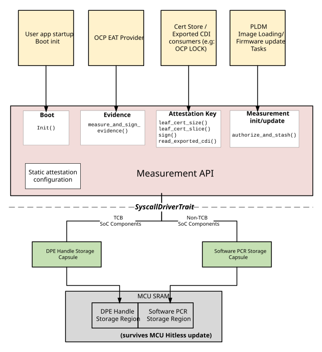
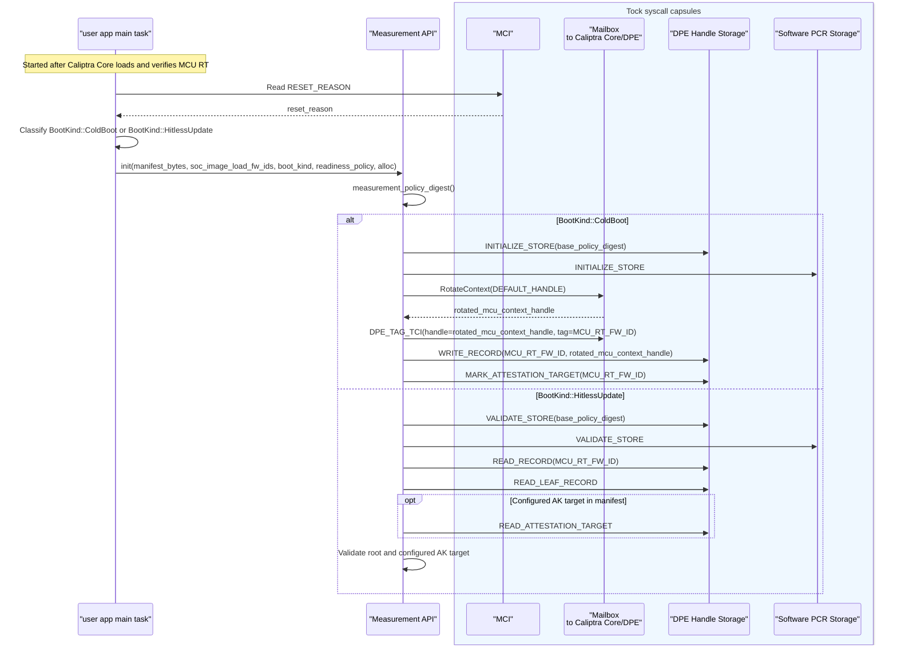
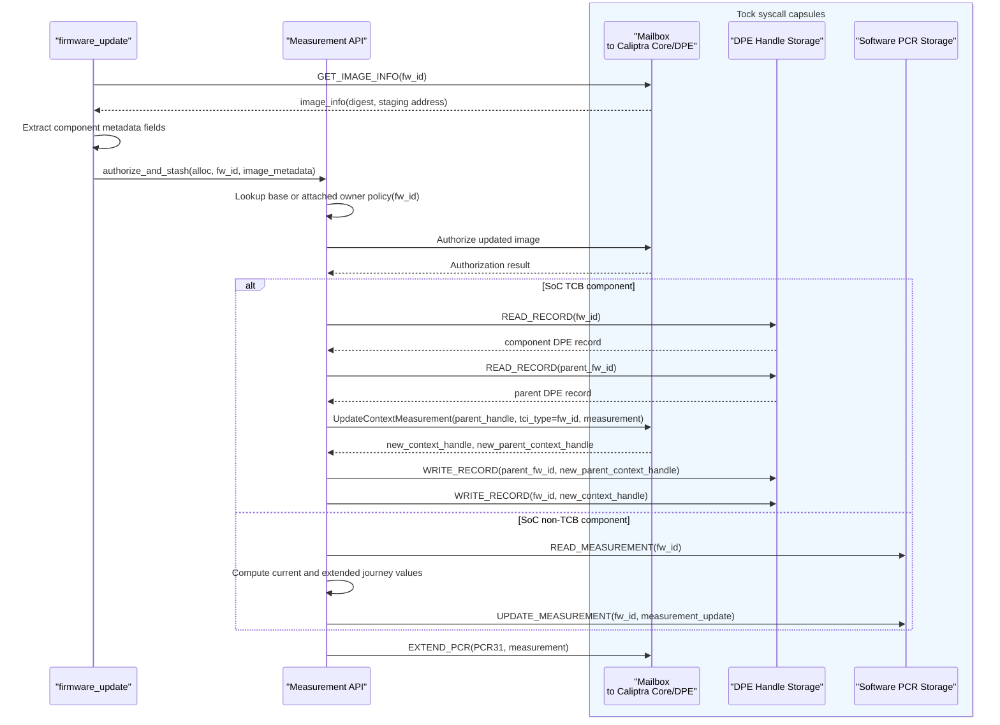

# Measurement API

The `MCU Runtime` Measurement API (`caliptra-mcu-measurement-api`) provides the internal userspace interface for recording SoC measurements, managing attestation keys, and generating signed Evidence according to the [attestation configuration](./attestation_configuration.md).

It abstracts DPE context rotation and [Tock capsule storage](./attestation-tock-capsules.md) behind a single library-owned state instance so that image loading, firmware update, SPDM, and Evidence providers do not manipulate Caliptra DPE handles or Software PCR records directly. External requester transport paths (SPDM over MCTP/DOE and MCU mailbox `GET_ATTESTATION`) are described in [Attestation](./attestation.md) and [Common Caliptra Commands](./caliptra_common_commands.md).



## API entry points

The API surface is grouped by consumer:

| Consumer | Interface | Purpose |
| --- | --- | --- |
| **User app startup / Boot init** | `init()` | Initializes the library-owned Measurement API instance from the base policy. Cold boot initializes stores and the MCU Runtime root record; hitless update validates preserved state. |
| **User app startup / Boot init** | `policy_contains_component()` | Tests membership in the base policy or an attached owner policy. |
| **User app startup / Boot init** | `measure_vendor_auth_key()` | Creates or synchronizes the Vendor Authorization Key control measurement. |
| **User app startup / Boot init** | `disable_attestation()` | Transitions the API to `Error` on boot or image-loading failure, blocking normal measurement and Evidence operations. |
| **OCP EAT provider** | `measure_and_sign_evidence()` | Serializes selected-AK identification, concise-evidence encoding, payload construction, and signing under one Measurement API lock. |
| **SPDM cert store / Responder** | `leaf_cert_size()` | Returns the DPE leaf certificate size and persists the rotated target handle. |
| **SPDM cert store / Responder** | `leaf_cert_slice()` | Returns one DPE leaf certificate slice and persists the rotated target handle. |
| **SPDM cert store / Responder** | `sign()` | Signs a typed input with the selected AK, persists its rotated handle, and returns the signature length. |
| **Exported-CDI consumers (e.g., OCP LOCK)** | `export_cdi_and_stash()` | Derives an exported CDI, stores its handle, persists the rotated target handle, and returns the certificate length. |
| **Exported-CDI consumers (e.g., OCP LOCK)** | `read_exported_cdi()` | Reads the stored handle; rejects an all-zero, not-yet-derived handle. |
| **Image loading / Firmware update** | `validate_and_set_owner_policy()` | Parses and attaches already-authenticated `MOAM`/`MOLL` bytes without resetting base state. |
| **Image loading / Firmware update** | `measure_owsm()` | Creates or synchronizes the MCU-managed Owner Authorization Manifest preamble measurement. |
| **Image loading / Firmware update** | `measure_owner_measurement_policy()` | Creates the owner-policy measurement on cold boot; verifies it is unchanged on hitless update. |
| **Image loading / Firmware update** | `measure_owner_auth_key()` | Creates or synchronizes the Owner Authorization Key control measurement. |
| **Image loading / Firmware update** | `authorize_and_stash()` | Requests Caliptra authorization, then records the accepted component measurement through DPE or Software PCR Storage. |
| **Image loading / Firmware update** | `mark_initial_soc_load_complete()` | Validates records for the configured load list and transitions to `Active`. |

The Tock capsule syscall drivers and reserved SRAM layout used by these APIs are described in [Tock Capsules](./attestation-tock-capsules.md).

## Data interfaces

Callers retrieve authorization metadata (`GET_IMAGE_INFO(fw_id)`) for each `fw_id` in the configured load list (`SOC_IMAGE_LOAD_LIST` or `MOLL`) or firmware-update package, load or stage the image, and pass the resulting metadata (`InitialLoad` or `ComponentUpdate`) into `authorize_and_stash()`. The Measurement API supplies `SKIP_STASH` so Caliptra Core authorizes the image without independently stashing the MCU-managed measurement, then routes the measurement to DPE or Software PCR Storage according to the [attestation configuration](./attestation_configuration.md).

### DPE tagging

For SoC TCB components, DPE `tci_type` is the component `fw_id`. The Measurement API also tags each newly created SoC TCB DPE context with `DPE_TAG_TCI(handle=<context_handle>, tag=fw_id)`. Because the tag stays with the context across handle rotations, inventory Evidence generation can read the context's current and cumulative TCI values via `DPE_GET_TAGGED_TCI(tag=fw_id)` without tracking the current handle.

## Boot initialization

On cold boot, persistent DPE and Software PCR state is treated as stale. `init()` validates the base load list against `MCAM`, computes the base-policy digest, initializes both stores, rotates and tags the MCU Runtime DPE context (`MCU_RT_FW_ID`), writes its root record, and marks it as the initial AK target.



On `FW_HITLESS_UPD_RESET`, the stores are not reset or reinitialized. Boot initialization recomputes the base-policy digest, validates both store headers, and checks the preserved MCU Runtime root, readable active leaf, and attestation target against the unchanged cold-boot policy. Failure transitions the API to `Error` rather than recreating state. Owner-policy validation occurs later during image loading.

### Readiness and failure gating

| State | Measurement operations | Evidence and AK operations |
| --- | --- | --- |
| `Uninitialized` | Blocked | Blocked |
| `InitialMeasurementsPending` | Initial-load and component-update operations allowed | Blocked |
| `Active` | Allowed | Allowed |
| `Error` | Blocked | Blocked |

`ReadyAfterBootInit` enters `Active` immediately after `init()`; `RequireInitialSocLoadComplete` stays in `InitialMeasurementsPending` until `mark_initial_soc_load_complete()` succeeds. Any initialization, loading, or measurement failure calls `disable_attestation()` to enter `Error` so incomplete measurement state is never reported.

## Owner artifacts and control measurements

The image loader handles flash/PLDM retrieval and `SET_OWNER_AUTH_MANIFEST` installation; the Measurement API manages the resulting measurement state:

1. Boot initialization measures the Vendor Authorization Key (`0x4`) when configured in `MCAM`.
2. The loader installs the Owner Authorization Manifest via `SET_OWNER_AUTH_MANIFEST`, authenticates the Owner Measurement Policy (`0x5`) against `GET_IMAGE_INFO(0x5).digest`, and attaches it with `validate_and_set_owner_policy()`.
3. The loader records the control chain in order via `measure_owsm()`, `measure_owner_measurement_policy()`, and `measure_owner_auth_key()`:

```text
MCU_RT (0x2) -> Vendor Auth Key (0x4) -> OWSM (0x3)
            -> Owner Measurement Policy (0x5) -> Owner Auth Key (0x6)
```

On hitless update, `measure_owner_measurement_policy()` runs **before** updating `OWSM` or the Owner Authorization Key and verifies that the policy digest matches the preserved DPE measurement:

| Measurement | Hitless behavior |
| --- | --- |
| Owner Measurement Policy | `VerifyUnchanged`: matching digest preserves state without another PCR31 extension; a mismatch rejects the flow. |
| Vendor key, `OWSM`, owner key | `UpdateIfChanged`: matching digest preserves state; a changed accepted digest updates the existing context and extends PCR31 once. |
| Firmware component update | `AlwaysRecord`: records the accepted update, including when its digest matches the previous value. |

## Attestation key operations

Callers do not invoke DPE `CertifyKeyChunks`, `CertifyKey`, `Sign`, or `ExportCdi` directly on Measurement API-managed contexts. Each AK or Exported-CDI entry point reads the current attestation target record, issues one DPE command, and writes the rotated context handle back to DPE Handle Storage before returning (`GetCertificateChain` does not take or rotate a DPE context handle). If the DPE command succeeds but persisting the rotated handle fails, the API enters `Error` to prevent reuse of a stale handle.

## Initial image loading

For each `fw_id` in the configured load list (`SOC_IMAGE_LOAD_LIST` and, when present, `MOLL`), image loading calls `authorize_and_stash()` with `operation=InitialLoad`.


SoC TCB derivations use the active leaf as the parent, update the parent handle, append and tag the child record, and mark the attestation target when configured. SoC non-TCB components create a Software PCR record (failing if one already exists during initial load). PCR31 is extended after authorization and store updates succeed; any post-command persistence failure transitions the API to `Error`.

## SoC component update

For runtime firmware updates, the update flow calls `authorize_and_stash()` with `operation=ComponentUpdate`.



Component updates do not re-tag DPE contexts; the existing `fw_id` tag stays with the context across handle rotations.

## Measurement evidence encoding path

For signed inventory Evidence, the OCP EAT provider calls `measure_and_sign_evidence()` with an `EvidenceBuilder`. The Measurement API holds its mutex across selected-AK identification, concise-evidence encoding (excluding TCB components on the selected-AK lineage), payload construction, and signing so concurrent component updates cannot interleave between reading measurements and signing. If encoding fails, callers must discard the output buffer rather than returning partial Evidence.


