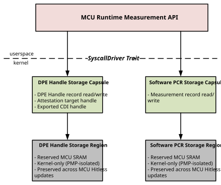

# Attestation Tock Capsules

Caliptra Subsystem attestation uses two Tock capsules to isolate and persist measurement records for MCU Runtime and SoC components. The Base Vendor and Owner configurations share the same capsule storage instances.

The capsules are kernel-side `SyscallDriver` implementations backed by a PMP-protected, kernel-only reserved SRAM region (`_sstorage.._estorage`). This storage is used during normal image loading, component update, and Evidence generation, and it must be preserved across MCU hitless updates. MCU Runtime userspace code accesses the capsules through libtock syscall APIs. Image loading, firmware update, and Evidence generation code must go through the [Measurement API](./attestation-measurement-api.md); only the Measurement API mutates attestation storage.

The two capsules are:

| Capsule | Purpose |
| --- | --- |
| DPE Handle Storage | Stores current DPE context handles for MCU Runtime and SoC TCB components. |
| Software PCR Storage | Stores current and journey PCR-style measurement records for SoC non-TCB components. |

The capsules only validate store headers and record integrity and read/write fixed-size records in reserved SRAM; policy evaluation and measurement orchestration belong to the Measurement API.

## Capsule stack



## Reserved SRAM layout

The platform provides one reserved SRAM region for measurement storage. That reservation is partitioned into two non-overlapping subregions:

```text
_sstorage
+-------------------------------------------------------+
| DPE Handle Storage Subregion                          |
|   - DPE store header                                  |
|   - DPE handle records[capacity]                      |
+-------------------------------------------------------+
| Software PCR Storage Subregion                        |
|   - PCR store header                                  |
|   - Measurement records[capacity]                     |
+-------------------------------------------------------+
_estorage
```

The full `_sstorage.._estorage` reservation must be outside kernel/app RAM and startup zeroing so it is preserved across MCU hitless updates; cold-boot clearing and initial record population are performed explicitly by `measurement_boot_init()` through capsule syscalls.

Both stores are fixed-size and cannot be resized at runtime. Store capacities must be computed from the SoC static configuration to reserve sufficient space for the MCU Runtime root, control measurements (`OWSM`, Owner Measurement Policy, and authorization keys), and all base and owner TCB/non-TCB components. See [MCU SRAM Partitioning in the Integrator's Guide](./integrator-guide.md#mcu-sram-partitioning) for configuring `storage_size`.

## Board initialization

During board initialization, the platform constructs each capsule with only its assigned SRAM subregion (capsules cannot access each other's memory and do not populate records at board init) and registers both capsules in the platform `SyscallDriver` lookup:

* DPE Handle Storage: `0x8000_0020`
* Software PCR Storage: `0x8000_0021`

## DPE Handle Storage capsule

The DPE Handle Storage capsule stores `fw_id`-keyed DPE context handle records for MCU Runtime, base/owner TCB components, and controls such as `OWSM`, Owner Measurement Policy, and authorization keys.

### Storage and record format

The DPE subregion begins with a 104-byte store header followed by an ordered log of 32-byte records (`records[0..record_count]`):

```Rust
pub struct DpeHandleStoreHeader {
    pub magic: u32,                        // 0xD9E4_C7A1
    pub version: u8,                       // 1
    pub header_size: u16,                  // 104 bytes
    pub record_size: u16,                  // 32 bytes
    pub record_capacity: u16,
    pub record_count: u32,                 // Valid records occupy records[0..record_count]; last entry is the active DPE leaf
    pub attestation_target_fw_id: u32,     // fw_id of the DPE record marked as the AK target (0xFFFF_FFFF when unset)
    pub attestation_policy_digest: [u8; 48], // SHA-384 digest of Base Attestation Policy (MCAM + Base SoC Image Load List)
    pub exported_cdi_handle: [u8; 32],     // Caliptra exported CDI handle
}

pub struct DpeHandleRecord {
    pub fw_id: u32,
    pub parent_fw_id: Option<u32>,         // Parent fw_id (stored instead of parent handle, which rotates on DPE use)
    pub context_handle: [u8; 16],
    pub tci_tag: u32,
    pub flags: u8,
}
```

### Userspace syscall API

```Rust
pub struct DpeHandleStore<S: Syscalls = DefaultSyscalls> {
    _syscalls: core::marker::PhantomData<S>,
    driver_num: u32,
}

impl<S: Syscalls> DpeHandleStore<S> {
    pub fn new(driver_num: u32) -> Self;
    pub fn exists(&self) -> Result<(), ErrorCode>;
    pub fn initialize_store(&self, policy_digest: &[u8; 48]) -> Result<(), ErrorCode>;
    pub fn validate_store(&self, policy_digest: &[u8; 48]) -> Result<(), ErrorCode>;
    pub fn read_record(&self, fw_id: u32, out: &mut DpeHandleRecord) -> Result<(), ErrorCode>;
    pub fn write_record(&self, fw_id: u32, record: &DpeHandleRecord) -> Result<(), ErrorCode>;
    pub fn read_leaf_record(&self, out: &mut DpeHandleRecord) -> Result<(), ErrorCode>;
    pub fn mark_attestation_target(&self, fw_id: u32) -> Result<(), ErrorCode>;
    pub fn read_attestation_target(&self, out: &mut DpeHandleRecord) -> Result<(), ErrorCode>;
    pub fn read_exported_cdi(&self, out: &mut [u8; 32]) -> Result<(), ErrorCode>;
    pub fn write_exported_cdi(&self, cdi: &[u8; 32]) -> Result<(), ErrorCode>;
}
```

### Syscalls provided

The DPE Handle Storage capsule implements the `SyscallDriver` trait.

1. Read-Write Allow
    - Allow number: 0
        - Description: Output buffer used by record reads and `READ_EXPORTED_CDI`.
        - Argument: Mutable userspace buffer for one 32-byte record or the 32-byte exported CDI handle.

2. Read-Only Allow
    - Allow number: 0
        - Description: Input buffer used by `INITIALIZE_STORE`, `VALIDATE_STORE`, `WRITE_RECORD`, and `WRITE_EXPORTED_CDI`.
        - Argument: A 48-byte base-policy digest, 32-byte serialized record, or 32-byte exported CDI handle, according to the command.

3. Subscribe
    - Not used. DPE Handle Storage operations are synchronous.

4. Command
    - Command number 0:
        - Description: Existence check.
    - Command number 1:
        - Description: `READ_RECORD`
        - Argument 1: `fw_id`
        - Argument 2: Reserved, must be zero.
        - Output: Writes one serialized `DpeHandleRecord` into the Read-Write Allow buffer.
    - Command number 2:
        - Description: `WRITE_RECORD`
        - Argument 1: `fw_id`
        - Argument 2: Reserved, must be zero.
        - Input: Reads one serialized `DpeHandleRecord` from the Read-Only Allow buffer.
        - Behavior: Updates the existing record for `fw_id` in place, or appends a new record and increments `record_count`.
    - Command number 3:
        - Description: `INITIALIZE_STORE`
        - Argument 1: Reserved, must be zero.
        - Argument 2: Reserved, must be zero.
        - Input: Reads a 48-byte `base_policy_digest` from the Read-Only Allow buffer.
        - Behavior: Writes a fresh `DpeHandleStoreHeader`, zeroizes all record slots and the exported CDI handle, resets `record_count`, and clears the attestation target marker.
    - Command number 4:
        - Description: `READ_LEAF_RECORD`
        - Argument 1: Reserved, must be zero.
        - Argument 2: Reserved, must be zero.
        - Output: Writes the last DPE record in `records[0..record_count]` into the Read-Write Allow buffer.
    - Command number 5:
        - Description: `MARK_ATTESTATION_TARGET`
        - Argument 1: `fw_id`
        - Argument 2: Reserved, must be zero.
    - Command number 6:
        - Description: `READ_ATTESTATION_TARGET`
        - Argument 1: Reserved, must be zero.
        - Argument 2: Reserved, must be zero.
        - Output: Writes the attestation target DPE record into the Read-Write Allow buffer.
    - Command number 7:
        - Description: `VALIDATE_STORE`
        - Argument 1: Reserved, must be zero.
        - Argument 2: Reserved, must be zero.
        - Input: Reads a 48-byte expected `base_policy_digest` from the Read-Only Allow buffer.
        - Behavior: Validates header magic/version/sizes, capacity against the assigned SRAM slice, `record_count <= record_capacity`, stored digest equality, and that `attestation_target_fw_id` is unset or points to an existing record.
    - Command number 8:
        - Description: `READ_EXPORTED_CDI`
        - Arguments: Reserved, clients pass zero.
        - Output: Writes the 32-byte handle into the Read-Write Allow buffer.
    - Command number 9:
        - Description: `WRITE_EXPORTED_CDI`
        - Arguments: Reserved, clients pass zero.
        - Input: Reads the 32-byte handle from the Read-Only Allow buffer.

### Error behavior

The capsule returns:

| Condition | Error |
| --- | --- |
| Unsupported command | `NOSUPPORT` |
| Invalid allow-buffer lookup | `INVAL` |
| Process/grant or buffer-access failure | `FAIL` |
| Buffer smaller than the required record, digest, or handle | `SIZE` |
| `fw_id` not found | `FAIL` |
| Record capacity exhausted | `NOMEM` |
| Header magic/version mismatch on validation | `FAIL` |
| Attempt to mark a non-existent record as attestation target | `FAIL` |

## Software PCR Storage capsule

The Software PCR Storage capsule stores `fw_id`-keyed current and journey PCR-style measurement records for SoC non-TCB components. This mirrors the Caliptra PCR model where a current PCR represents the current accepted measurement and a journey PCR accumulates the measurement history.

### Storage and record format

The Software PCR subregion begins with a 16-byte store header followed by 112-byte measurement records (`records[0..record_count]`):

```Rust
pub struct SoftwarePcrStoreHeader {
    pub magic: u32,                        // 0x5350_4352 ("SPCR")
    pub version: u16,                      // 1
    pub header_size: u16,                  // 16 bytes
    pub record_size: u16,                  // 112 bytes
    pub record_capacity: u16,
    pub record_count: u16,
}

pub struct MeasurementRecord {
    pub fw_id: u32,
    pub current_digest: [u8; 48],
    pub journey_digest: [u8; 48],
    pub svn: u32,
    pub version: u32,
    pub reserved: [u8; 4],
}
```

The capsule only stores and retrieves serialized `MeasurementRecord` entries; digest computation (`current_digest` and `journey_digest` extension via Caliptra SHA) and SVN checks are performed in userspace by the Measurement API.

### Userspace syscall API

```Rust
pub struct SoftwarePcrStore<S: Syscalls = DefaultSyscalls> {
    _syscalls: core::marker::PhantomData<S>,
    driver_num: u32,
}

impl<S: Syscalls> SoftwarePcrStore<S> {
    pub fn new(driver_num: u32) -> Self;
    pub fn exists(&self) -> Result<(), ErrorCode>;
    pub fn initialize_store(&self) -> Result<(), ErrorCode>;
    pub fn validate_store(&self) -> Result<(), ErrorCode>;
    pub fn read_measurement(&self, fw_id: u32, out: &mut MeasurementRecord) -> Result<(), ErrorCode>;
    pub fn create_measurement(&self, fw_id: u32, record: &MeasurementRecord) -> Result<(), ErrorCode>;
    pub fn update_measurement(&self, fw_id: u32, record: &MeasurementRecord) -> Result<(), ErrorCode>;
}
```

### Syscalls provided

The Software PCR Storage capsule implements the `SyscallDriver` trait.

1. Read-Write Allow
    - Allow number: 0
        - Description: Output buffer used by `READ_MEASUREMENT`.
        - Argument: Mutable userspace buffer large enough to hold one serialized `MeasurementRecord`.

2. Read-Only Allow
    - Allow number: 0
        - Description: Input buffer used by `CREATE_MEASUREMENT` and `UPDATE_MEASUREMENT`.
        - Argument: Serialized `MeasurementRecord`.

3. Subscribe
    - Not used. Software PCR Storage operations are synchronous.

4. Command
    - Command number 0:
        - Description: Existence check.
    - Command number 1:
        - Description: `READ_MEASUREMENT`
        - Argument 1: `fw_id`
        - Argument 2: Reserved, must be zero.
        - Output: Writes one serialized `MeasurementRecord` into the Read-Write Allow buffer.
    - Command number 2:
        - Description: `CREATE_MEASUREMENT`
        - Argument 1: `fw_id`
        - Argument 2: Reserved, must be zero.
        - Input: Reads one serialized `MeasurementRecord` from the Read-Only Allow buffer.
        - Behavior: Creates a new record and fails if `fw_id` already exists.
    - Command number 3:
        - Description: `UPDATE_MEASUREMENT`
        - Argument 1: `fw_id`
        - Argument 2: Reserved, must be zero.
        - Input: Reads one serialized `MeasurementRecord` from the Read-Only Allow buffer.
        - Behavior: Updates an existing record and fails if `fw_id` does not exist.
    - Command number 4:
        - Description: `INITIALIZE_STORE`
        - Argument 1: Reserved, must be zero.
        - Argument 2: Reserved, must be zero.
        - Behavior: Writes a fresh `SoftwarePcrStoreHeader`, resets `record_count`, and zeroizes all record slots.
    - Command number 5:
        - Description: `VALIDATE_STORE`
        - Argument 1: Reserved, must be zero.
        - Argument 2: Reserved, must be zero.
        - Behavior: Validates header magic/version/sizes, capacity against the assigned SRAM slice, and `record_count <= record_capacity`.

### Error behavior

The capsule returns:

| Condition | Error |
| --- | --- |
| Unsupported command | `NOSUPPORT` |
| Invalid allow-buffer lookup | `INVAL` |
| Read/create/update/validation process or buffer-access failure | `FAIL` |
| Buffer smaller than serialized record or update request | `SIZE` |
| `fw_id` not found for read/update | `FAIL` |
| `fw_id` already exists on create | `ALREADY` |
| Record capacity exhausted | `NOMEM` |
| Header magic/version mismatch on validation | `FAIL` |
