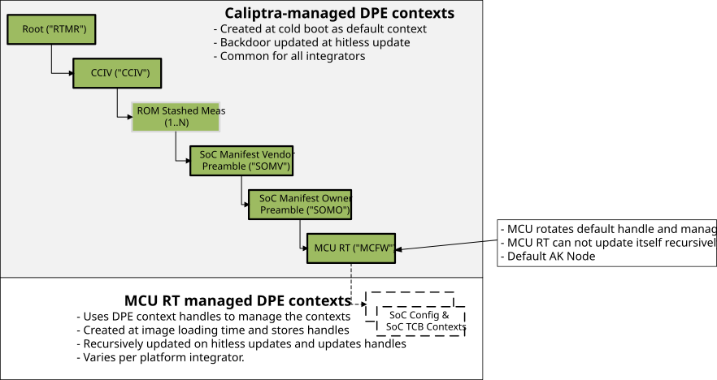

# Caliptra Subsystem Attestation

## Purpose and scope

This section defines the **platform attestation** architecture for a Caliptra-integrated SoC: establishing trust in the identity and security-relevant state of the SoC before an operator admits it to run workloads.

| Attestation goal | Architectural mechanism |
| --- | --- |
| **Hardware authenticity** | Identity keys (`IDevID`, `LDevID`) and firmware-bound alias keys (`AliasFMC`, `AliasRT`) are derived inside Caliptra Core from hardware secrets (`UDS`, `FE`) and endorsed by a Vendor, Owner, or Tenant PKI (see [Caliptra Device Identity Authentication](./device_identity_authentication.md)). |
| **Configuration integrity** | Acting as Attesting Environments (AEs), Caliptra Core and MCU Runtime measure hardware security state (fuses, lifecycle, debug state, and SVN floors) and SoC security configuration (Vendor/Owner authorization manifests, authorization keys, and attestation policy) and store those claims in integrity-protected storage. |
| **Firmware integrity** | Each Attesting Environment authenticates, enforces anti-rollback SVN floors on, and measures its Target Environment into integrity-protected storage before execution across boot and hitless updates: Caliptra Core attests `Caliptra FMC`, `Caliptra RT`, and `MCU Runtime`, and MCU Runtime (with Caliptra Core authorization) attests downstream SoC components. |

Platform attestation Evidence combines:

- **Identity attestation**: Extends Caliptra's DICE identity beyond Caliptra Core to `MCU Runtime` and, if configured, to *SoC TCB components* that contribute to platform device identity. The resulting DICE/DPE certificate chain (`IDevID` → `LDevID` → `AliasFMC` → `AliasRT` → `DPE Leaf`) binds the SoC's attestation signing key to the PKI trust anchor trusted by the verifier and embeds `DiceTcbInfo` / `MultiTcbInfo` claims for each measured TCB layer along that derivation path. The private signing key never leaves Caliptra Core. See [Caliptra Device Identity Authentication](./device_identity_authentication.md).
- **Inventory attestation**: Acting as the final attesting environment in the chain, MCU Runtime collects measurements of the running SoC firmware and SoC configuration (such as authorization keys and measurement policy) and signs them with the certified attestation key to produce verifiable **Evidence** (**OCP EAT** or **PCR Quote**) for appraisal by a remote verifier against reference values and policy.

## Layered attestation model

In Caliptra Subsystem, Caliptra's DICE identity extends from Caliptra Core (`Caliptra ROM` → `Caliptra FMC` → `Caliptra RT`) to `MCU Runtime` (which joins the DICE chain as a DPE-managed PL0 context) and, if configured, to downstream *SoC TCB components* that contribute to platform device identity. Each boot layer transitions from a *Target Environment (TE)* to an *Attesting Environment (AE)* once it is authenticated, anti-rollback-checked, and measured. MCU Runtime is the final Attesting Environment in the chain: it collects claims from downstream SoC components and reports them as one signed Evidence payload.

| Layer | Attesting Environment (AE) | Target Environment (TE) | Evidence Produced (TCG DICE Extensions / OCP EAT Claims) |
| --- | --- | --- | --- |
| 1 | Caliptra ROM | Hardware Fuses + Caliptra FMC | `AliasFMC` cert — `MultiTcbInfo` (`DEVICE_INFO` + `FMC_INFO`) |
| 2 | Caliptra FMC | Caliptra RT | `AliasRT` cert — `DiceTcbInfo` (`RT_INFO`) |
| 3 | Caliptra RT | SoC configuration + MCU Runtime | DPE leaf cert — `MultiTcbInfo` (`RTMR` + `CCIV` + … + `MCFW`) |
| 4 | MCU Runtime | Configured SoC TCB components and SoC configuration that contribute to platform device identity | DPE leaf cert — `MultiTcbInfo` (`RTMR` + … + `MCFW` + `<SoC TCB components>`) |
| 5 | MCU Runtime | Remaining SoC components (SoC-TCB that do not contribute to platform device identity and SoC-non-TCB) and SoC configuration | Signed OCP EAT claims (or PCR Quote) |

## DPE context lineage

In subsystem mode, `MCU Runtime` is the only `PL0` privileged user in the SoC (see Caliptra Runtime [PAUSER privilege levels](https://github.com/chipsalliance/caliptra-sw/blob/main/runtime/README.md#pauser-privilege-levels)). Caliptra Core manages the DPE chain above `MCU Runtime` as the default `PL0` DPE context and creates `MCFW` as the default `PL0` DPE context when loading `MCU Runtime`.

When `MCU Runtime` boots, it rotates `MCFW` into a non-default (handle-managed) DPE context. It then derives non-default child DPE contexts for *SoC configuration* (if any) and *SoC TCB components* (as configured by the integrator) while retaining parent contexts so earlier nodes in the chain remain accessible. Contexts up to the configured attestation key (`AK`) target (`MCFW` by default) contribute to platform device identity in the DPE leaf certificate, while any DPE contexts below the AK target—along with *SoC non-TCB* measurements—are reported in OCP EAT claims.

The attestation configuration policy is provided by the platform integrator (and platform owner) to define SoC component classification, load order, and attestation key target selection; see [Attestation Configuration](./attestation_configuration.md) for how this policy is defined and provisioned. `MCU Runtime` uses this policy to record SoC measurements and generate Evidence; see [Measurement API](./attestation-measurement-api.md).

## Measurement management and storage

Platform attestation responsibilities are partitioned across three architectural layers:

| Layer | Responsibility |
| --- | --- |
| Caliptra Core | Authenticates firmware against Vendor and Owner SoC Authorization Manifests, maintains hardware DPE contexts and hardware PCRs, derives and protects attestation signing keys, and signs Evidence. |
| [MCU Userspace Measurement API](./attestation-measurement-api.md) | Enforces the [SoC attestation configuration](./attestation_configuration.md), routes component measurements to Caliptra DPE contexts (*SoC TCB*) or Software PCRs (*SoC non-TCB*), tracks rotated DPE handles, and selects the attestation key (`AK`) target (`MCU_RT` by default). |
| [MCU Tock Kernel Capsules](./attestation-tock-capsules.md) | Own the kernel-only (PMP-isolated) reserved MCU SRAM region (`_sstorage.._estorage`) that persists DPE handle records and Software PCR measurement records across MCU hitless updates. |

Across cold boot and hitless update, measurements are stored and conveyed as follows:

| Measured target | Recorded by | Measurement storage | Conveyed in |
| --- | --- | --- | --- |
| Hardware configuration & Caliptra FMC | Caliptra ROM | `PCR 0 / 1` | `AliasFMC` Cert, PCR Quote |
| Caliptra RT | Caliptra ROM / RT | DPE (`RTMR`, `CCIV`), `PCR 2 / 3` | `AliasRT` Cert, DPE Leaf Cert, PCR Quote |
| Base SoC Manifest & MCU Runtime | Caliptra RT | DPE (`SOMV`, `SOMO`, `MCFW`), `PCR 31` | DPE Leaf Cert, PCR Quote |
| SoC configuration & *SoC TCB components* | MCU Runtime | DPE (non-default contexts), `PCR 31` | DPE Leaf Cert or OCP EAT, PCR Quote |
| *SoC non-TCB components* | MCU Runtime | Software PCR store, `PCR 31` | OCP EAT, PCR Quote |

## Evidence formats and retrieval paths

Both supported Evidence formats are self-contained: each binds to a requester-supplied nonce for freshness and is signed by its respective attestation key (`AK`), which a verifier authenticates through its corresponding certificate chain:

- **Signed OCP EAT (default)**: A `COSE_Sign1`-signed CBOR Web Token (CWT) carrying the OCP EAT profile OID, requester nonce, debug state, and structured `concise-evidence-map` measurements (`svn`, current digest, and journey digest per target environment), signed by the DPE leaf attestation key (`AK`) (see [OCP IETF EAT Profile](https://opencomputeproject.github.io/Security/ietf-eat-profile/HEAD/)).
- **Signed PCR Quote**: Hardware PCR values (`PCR[0..31]`), PCR reset counters, requester nonce, and aggregate digest, signed by the Caliptra `AliasFMC` key (see Caliptra Runtime [`QUOTE_PCRS_ECC384`](https://github.com/chipsalliance/caliptra-sw/blob/main/runtime/README.md#quote_pcrs_ecc384) and [`QUOTE_PCRS_MLDSA87`](https://github.com/chipsalliance/caliptra-sw/blob/main/runtime/README.md#quote_pcrs_mldsa87)).

Because authenticity rests on the Evidence token's own cryptographic signature and nonce binding, Evidence in the configured format can be retrieved over multiple transport paths:

| Retrieval path | Command |
| --- | --- |
| SPDM over MCTP or DOE | SPDM `GET_MEASUREMENTS` (block index `0xFD`) |
| [SPDM VDM over MCTP](./caliptra_spdm_vdm_cmds.md) | Caliptra Common Command [Get Attestation](./caliptra_common_commands.md#get-attestation) (`GetAttestation`, `0x05`) |
| [MCI Mailbox](./external_mailbox_cmds.md) | Caliptra Common Command [Get Attestation](./caliptra_common_commands.md#get-attestation) ([`MC_GET_ATTESTATION`](./external_mailbox_cmds.md#mc_get_attestation), `0x4D47_4154`) |

## Documents

The attestation design and integration details are described in the child documents below:

- [Attestation Configuration](./attestation_configuration.md) defines the Base Vendor Configuration (`MCAM` and Base SoC Image Load List) and Owner Configuration (`MOAM` and `MOLL`), SoC TCB/non-TCB classification, attestation key (AK) target selection, DPE topology, and hitless update policy preservation.
- [Measurement API](./attestation-measurement-api.md) defines the MCU Runtime userspace interface for boot initialization, SoC configuration and firmware measurement recording, attestation key operations, and atomic Evidence generation.
- [Tock Capsules](./attestation-tock-capsules.md) defines the `DpeHandleStore` and `SoftwarePcrStore` kernel capsules, reserved SRAM layout, and syscall contracts.

