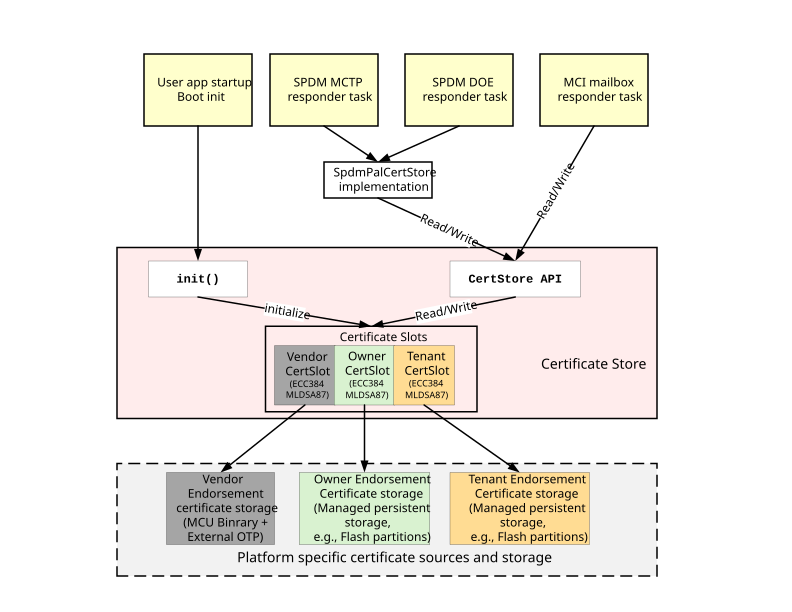

# Caliptra MCU Certificate Store

## Purpose and scope

This document defines the protocol-neutral design and behavioral contract of
the Caliptra MCU certificate store. It describes certificate composition,
provisioning policy, persistence requirements, and transport boundaries.

Initialization and transport interfaces are described as design contracts.
Persistence and shared-state consistency rules define requirements for
production integrations.

The trust model and certificate-chain contents are defined in the [Caliptra
Certificate Model](./certificate_model.md). The in-field provisioning
workflow is defined in [In-field Certificate Provisioning and
Management](./certificate_provisioning.md).

For available SDK interfaces and platform configuration, see [Certificate Store
Integration](./certificate-store-integration.md).

## Certificate store overview

The design uses one protocol-neutral certificate store shared by all enabled
certificate transports. It separates static provisioning policy from
transport-specific request handling. The store models ECC
P-384 and ML-DSA-87 certificate chains in Vendor, Owner, and Tenant certificate
slots. A static platform profile determines which optional slots are enabled
and whether the store uses the classical-only or classical-plus-PQC algorithm
profile.

Supported certificate algorithms are:

- ECC P-384, which is always enabled.
- ML-DSA-87, enabled explicitly by the platform profile.

Supported certificate slots are:

- Vendor.
- Owner.
- Tenant.

When ML-DSA-87 support is enabled, every enabled certificate slot is
configured with both an ECC P-384 chain and an independent ML-DSA-87 chain.
For example, Owner ECC P-384 and Owner ML-DSA-87 have separate certificate
data, lifecycle state, and persistent backing.

SPDM SlotIDs and MCI request fields are transport-specific identifiers.
Adapters map these identifiers to a certificate role and algorithm before
accessing the common store.

## Runtime architecture



The application calls `cert_store::init(...)` once during startup;
certificate responders must start only after it succeeds. Initialization:

- Imports integrator-provided IDevID certificates for each enabled algorithm
  into Caliptra and configures the read-only Vendor slot. Vendor always uses
  IDevID endorsements; certificate provisioning is outside the SDK.
- Loads and validates saved Owner and Tenant endorsements from configured
  persistent backing under the static provisioning policy.

Initialization requires a provisioned, available Vendor ECC P-384 chain.
Other chain initialization failures are reported for platform diagnostics
and leave only the affected chain unavailable.

A managed chain with accessible backing but no committed endorsement is
unprovisioned. Only available, provisioned chains are advertised.

SPDM responders use `SpdmPalCertStore`; MCI mailbox certificate responder uses the common API.

Each enabled certificate transport must access the same `CertStore` instance.
An endorsement update through one transport must be visible to all other
enabled certificate transports.

## Certificate slot behavior

The certificate store applies these slot semantics after initialization:

| Certificate slot | Certificate-store behavior |
| --- | --- |
| Vendor | Mandatory and read-only. Its PKI anchor point is the manufacturing IDevID, and it is configured to support every algorithm selected by the global profile. Only failure of its ECC P-384 chain is fatal to common initialization. |
| Owner | Optional managed endorsement. It is configured to support every algorithm selected by the global profile, with independent availability, lifecycle, and persistent backing for each algorithm. |
| Tenant | Optional managed endorsement, independent from Vendor and Owner. It is configured to support every algorithm selected by the global profile, with independent availability, lifecycle, and persistent backing for each algorithm. |

The Vendor endorsement certificates are established during manufacturing and
remain read-only for the device lifetime. They cannot be provisioned,
replaced, or removed at runtime. Owner and Tenant provisioning requires
authorization.

### Static provisioning policy

The certificate store uses an immutable, transport-neutral provisioning policy.
Vendor is read-only and runtime mutation is always denied. Each managed role
(Owner and Tenant) is configured with either:

- **A fixed key anchor point** (for example, Owner is configured with LDevID in
  the default policy): pins the role to that identity key. `key_pair_id = 0`
  resolves to the configured key anchor point, and any nonzero `key_pair_id`
  must match it.
- **No fixed key anchor point** (for example, Tenant in the default policy):
  allows any supported key anchor point when a nonzero `key_pair_id` is
  provided; `key_pair_id = 0` is rejected.

SPDM `SET_CERTIFICATE` passes `key_pair_id = 0` when the request has no
`KeyPairID` field (SPDM 1.2, or SPDM 1.3+ with `MULTI_KEY_CONN_RSP = 0`) and
passes the request's `KeyPairID` when `MULTI_KEY_CONN_RSP = 1`; MCI
`MC_SET_CERT_CHAIN` follows the same `device_key_id` resolution rule (`0`
resolves to the configured anchor point when pinned; nonzero is required when
no fixed anchor point is configured).

Provisioning also requires AliasCert metadata and enforces the configured region
capacity. Requester authorization and certificate-content validation are outside
this policy.

## Certificate-chain composition

For each available certificate slot, the store obtains:

- Caliptra device certificates below the configured PKI anchor point.
- The generated DPE leaf certificate.

The common store composes these sources in root-to-leaf order:

```text
complete chain =
    PKI endorsement
    + Caliptra device certificates below the PKI anchor point
    + generated DPE leaf certificate
```

Provisioning changes only the PKI endorsement. The generated Caliptra and DPE
certificates remain owned by the Caliptra certificate services.

Certificate signing remains outside the common store. The certificate and
signing services ensure that the generated leaf certificate and selected
signing key represent the same active identity.

## Managed endorsement backing

Managed Owner and Tenant endorsements use platform-provided persistent
backing. Each enabled algorithm-and-slot endorsement has independent backing
and size limits. ECC P-384 and ML-DSA-87 endorsements SHALL NOT share the same
managed region.

Persistent backing for managed endorsements must provide these guarantees:

- An endorsement update is validated and committed atomically; the previous
  endorsement remains readable while an update is in progress.
- Reset, power loss, or stream abort does not expose a partial endorsement.
- Removal is durable so an older endorsement cannot reappear after reset.
- Startup recovery restores the newest valid committed endorsement or leaves
  the chain unprovisioned.

See [Certificate Store Integration](./certificate-store-integration.md#allocate-managed-endorsement-storage)
for how the SDK reference implementation satisfies these requirements.

## Shared runtime requirements

All enabled transports share the same `CertStore` instance and observe the same
published state:

- Reads return the complete composed chain; provisioning accepts only the PKI
  endorsement.
- Updates to one algorithm or slot do not affect or block another.
- Switching to a new endorsement is atomic: readers on any transport always
  receive a complete, consistent chain, never an intermediate state.

## Certificate algorithm requirements

Each enabled algorithm (ECC P-384 and ML-DSA-87) in an enabled slot requires:

- A dedicated PKI endorsement source or managed backing.
- The corresponding Caliptra-generated certificate path.
- The corresponding DPE leaf certificate.
- Access to the corresponding signing key.

ML-DSA-87 certificate data and storage are independent from ECC P-384. A chain
remains unavailable until every component required for its complete chain and
signing operation is present. Algorithm negotiation and transport encodings
remain transport responsibilities.

## SPDM integration

The `SpdmPalCertStore` implementation:

- Maps the negotiated certificate algorithm and SPDM SlotID to a certificate
  chain.
- Advertises only certificate chains available through SPDM.
- Obtains complete chains from the common store.
- Forwards authorized endorsement updates to the common store.

SPDM SlotID policy is defined in [In-field Certificate Provisioning and
Management](./certificate_provisioning.md). SPDM message formats are defined
by the SPDM specifications.

## MCI integration

An MCI mailbox command handler must:

- Validate the requested certificate algorithm and `EndorsementRole`.
- Call the `CertStore` API for complete-chain reads.
- Forward authorized endorsement updates to the common store.
- Expose only certificate chains available through MCI.

MCI certificate requests identify the role directly rather than use SPDM
SlotIDs.

## Authorization boundary

Vendor endorsements are read-only and never writable. Platforms must authorize
the requester and requested operation before passing Owner or Tenant updates to
the certificate store.

The authorization credential format, policy, and lifecycle are defined by the
platform outside the certificate store. Static provisioning policy and
metadata checks do not evaluate requester authorization.
