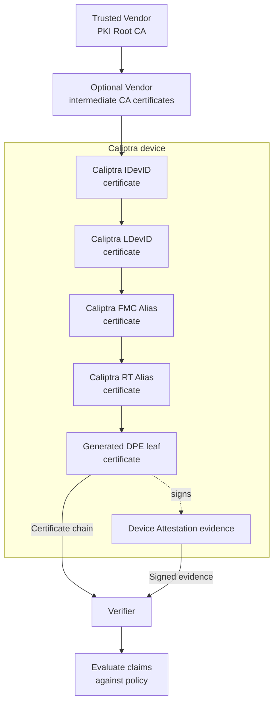
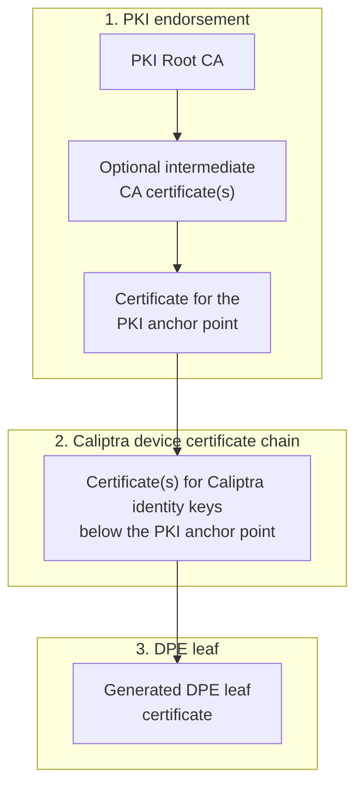

# Caliptra Certificate Model

## Introduction

A Caliptra device uses identity keys protected by Caliptra to sign
attestations about its identity, firmware, configuration, and runtime state.
When a verifier receives that evidence from the device, it must make two
separate decisions:

1. Authenticate the device and the key that signed the evidence.
2. Decide whether the authenticated claims satisfy its security policy.

The Caliptra certificate chain supports the first decision. It connects the
device's protected signing key to a PKI root trusted by the verifier. The
verifier validates that trust path before deciding whether the device's
reported state is acceptable.

Caliptra applies the [OCP Device Identity
Provisioning](https://opencomputeproject.github.io/Security/device-identity-provisioning/HEAD/)
multi-PKI-owner model through three certificate endorsement roles: [Vendor,
Owner, and Tenant](#supporting-multiple-pki-owners). The Caliptra MCU
certificate store enables the device to present independent trust paths for
each role while private keys remain protected inside Caliptra.

Software integration, initialization, persistence, synchronization, and
transport command handling are defined in the [Caliptra MCU Certificate
Store](./cert_store.md).

## What certificate chains are used for

The Vendor certificate chain provides a concrete Caliptra example. The Vendor
endorses the Caliptra IDevID, and certificates in the Caliptra identity
hierarchy extend that trust path to the generated DPE leaf key used to sign
device evidence.

*Figure 1: A Vendor-endorsed Caliptra certificate chain authenticates the DPE
leaf key that signs device evidence*

Certificate-backed device keys can be used to authenticate:

- Device identity.
- Responses to freshness challenges.
- Attestation evidence (firmware and configuration measurements).
- SPDM transcripts and secure-session establishment.
- Other signed device-management responses.

Although DMTF DSP0274 uses certificate chains for these purposes, the
trust model is transport-neutral. A valid certificate chain authenticates the
signing identity; evaluating whether the signed measurements or claims are
acceptable remains the responsibility of the verifier's policy. Private keys
remain protected inside Caliptra and are never exposed or managed through the
certificate store.

## Supporting multiple PKI owners

Caliptra follows the multi-PKI model defined by the [OCP Device Identity
Provisioning
Specification](https://opencomputeproject.github.io/Security/device-identity-provisioning/HEAD/).
That model allows more than one PKI owner to establish a trust path to a key
in the device identity hierarchy.

The following OCP concepts are used by this architecture:

| Concept | Meaning |
| --- | --- |
| PKI owner | The organization that controls the PKI under which a device identity is issued |
| PKI Root CA | The trust anchor distributed to verifiers for that PKI owner |
| PKI anchor point | The device identity key certified by that PKI owner |
| Endorsement | The CA certificates and device certificate that bind the PKI owner's root to the PKI anchor point |

Caliptra defines three values for `EndorsementRole`:

| `EndorsementRole` | Endorsing authority | Lifecycle use |
| --- | --- | --- |
| Vendor | Device manufacturer or silicon/platform vendor | Initial identity provisioned during manufacturing and read-only for the device lifetime |
| Owner | Current platform or cloud owner | In-field operational identity rooted in the Owner's PKI |
| Tenant | Tenant or delegated operator | Optional in-field identity rooted in a separate Tenant PKI |

The endorsement roles represent independent trust domains. An Owner or Tenant
certificate chain does not need to chain through the Vendor PKI. Each PKI
owner distributes its own Root CA as a trust anchor to the verifiers that
should accept that identity.

### Establishing a new PKI endorsement

The Vendor endorsement is provisioned once during manufacturing and remains
read-only for the lifetime of the device.

An Owner or Tenant establishes its trust path through in-field provisioning:

1. **Attest the device**: Perform an initial attestation using an existing
   trusted slot (such as Vendor).
2. **Obtain an attested CSR**: Request a CSR for the target PKI anchor point,
   attested by the trusted slot's key.
3. **Issue the endorsement**: The PKI owner validates the attested CSR and
   issues the device endorsement under its Root or Intermediate CA.
4. **Provision and verify**: Install the endorsement into the designated slot
   and verify the complete composed chain with an attestation challenge.

Changing the endorsement binds a new PKI to the existing device key; it does
not import, export, or replace private keys held by Caliptra. See [In-field
Certificate Provisioning and Management](./certificate_provisioning.md) for the
complete protocol workflow.

## Caliptra certificate-chain composition

A complete Caliptra certificate chain has three logical levels composed in
root-to-leaf order:

*Figure 2: Three-level composition of a complete Caliptra certificate chain*

The PKI owner supplies the endorsement. Caliptra supplies the device
certificates below the endorsed key and the DPE leaf certificate for the
active evidence-signing key.

The certificate store assembles these sources into one complete chain for a
reader. The certificate store SHALL NOT permit provisioning software to
modify or replace the Caliptra device certificate chain or the generated
DPE leaf certificate.

Each complete chain SHALL use one certificate algorithm and form a valid path
from its PKI Root CA to its DPE leaf certificate.

A certificate slot is available to consumers only when the platform can:

- Provide the complete chain.
- Access the corresponding device private key for signing.
- Satisfy the certificate and signature algorithm profile for that slot.

## Certificate slots

Each certificate-chain slot is identified by its `(EndorsementRole, Algorithm)`
pair.

Supported certificate algorithms:

| Certificate algorithm | Profile |
| --- | --- |
| ECDSA P-384 | Classical device identity and attestation |
| ML-DSA-87 | Post-quantum device identity and attestation |

The platform selects one global certificate algorithm profile: ECDSA P-384
only, or ECDSA P-384 plus ML-DSA-87. When ML-DSA-87 is enabled, every enabled
endorsement role has both algorithm-specific chains. Transports negotiate
one of the supported algorithms for a connection; the two chains are not a
hybrid certificate chain. Updating one chain does not change any other
algorithm or role.

### Endorsement role slots

Each role anchors its endorsement at a designated Caliptra identity key and
completes the chain down to the DPE leaf as shown in Figure 2:

| Role | PKI anchor point | Endorsement source | Caliptra chain below anchor |
| --- | --- | --- | --- |
| **Vendor** | Caliptra IDevID | MCU runtime image and/or External OTP (read-only) | LDevID &rarr; FMC &rarr; RT &rarr; DPE leaf |
| **Owner** | Configured key (e.g. Caliptra LDevID) | In-field provisioning via attested CSR (mutable) | Keys below anchor &rarr; DPE leaf (e.g. FMC &rarr; RT &rarr; DPE leaf) |
| **Tenant** | Configured key | In-field provisioning, if enabled (mutable) | Keys below anchor &rarr; DPE leaf |

The platform profile selects which Caliptra identity key serves as the PKI
anchor point for Owner (defaulting to LDevID) and Tenant. Caliptra
supplies all device certificates situated below the configured anchor point.
