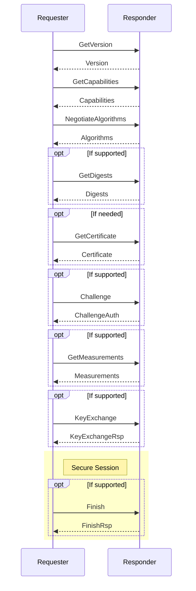
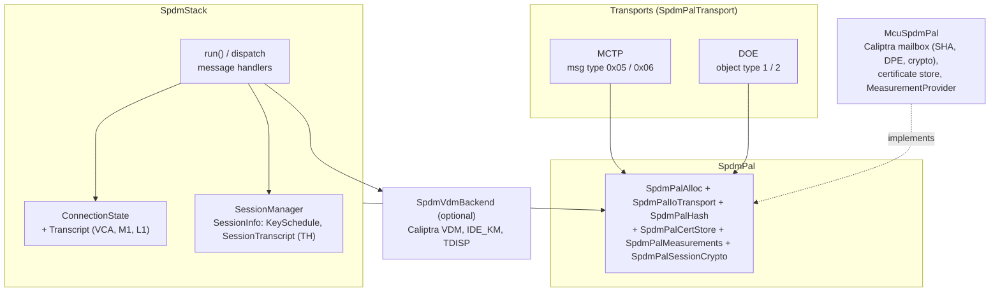
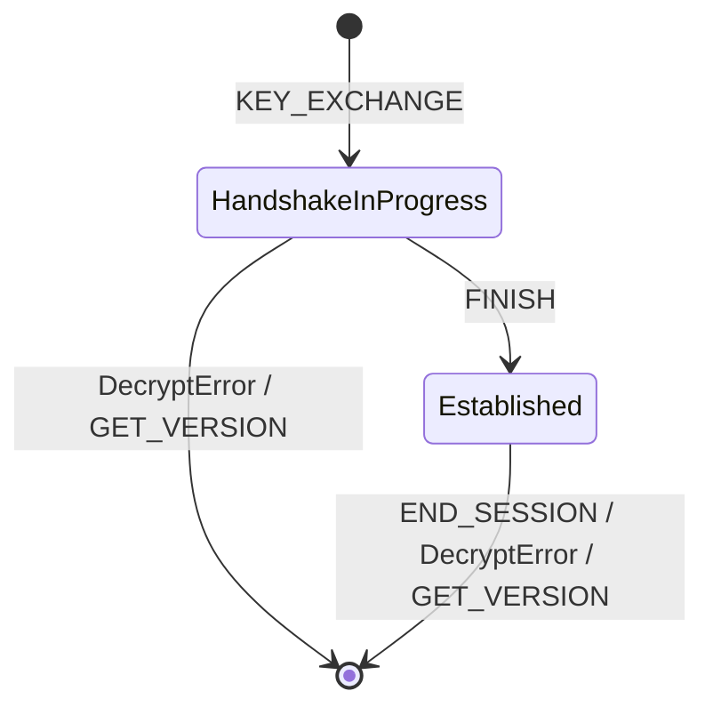

# SPDM
The Security Protocol and Data Model (SPDM) is a protocol designed to ensure secure communication between hardware components by focusing on mutual authentication and the establishment of secure channels over potentially insecure media. SPDM enables devices to verify each other's identities and configurations, leveraging X.509v3 certificates to ensure cryptographic security. Designed for interoperability, it can work across various transport and physical media, often utilizing the Management Component Transport Protocol (MCTP). This protocol is especially valuable in environments where secure hardware communication is crucial, such as data centers and enterprise systems.

## Specifications
| Specification                                 | Document Link                                                                             |
| --------------------------------------------- | ----------------------------------------------------------------------------------------- |
| Security Protocol and Data Model              | [DSP0274](https://www.dmtf.org/sites/default/files/standards/documents/DSP0274_1.3.2.pdf) |
| Secured Messages using SPDM                   | [DSP0277](https://www.dmtf.org/sites/default/files/standards/documents/DSP0277_1.2.0.pdf) |
| SPDM over MCTP Binding Specification          | [DSP0275](https://www.dmtf.org/sites/default/files/standards/documents/DSP0275_1.0.2.pdf) |
| Secured Messages using SPDM over MCTP Binding | [DSP0276](https://www.dmtf.org/sites/default/files/standards/documents/DSP0276_1.2.0.pdf) |

## Caliptra Device Identity Authentication

For the device-trust model, PKI ownership, and certificate-chain composition,
see the [Caliptra Certificate Model](./certificate_model.md).

For platform certificate-store configuration, see the [Caliptra MCU
Certificate Store](./cert_store.md).

For the in-field Owner and Tenant provisioning workflow, see [In-field
Certificate Provisioning and Management](./certificate_provisioning.md).

## SPDM Protocol Sequence


## Architecture

The SPDM responder is implemented by the "SPDM-Lite" crates in
[`runtime/userspace/api/spdm-lib`](../../runtime/userspace/api/spdm-lib). The
protocol logic lives in a platform-independent stack (`SpdmStack`). Everything
that touches hardware, memory or cryptography goes through the `SpdmPal`
platform abstraction layer (PAL), which the MCU implements on top of Caliptra
as `McuSpdmPal`.



| Crate                                                                            | Purpose                                                       |
| -------------------------------------------------------------------------------- | ------------------------------------------------------------- |
| [`traits`](../../runtime/userspace/api/spdm-lib/traits)                          | PAL trait definitions (`SpdmPal` and its component traits)    |
| [`stack`](../../runtime/userspace/api/spdm-lib/stack)                            | Responder state machine, message handlers, transcripts, sessions |
| [`codec`](../../runtime/userspace/api/spdm-lib/codec)                            | Encoding and decoding of SPDM messages                        |
| [`pal`](../../runtime/userspace/api/spdm-lib/pal)                                | `McuSpdmPal`, the Caliptra-based PAL implementation           |
| [`transports`](../../runtime/userspace/api/spdm-lib/transports)                  | MCTP and DOE transports                                       |
| [`vdm-handler`](../../runtime/userspace/api/spdm-lib/vdm-handler)                | VENDOR_DEFINED backends (Caliptra VDM, IDE_KM, TDISP)         |
| [`errors`](../../runtime/userspace/api/spdm-lib/errors)                          | SPDM error subdomains                                         |

## SPDM Responder
The Responder receives and processes requests from the Requester. It reports
its identity (certificate chains), attests its state and configuration
(signed measurements), and establishes secure sessions with the Requester.
The Responder does not authenticate the Requester; mutual authentication is
not supported.

The responder is `SpdmStack`, defined in
[`stack/src/stack.rs`](../../runtime/userspace/api/spdm-lib/stack/src/stack.rs):

```Rust
pub struct SpdmStack<Pal: SpdmPal, const MAX_SESSIONS: usize = 1, Vdm: SpdmVdmBackend = NoVdmBackend> {
    pal: Pal,
    state: ConnectionState<..>,
    sessions: SessionManager<..>,
    vdm_backend: Vdm,
}

impl<Pal: SpdmPal, const MAX_SESSIONS: usize, Vdm: SpdmVdmBackend> SpdmStack<Pal, MAX_SESSIONS, Vdm> {
    pub fn new(pal: Pal) -> Self;                                // no VDM backend
    pub fn with_vdm_backend(pal: Pal, vdm_backend: Vdm) -> Self;
    pub async fn run(&mut self) -> McuResult<()>;
}
```

- `Pal` provides transport, memory, hashing, certificates, measurements and
  session cryptography.
- `MAX_SESSIONS` is the number of secure sessions that can exist at the same
  time.
- `Vdm` handles `VENDOR_DEFINED_REQUEST` messages. With `new()`, these
  requests are answered with `UnsupportedRequest`.

`with_vdm_backend()` checks that the PAL's maximum inbound request size is at
least the transport MTU. If the PAL cannot buffer at least one MTU-sized large
message, the `CHUNK` capability is removed from what the responder advertises.

### Run Loop
`run()` processes one request at a time and never returns unless the
transport reports a fatal error:

1. Receive a request from the PAL (`recv_request`).
2. Route the request based on its kind (`SpdmPalIoKind`):
   - `Message`: a plain SPDM message, dispatched to the handler for its
     request code.
   - `SecuredMessage`: a message inside a secure session, which is decrypted,
     dispatched and encrypted again (see
     [Secured Messages](#secured-messages)).
3. Send the handler's response, or an SPDM `ERROR` message if the handler
   failed.

The stack has no fixed message buffer. Request and response buffers are
allocated through the PAL for each request.

### Connection State
`ConnectionState` holds two kinds of data:

- **Local policy**: the capabilities and algorithms the responder advertises.
  These are fixed at construction by `ConnectionState::caliptra()`.
- **Negotiated state**: the connection phase, negotiated version, the peer's
  capabilities and transfer sizes, the selected algorithms, the
  [transcript](#transcript-management) and large-message (chunking) context.

The connection phase advances from `Start` through `AfterVersion`,
`AfterCapabilities`, `AfterAlgorithms`, `AfterDigests` and `AfterCertificate`.
Handlers reject requests that arrive out of order. A valid `GET_VERSION` is
accepted in every phase: it resets the negotiated state and transcripts and
destroys all secure sessions.

### Errors
Message handlers return `SpdmError`, which carries the SPDM error code and
error data that are sent in the `ERROR` response. The PAL traits and lower
layers use `McuErrorCode`/`McuResult`; these are converted to an SPDM error
code when they reach a handler. A handler can also request that no response is
sent at all.

## Transcript Management
SPDM signatures and session keys are computed over transcripts: the
concatenation of specific request and response messages. The responder never
stores raw transcript bytes. It keeps only running hash states, so each
transcript costs one hash context (about 200 bytes of heap with the Caliptra
mailbox hash backend). All hashing goes through the `SpdmPalHash` trait, and
the hash algorithm is always SHA-384.

Connection-level transcripts are held by `Transcript` in
[`stack/src/transcript.rs`](../../runtime/userspace/api/spdm-lib/stack/src/transcript.rs).
The per-session transcript is held by `SessionTranscript` in
[`stack/src/session.rs`](../../runtime/userspace/api/spdm-lib/stack/src/session.rs).

| Transcript | Contents                                                                                       | Used for                                                    |
| ---------- | ---------------------------------------------------------------------------------------------- | ----------------------------------------------------------- |
| VCA        | `GET_VERSION`/`VERSION`, `GET_CAPABILITIES`/`CAPABILITIES`, `NEGOTIATE_ALGORITHMS`/`ALGORITHMS` | Prefix of all other transcripts                             |
| M1         | VCA, then `GET_DIGESTS`/`DIGESTS`, `GET_CERTIFICATE`/`CERTIFICATE`, `CHALLENGE`/`CHALLENGE_AUTH` | Signature in `CHALLENGE_AUTH`                               |
| L1         | VCA, then `GET_MEASUREMENTS`/`MEASUREMENTS`                                                    | Signature in `MEASUREMENTS`                                 |
| TH         | VCA, then certificate chain hash, `KEY_EXCHANGE`/`KEY_EXCHANGE_RSP`, `FINISH`/`FINISH_RSP`     | `KEY_EXCHANGE_RSP` signature and HMAC, session key derivation |

How the transcripts are maintained:

- The VCA hash runs for the whole connection.
- M1 and L1 are started on first use by cloning the running VCA hash. They
  are consumed when their signature is produced.
- TH is created for each session in `KEY_EXCHANGE`, also by cloning the
  running VCA hash. Intermediate digests (TH1) are taken from a clone so the
  hash can continue; the final digest (TH2) is taken in `FINISH`.
- `GET_VERSION` drops all connection transcripts. A session's TH is dropped
  together with its session.

## Secure Session Management
Secure sessions are created with `KEY_EXCHANGE` and confirmed with `FINISH`.
Afterwards, SPDM messages are exchanged as secured messages (DSP0277),
protected with AES-256-GCM.

### Session Lifecycle



- `KEY_EXCHANGE` creates the session in `HandshakeInProgress`, computes the
  shared secret and derives the handshake keys. If `KEY_EXCHANGE` fails, the
  session is removed again.
- `FINISH` verifies the requester's HMAC, derives the data keys, destroys the
  handshake secrets and moves the session to `Established`.
- `END_SESSION` removes that session. `GET_VERSION` removes all sessions.
- Any `DecryptError`, including a failed `FINISH` HMAC check, removes the
  session.

### Session Manager
`SessionManager` in
[`stack/src/session.rs`](../../runtime/userspace/api/spdm-lib/stack/src/session.rs)
is a fixed-size table with `MAX_SESSIONS` entries. If the table is full,
`KEY_EXCHANGE` fails with `SessionLimitExceeded`.

- The session ID combines the responder's and the requester's halves:
  `(rsp_session_id << 16) | req_session_id`. The responder picks its half so
  that it never collides with an existing session.
- Each session is a `SessionInfo` holding the session ID, the state, the
  `KeySchedule` and the session's TH transcript. It is allocated through the
  PAL, and all of its keys are destroyed when it is dropped.

### Key Schedule
`KeySchedule` in
[`stack/src/key_schedule.rs`](../../runtime/userspace/api/spdm-lib/stack/src/key_schedule.rs)
implements the SPDM key schedule with HKDF. For the derivation chain, see the
key schedule section of [DSP0274](https://www.dmtf.org/sites/default/files/standards/documents/DSP0274_1.3.2.pdf).

- The shared secret comes from ECDH on SECP384R1 or ML-KEM-1024,
  depending on the negotiated key exchange algorithm.
- Handshake keys are derived from the shared secret and TH1. Data keys are
  derived from TH2.
- Each direction has its own sequence number for handshake and data keys.
- All key operations go through `SpdmPalSessionCrypto`. Keys are opaque
  handles (`SpdmPalSessionCrypto::Key`); on Caliptra these are `Cmk`
  handles, so key material never leaves Caliptra.

### Secured Messages
A `SecuredMessage` request is processed as follows:

1. Read the session ID from the secured message header. If no session with
   that ID exists, the message is dropped without a response.
2. Select the request key: the handshake key while the session is in
   `HandshakeInProgress`, the data key once it is `Established`.
3. Decrypt and verify the message with AES-256-GCM.
4. Check that the inner request is allowed in the session's current state,
   then dispatch it to its handler.
5. Encrypt the response with the matching response key.

If processing fails, the `ERROR` response is also sent encrypted. A
`DecryptError` destroys the session.

Secured messages require a transport that supports them: MCTP bound to
message type 0x06 (secured SPDM), or DOE. If the transport does not support
secured messages, the responder does not advertise `KEY_EX_CAP`, `ENCRYPT_CAP`
or `MAC_CAP`.
