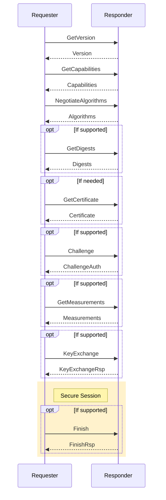
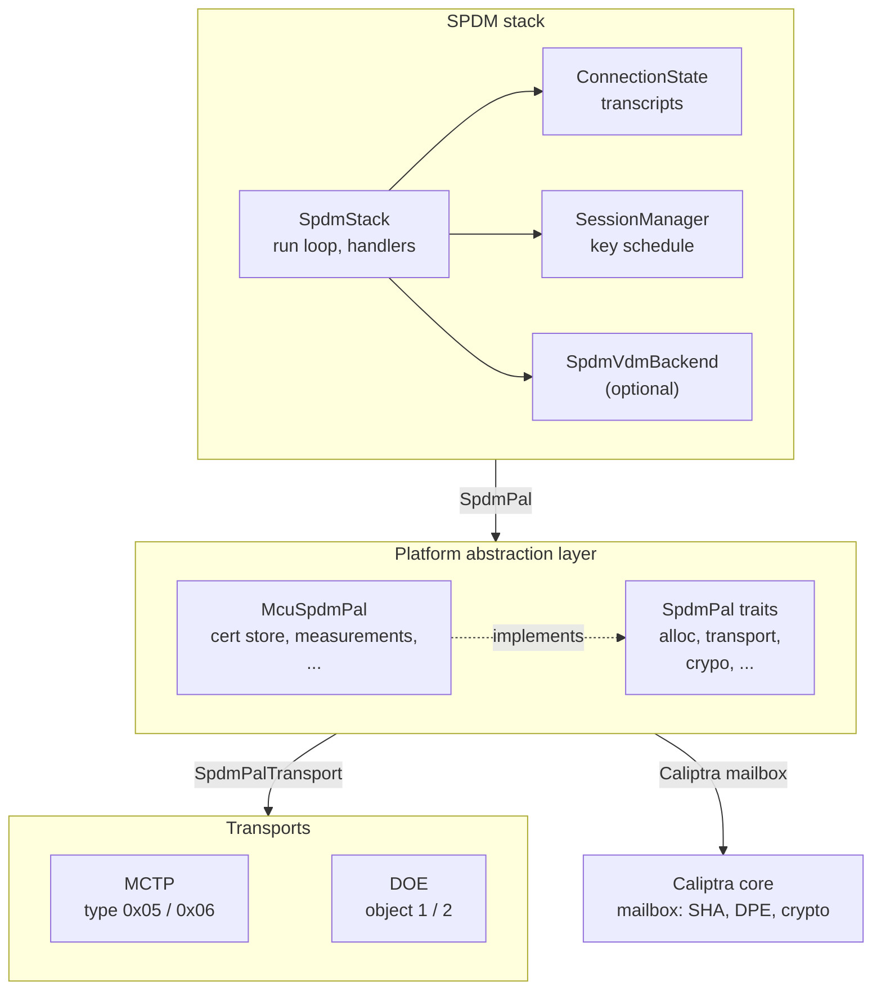
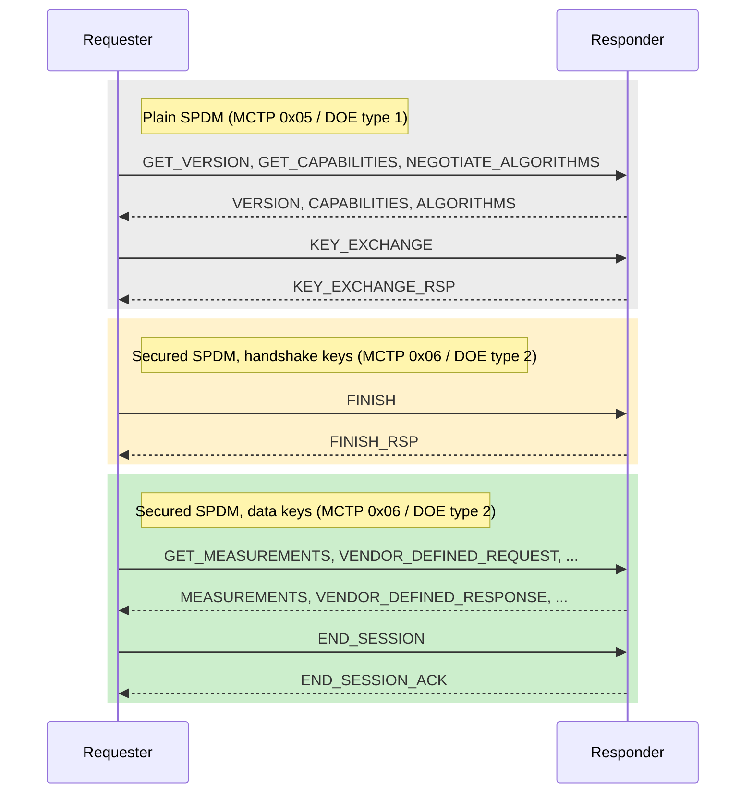
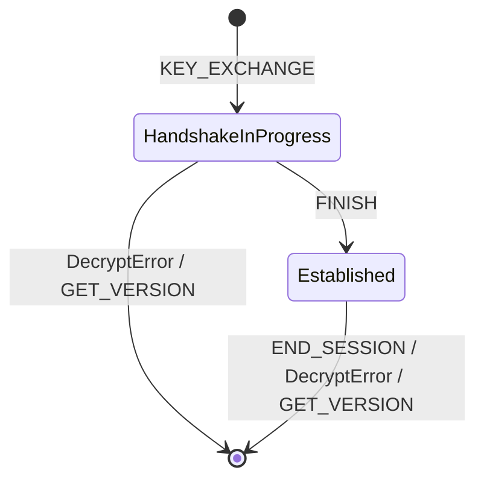

# SPDM
The Security Protocol and Data Model (SPDM) is a protocol designed to ensure secure communication between hardware components by focusing on mutual authentication and the establishment of secure channels over potentially insecure media. SPDM enables devices to verify each other's identities and configurations, leveraging X.509v3 certificates to ensure cryptographic security. Designed for interoperability, it can work across various transport and physical media, often utilizing the Management Component Transport Protocol (MCTP). This protocol is especially valuable in environments where secure hardware communication is crucial, such as data centers and enterprise systems.

## Specifications
| Specification                                 | Document Link                                                                             |
| --------------------------------------------- | ----------------------------------------------------------------------------------------- |
| Security Protocol and Data Model              | [DSP0274](https://www.dmtf.org/sites/default/files/standards/documents/DSP0274_1.4.0.pdf) |
| Secured Messages using SPDM                   | [DSP0277](https://www.dmtf.org/sites/default/files/standards/documents/DSP0277_1.2.0.pdf) |
| SPDM over MCTP Binding Specification          | [DSP0275](https://www.dmtf.org/sites/default/files/standards/documents/DSP0275_1.0.2.pdf) |
| Secured Messages using SPDM over MCTP Binding | [DSP0276](https://www.dmtf.org/sites/default/files/standards/documents/DSP0276_1.2.0.pdf) |

For a summary of the supported SPDM versions, capabilities, algorithms and
limitations, see [SPDM Responder Support](./spdm_support.md).

## Caliptra Device Identity Authentication

For the device-trust model, PKI ownership, and certificate-chain composition,
see the [Caliptra Certificate Model](./certificate_model.md).

For platform certificate-store configuration, see the [Caliptra MCU
Certificate Store](./cert_store.md).

For the in-field Owner and Tenant provisioning workflow, see [In-field
Certificate Provisioning and Management](./certificate_provisioning.md).

## SPDM Protocol Sequence


## Architecture

The SPDM responder is implemented by the "SPDM-Lite" crates in
[`runtime/userspace/api/spdm-lib`](../../runtime/userspace/api/spdm-lib). It is
split into three layers, and each layer talks to the layer below it only
through a trait:



- **SPDM stack**: the protocol logic. It is platform independent and only
  uses the `SpdmPal` trait.
- **Platform abstraction layer**: `SpdmPal` combines the traits `SpdmPalAlloc`,
  `SpdmPalIoTransport`, `SpdmPalHash`, `SpdmPalCertStore`,
  `SpdmPalMeasurements` and `SpdmPalSessionCrypto`. `McuSpdmPal` implements
  them using the Caliptra mailbox, the certificate store and a measurement
  provider.
- **Transports**: move SPDM messages over the wire. `McuSpdmPal` uses one
  `SpdmPalTransport`, either MCTP (message type 0x05 for SPDM, 0x06 for
  secured SPDM) or DOE (data object type 1 for SPDM, 2 for secured SPDM).
  Secure sessions are currently only supported over DOE; see
  [Transport Support](#transport-support).

| Crate                                                                            | Purpose                                                       |
| -------------------------------------------------------------------------------- | ------------------------------------------------------------- |
| [`traits`](../../runtime/userspace/api/spdm-lib/traits)                          | PAL trait definitions (`SpdmPal` and its component traits)    |
| [`stack`](../../runtime/userspace/api/spdm-lib/stack)                            | Responder state machine, message handlers, transcripts, sessions |
| [`codec`](../../runtime/userspace/api/spdm-lib/codec)                            | Encoding and decoding of SPDM messages                        |
| [`pal`](../../runtime/userspace/api/spdm-lib/pal)                                | `McuSpdmPal`, the Caliptra-based PAL implementation           |
| [`transports`](../../runtime/userspace/api/spdm-lib/transports)                  | MCTP and DOE transports                                       |
| [`vdm-handler`](../../runtime/userspace/api/spdm-lib/vdm-handler)                | VENDOR_DEFINED backends (Caliptra VDM, IDE_KM, TDISP)         |
| [`errors`](../../runtime/userspace/api/spdm-lib/errors)                          | SPDM error subdomains                                         |

## SPDM Responder
The Responder receives and processes requests from the Requester. It reports
its identity (certificate chains), attests its state and configuration
(signed measurements), and establishes secure sessions with the Requester.
The Responder does not authenticate the Requester; mutual authentication is
not supported.

The responder is `SpdmStack`, defined in
[`stack/src/stack.rs`](../../runtime/userspace/api/spdm-lib/stack/src/stack.rs):

```Rust
pub struct SpdmStack<Pal: SpdmPal, const MAX_SESSIONS: usize = 1, Vdm: SpdmVdmBackend = NoVdmBackend> {
    pal: Pal,
    state: ConnectionState<..>,
    sessions: SessionManager<..>,
    vdm_backend: Vdm,
}

impl<Pal: SpdmPal, const MAX_SESSIONS: usize, Vdm: SpdmVdmBackend> SpdmStack<Pal, MAX_SESSIONS, Vdm> {
    pub fn new(pal: Pal) -> Self;                                // no VDM backend
    pub fn with_vdm_backend(pal: Pal, vdm_backend: Vdm) -> Self;
    pub async fn run(&mut self) -> McuResult<()>;
}
```

- `Pal` provides transport, memory, hashing, certificates, measurements and
  session cryptography.
- `MAX_SESSIONS` is the number of secure sessions that can exist at the same
  time.
- `Vdm` handles `VENDOR_DEFINED_REQUEST` messages. With `new()`, these
  requests are answered with `UnsupportedRequest`.

`with_vdm_backend()` checks that the PAL's maximum inbound request size is at
least the transport MTU. If the PAL cannot buffer at least one MTU-sized large
message, the `CHUNK` capability is removed from what the responder advertises.

### Supported Requests
The table lists the requests the responder handles and the response it
sends. A request can arrive in three contexts:

- **Plain**: outside a secure session.
- **Handshake**: as a secured message in a session that is still in the
  handshake (after `KEY_EXCHANGE`, before `FINISH`).
- **Established**: as a secured message in an established session.

See [Secure Session Management](#secure-session-management) for details.

| Request → Response (code)                                    | Plain   | Handshake | Established |
| ------------------------------------------------------------ | ------- | --------- | ----------- |
| `GET_VERSION` → `VERSION` (0x84)                             | Yes [^v] | No       | No          |
| `GET_CAPABILITIES` → `CAPABILITIES` (0xE1)                   | Yes     | No        | No          |
| `NEGOTIATE_ALGORITHMS` → `ALGORITHMS` (0xE3)                 | Yes     | No        | No          |
| `GET_DIGESTS` → `DIGESTS` (0x81)                             | Yes     | No        | Yes         |
| `GET_CERTIFICATE` → `CERTIFICATE` (0x82)                     | Yes     | No        | Yes         |
| `CHALLENGE` → `CHALLENGE_AUTH` (0x83)                        | Yes     | No        | No          |
| `GET_MEASUREMENTS` → `MEASUREMENTS` (0xE0)                   | Yes     | No        | Yes         |
| `KEY_EXCHANGE` → `KEY_EXCHANGE_RSP` (0xE4)                   | Yes     | No        | No          |
| `FINISH` → `FINISH_RSP` (0xE5)                               | No      | Yes       | No          |
| `END_SESSION` → `END_SESSION_ACK` (0xEC)                     | No      | No        | Yes         |
| `VENDOR_DEFINED_REQUEST` → `VENDOR_DEFINED_RESPONSE` (0xFE)  | Yes [^vdm] | Yes    | Yes         |
| `CHUNK_SEND` → `CHUNK_SEND_ACK` (0x85)                       | Yes     | Yes       | Yes         |
| `CHUNK_GET` → `CHUNK_RESPONSE` (0x86)                        | Yes     | Yes       | Yes         |
| `SET_CERTIFICATE` → `SET_CERTIFICATE_RSP` (0xEE)             | Yes [^setcert] | No | Yes [^setcert] |

[^v]: A valid `GET_VERSION` resets the connection and removes all sessions.

[^vdm]: Only if a VDM backend is registered. PCI-SIG vendor-defined
    messages (IDE_KM, TDISP) are only accepted inside a secure session.

[^setcert]: Only with the `set-certificate` feature. Inside a session,
    `SET_CERTIFICATE` is accepted only when it is carried in `CHUNK_SEND`; a
    direct `SET_CERTIFICATE` request is answered with `UnsupportedRequest`.

Requests that are not allowed in the current context are rejected:

- `FINISH` and `END_SESSION` outside a session: `SessionRequired`.
- Other requests in a session's wrong state: `UnexpectedRequest`.
- All other request codes, for example `PSK_EXCHANGE`, `HEARTBEAT`,
  `KEY_UPDATE`, `GET_CSR` and encapsulated requests: `UnsupportedRequest`.

### Run Loop
`run()` processes one request at a time and never returns unless the
transport reports a fatal error:

1. Receive a request from the PAL (`recv_request`).
2. Route the request based on its kind (`SpdmPalIoKind`):
   - `Message`: a plain SPDM message, dispatched to the handler for its
     request code.
   - `SecuredMessage`: a message inside a secure session, which is decrypted,
     dispatched and encrypted again (see
     [Secured Messages](#secured-messages)).
3. Send the handler's response, or an SPDM `ERROR` message if the handler
   failed.

The stack has no fixed message buffer. Request and response buffers are
allocated through the PAL for each request.

### Connection State
`ConnectionState` holds two kinds of data:

- **Local policy**: the capabilities and algorithms the responder advertises.
  These are fixed at construction by `ConnectionState::caliptra()`.
- **Negotiated state**: the connection phase, negotiated version, the peer's
  capabilities and transfer sizes, the selected algorithms, the
  [transcript](#transcript-management) and large-message (chunking) context.

The connection phase advances from `Start` through `AfterVersion`,
`AfterCapabilities`, `AfterAlgorithms`, `AfterDigests` and `AfterCertificate`.
Handlers reject requests that arrive out of order. A valid `GET_VERSION` is
accepted in every phase: it resets the negotiated state and transcripts and
destroys all secure sessions.

### Errors
Message handlers return `SpdmError`, which carries the SPDM error code and
error data that are sent in the `ERROR` response. The PAL traits and lower
layers use `McuErrorCode`/`McuResult`; these are converted to an SPDM error
code when they reach a handler. A handler can also request that no response is
sent at all.

## Transcript Management
SPDM signatures and session keys are computed over transcripts: the
concatenation of specific request and response messages. The responder never
stores raw transcript bytes. It keeps only running hash states, so each
transcript costs one hash context (about 200 bytes of heap with the Caliptra
mailbox hash backend). All hashing goes through the `SpdmPalHash` trait, and
the hash algorithm is always SHA-384.

Connection-level transcripts are held by `Transcript` in
[`stack/src/transcript.rs`](../../runtime/userspace/api/spdm-lib/stack/src/transcript.rs).
The per-session transcript is held by `SessionTranscript` in
[`stack/src/session.rs`](../../runtime/userspace/api/spdm-lib/stack/src/session.rs).

| Transcript | Contents                                                                                       | Used for                                                    |
| ---------- | ---------------------------------------------------------------------------------------------- | ----------------------------------------------------------- |
| VCA        | `GET_VERSION`/`VERSION`, `GET_CAPABILITIES`/`CAPABILITIES`, `NEGOTIATE_ALGORITHMS`/`ALGORITHMS` | Prefix of all other transcripts                             |
| M1         | VCA, then `GET_DIGESTS`/`DIGESTS`, `GET_CERTIFICATE`/`CERTIFICATE`, `CHALLENGE`/`CHALLENGE_AUTH` | Signature in `CHALLENGE_AUTH`                               |
| L1         | VCA, then `GET_MEASUREMENTS`/`MEASUREMENTS`                                                    | Signature in `MEASUREMENTS`                                 |
| TH         | VCA, then certificate chain hash, `KEY_EXCHANGE`/`KEY_EXCHANGE_RSP`, `FINISH`/`FINISH_RSP`     | `KEY_EXCHANGE_RSP` signature and HMAC, session key derivation |

How the transcripts are maintained:

- The VCA hash runs for the whole connection.
- M1 and L1 are started on first use by cloning the running VCA hash. They
  are consumed when their signature is produced.
- TH is created for each session in `KEY_EXCHANGE`, also by cloning the
  running VCA hash. Intermediate digests (TH1) are taken from a clone so the
  hash can continue; the final digest (TH2) is taken in `FINISH`.
- `GET_VERSION` drops all connection transcripts. A session's TH is dropped
  together with its session.

## Secure Session Management
Secure sessions are created with `KEY_EXCHANGE` and confirmed with `FINISH`.
Starting with `FINISH`, all messages of the session are exchanged as secured
messages (DSP0277), protected with AES-256-GCM.

### Session Establishment
A session is established in four steps. The first steps use plain SPDM
messages. From `FINISH` on, every message of the session is a secured
message.

1. **Connection setup (plain)**: `GET_VERSION`, `GET_CAPABILITIES` and
   `NEGOTIATE_ALGORITHMS`. The responder advertises `KEY_EX_CAP`,
   `ENCRYPT_CAP` and `MAC_CAP`, and the two sides agree on the DHE/KEM, AEAD
   and key schedule algorithms. Optionally, the requester reads the
   certificate chain with `GET_DIGESTS` and `GET_CERTIFICATE`.
2. **Key exchange (plain)**: the requester sends `KEY_EXCHANGE` with its
   ephemeral public key (or KEM encapsulation key) and its half of the
   session ID. The responder computes the shared secret, derives the
   handshake keys from it and TH1, and answers with `KEY_EXCHANGE_RSP`. That
   response is signed with the device key and carries an HMAC over the
   transcript. `KEY_EXCHANGE` and `KEY_EXCHANGE_RSP` are always sent in the
   clear, because no keys exist yet.
3. **Handshake (secured, handshake keys)**: the requester sends `FINISH` and
   the responder answers with `FINISH_RSP`. The responder does not advertise
   `HANDSHAKE_IN_THE_CLEAR_CAP`, so both messages must be secured messages
   protected with the handshake keys. After `FINISH_RSP`, both sides derive
   the data keys from TH2 and the session is established.
4. **Application phase (secured, data keys)**: all further requests in the
   session, such as `GET_MEASUREMENTS`, `GET_CERTIFICATE`,
   `VENDOR_DEFINED_REQUEST` and `END_SESSION`, are secured messages
   protected with the data keys.



A plain SPDM message is still accepted while a session exists. The responder
handles it outside the session (see [Supported Requests](#supported-requests)).

### Session Lifecycle



- `KEY_EXCHANGE` creates the session in `HandshakeInProgress`, computes the
  shared secret and derives the handshake keys. If `KEY_EXCHANGE` fails, the
  session is removed again.
- `FINISH` verifies the requester's HMAC, derives the data keys, destroys the
  handshake secrets and moves the session to `Established`.
- `END_SESSION` removes that session. `GET_VERSION` removes all sessions.
- Any `DecryptError`, including a failed `FINISH` HMAC check, removes the
  session.

### Session Manager
`SessionManager` in
[`stack/src/session.rs`](../../runtime/userspace/api/spdm-lib/stack/src/session.rs)
is a fixed-size table with `MAX_SESSIONS` entries. If the table is full,
`KEY_EXCHANGE` fails with `SessionLimitExceeded`.

- The session ID combines the responder's and the requester's halves:
  `(rsp_session_id << 16) | req_session_id`. The responder picks its half so
  that it never collides with an existing session.
- Each session is a `SessionInfo` holding the session ID, the state, the
  `KeySchedule` and the session's TH transcript. It is allocated through the
  PAL, and all of its keys are destroyed when it is dropped.

### Key Schedule
`KeySchedule` in
[`stack/src/key_schedule.rs`](../../runtime/userspace/api/spdm-lib/stack/src/key_schedule.rs)
implements the SPDM key schedule with HKDF. For the derivation chain, see the
key schedule section of [DSP0274](https://www.dmtf.org/sites/default/files/standards/documents/DSP0274_1.3.2.pdf).

- The shared secret comes from ECDH on SECP384R1 or ML-KEM-1024,
  depending on the negotiated key exchange algorithm.
- Handshake keys are derived from the shared secret and TH1. Data keys are
  derived from TH2.
- Each direction has its own sequence number for handshake and data keys.
- All key operations go through `SpdmPalSessionCrypto`. Keys are opaque
  handles (`SpdmPalSessionCrypto::Key`); on Caliptra these are `Cmk`
  handles, so key material never leaves Caliptra.

### Secured Messages
A `SecuredMessage` request is processed as follows:

1. Read the session ID from the secured message header. If no session with
   that ID exists, the message is dropped without a response.
2. Select the request key: the handshake key while the session is in
   `HandshakeInProgress`, the data key once it is `Established`.
3. Decrypt and verify the message with AES-256-GCM.
4. Check that the inner request is allowed in the session's current state,
   then dispatch it to its handler.
5. Encrypt the response with the matching response key.

If processing fails, the `ERROR` response is also sent encrypted. A
`DecryptError` destroys the session.

### Secured Messages and Transport Bindings
A secured message is **not** an SPDM message. It is an envelope around an
SPDM message:

```text
[ session ID | length | encrypted( app data length | SPDM message ) | MAC ]
```

It starts with the session ID, not with an SPDM header (version, request
code). For this reason it cannot be sent as a plain SPDM message. Each
transport needs its own message type for secured messages, and how the
envelope is carried is defined by the transport binding:

| Transport | Plain SPDM                   | Secured SPDM                  |
| --------- | ---------------------------- | ----------------------------- |
| MCTP      | message type 0x05 (DSP0275)  | message type 0x06 (DSP0276)   |
| PCIe DOE  | data object type 1           | data object type 2            |

The specifications are split like this:

- **DSP0277** defines the secured message in general: the key schedule,
  AEAD protection, the envelope, and sequence numbers. It does not define a
  wire format for a specific transport.
- **The transport binding** (DSP0276 for MCTP, the PCIe DOE specification
  for DOE) defines how the envelope appears on that transport: its message
  type, and transport-specific fields such as whether a sequence number is
  sent on the wire.

> **Note:** DSP0276 is not only for protecting non-SPDM data sent over MCTP.
> Every message in an SPDM session sent over MCTP is a secured message and
> must use message type 0x06 and DSP0276 framing. This includes `FINISH` and
> all SPDM requests sent inside the session, such as `GET_MEASUREMENTS`.
> Message type 0x05 only carries plain SPDM messages. An MCTP session
> therefore uses **both** message types on the same endpoint: 0x05 until
> `KEY_EXCHANGE_RSP`, then 0x06 from `FINISH` on.

### Transport Support
The stack learns from the transport whether it can carry secured messages
(`SpdmPalTransport::secure_message_supported`). If it cannot, the responder
does not advertise `KEY_EX_CAP`, `ENCRYPT_CAP` or `MAC_CAP`, and does not
select DHE, KEM, AEAD or key schedule algorithms in `ALGORITHMS`. Requesters
then cannot start a session.

| Transport | Secure sessions | Notes                                                                    |
| --------- | --------------- | ------------------------------------------------------------------------ |
| PCIe DOE  | Supported       | One DOE mailbox carries both data object types 1 and 2.                  |
| MCTP      | Not supported   | Limitation of the implementation, not of the specifications; see below.  |

SPDM sessions over MCTP are allowed by DSP0276. They are not implemented
yet, for these reasons:

- `McuSpdmMctpTransport` is bound to a single MCTP driver and message type.
  A responder on message type 0x05 never receives secured messages. A
  responder on message type 0x06 never receives `GET_VERSION` or
  `KEY_EXCHANGE`, so it cannot set up a session. Supporting sessions needs a
  transport that serves both message types for the same responder.
- The secured-message codec
  ([`codec/src/secured_message.rs`](../../runtime/userspace/api/spdm-lib/codec/src/secured_message.rs))
  implements the DOE framing, which sends no sequence number on the wire.
  The DSP0276 framing for MCTP is not implemented.
- The emulator platform does not register the MCTP secured-SPDM kernel
  driver (`MCTP_SECURE_SPDM_DRIVER_NUM`).

Because of this, the MCTP responder only uses message type 0x05, and
features that need a session are only available over DOE.
