# USB Recovery Emulation Design

## 1. Purpose

This document defines how to develop and validate OCP Secure Firmware Recovery over USB before the VCK190 USB RTL is available. The design provides a software model of the USB device controller used by the RISC-V CPU, a host-side recovery-agent connection, and a migration path that preserves the RISC-V firmware when RTL and a USB PHY become available.

The repository already contains the first, in-process version of this architecture:

- an OpenTitan-derived `usbdev` register map;
- an MMIO peripheral model connected to the RISC-V emulator;
- a reference RISC-V USB device driver;
- OCP USB descriptors, SETUP-packet parsing, and a transport-independent recovery state machine; and
- integration tests that enumerate the device and transfer recovery images.

The remaining design work is primarily to expose the emulated USB host outside the test process, complete USB control-transfer semantics, and establish RTL parity criteria.

## 2. Goals and non-goals

### 2.1 Goals

1. Run the same RISC-V USB driver and OCP Recovery logic against emulated and FPGA USB controllers.
2. Let the production-style recovery-agent application access the emulated device through USB/IP and `libusb`.
3. Validate enumeration, EP0 control transfers, OCP command handling, image streaming, recovery activation, reset, STALL, and timeout behavior.
4. Keep USB transaction handling deterministic while presenting the device through the Linux USB/IP infrastructure.
5. Present the emulated device to Linux through USB/IP so an unmodified `libusb` recovery agent can be tested.
6. Make known differences between transaction-level emulation and physical USB explicit.

### 2.2 Non-goals

The base emulator will not model D+/D- signaling, PHY analog behavior, NRZI encoding, bit stuffing, packet CRC generation, electrical timing, hub behavior, or signal integrity. Those require RTL simulation, FPGA testing, USB protocol analyzers, and USB compliance testing.

Bulk or interrupt endpoints are not required by OCP Recovery v1.1. The initial implementation is EP0-only. Other composite-device interfaces are outside this design except that their absence or STALL behavior must not prevent access to the recovery interface.

## 3. References

- [OCP Secure Firmware Recovery Specification v1.1](../../ocp-recovery-document-1p1-final.md), especially sections 8.5, 8.5.1 through 8.5.6, and section 9.
- [OCP Recovery Integrator Guide](./ocp_recovery_integrator_guide.md).
- [Network Recovery Boot](./network_boot.md), used as the repository pattern for separating an emulated peripheral from a host backend.
- USB 2.0 specification, chapters 5, 8, and 9.
- OpenTitan `usbdev` programming model represented by `hw/usbdev.rdl`.

## 4. Terminology

| Term                | Meaning in this document                                                                                               |
| ------------------- | ---------------------------------------------------------------------------------------------------------------------- |
| Device              | The Caliptra MCU subsystem exposing OCP Recovery over USB. It is always a USB device, not a USB host.                  |
| Recovery Agent (RA) | Host software that discovers the recovery interface and sends OCP Recovery commands and images.                        |
| EP0                 | The mandatory bidirectional USB control endpoint.                                                                      |
| USB controller      | RTL or emulator peripheral that presents the`usbdev` MMIO register contract to RISC-V firmware.                      |
| USB device driver   | RISC-V firmware that owns enumeration, EP0 buffers, and control-transfer state.                                        |
| OCP state machine   | Transport-independent command, status, CMS, and activation logic in`common/ocp`.                                     |
| CMS                 | Component Memory Space exposed by OCP Recovery, using indirect or FIFO access.                                         |
| USB/IP adapter      | Emulator component that exports the emulated controller as a USB/IP device and translates URBs into host transactions. |

## 5. USB protocol overview

### 5.1 Topology and roles

USB is host scheduled. The RA's host controller initiates every transfer; the recovery device never sends a packet without first receiving an IN token. The device advertises its presence, responds to enumeration, and then accepts class-specific OCP requests on EP0.

This differs from network boot. In network boot, firmware is a network client that discovers a server and downloads images. In USB Recovery, MCU firmware is the USB device and OCP responder, while an external RA pushes or reads recovery data.

### 5.2 Enumeration

ROM initializes Device 0 before connecting it. After attach and bus reset,
the device enters the Default state at address zero. The sequence below
distinguishes firmware-supplied Device 0 responses from hardware-handled hub
requests and USB packet transfers. Device 1 remains disabled.

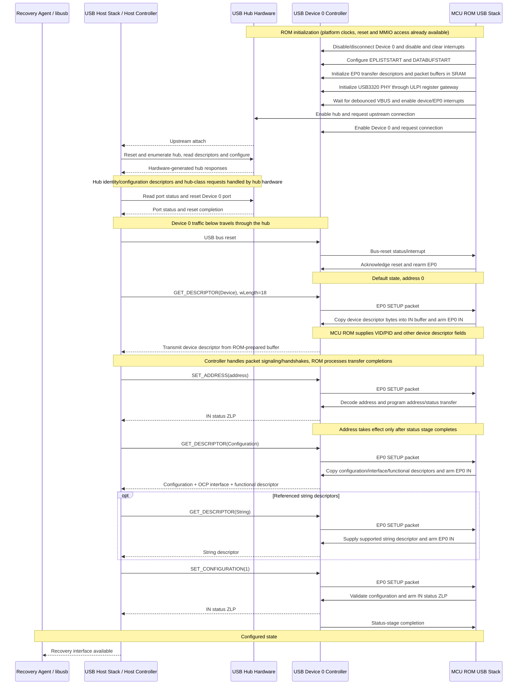

The **USB device descriptor** returned by `GET_DESCRIPTOR(Device)` contains
VID/PID and is supplied by MCU ROM for Device 0. It is not the **EP0 transfer
descriptor** initialized in packet SRAM: that hardware descriptor specifies
buffer location, transfer length and control flags. `EPLISTSTART` and
`DATABUFSTART` configure the controller's endpoint-list/data-buffer bases; they
do not configure Device 0's host-visible VID/PID.

Device 0 standard requests require ROM to decode the request and prepare the
response or state change; the controller transmits the packets. Enabling the
controller alone does not make it answer `GET_DESCRIPTOR` autonomously. Hub
responses instead come from the hub hardware's descriptor/configuration logic,
not the Device 0 ROM descriptor buffers. Supported OCP requests use the
separate hardware recovery path described in
[Appendix B.4](#b4-ocp-recovery-hardware-after-enumeration).

A robust implementation must also tolerate repeated and short descriptor reads, a new SETUP packet aborting an active control transfer, and a bus reset at any point.

### 5.3 EP0 control transfers

Every control transfer begins with an eight-byte SETUP packet and has one of these forms:

**Control write, host to device**

1. SETUP packet with direction OUT and actual payload length in `wLength`.
2. Zero or more OUT data packets.
3. Device returns an IN zero-length packet (ZLP) as status.

**Control read, device to host**

1. SETUP packet with direction IN and requested maximum length in `wLength`.
2. Device returns zero or more IN data packets.
3. Host sends an OUT ZLP as status.

For the current Full-Speed-style `usbdev` model, EP0 maximum packet size is 64 bytes. A transfer may be larger than one packet. All non-final data packets are 64 bytes. A short packet or required ZLP terminates a device-to-host data stage before `wLength`; receiving exactly `wLength` also terminates it.

A SETUP packet resets EP0 data toggles and clears an endpoint halt for the new control transfer. NAK means the endpoint is temporarily not ready and should be retried. STALL means the request cannot be serviced and requires host recovery.

### 5.4 What the transaction-level emulator validates

The emulator validates software-visible behavior:

- MMIO register programming;
- buffer ownership and FIFO depth;
- endpoint enable, NAK, STALL, and ready state;
- packetization at EP0 maximum packet size;
- interrupt status and clearing behavior;
- enumeration and control-transfer state;
- OCP framing, state transitions, and image flow; and
- reset and software error recovery.

CRC, PID, and bit-stuffing failures are represented by fault-injection events and status bits rather than calculated from a serial bitstream.

## 6. OCP Recovery over USB

### 6.1 High-level boot architecture

Unlike network recovery, USB recovery does not use a separate boot coprocessor.
MCU ROM runs the USB device stack and OCP recovery responder. The host-side
Recovery Agent discovers the device and pushes images from its image store over
EP0 control transfers.

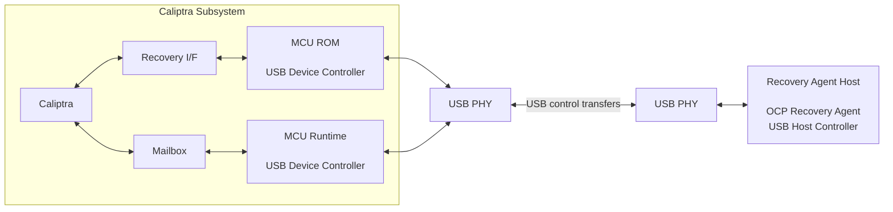

### 6.2 Physical hardware and software stacks

#### Demo Setup

The recovery-agent connects by USB to the HTG-FMC-8639 daughter
board. The daughter board plugs into the HTG-940 FPGA board through its FMC
connector.

    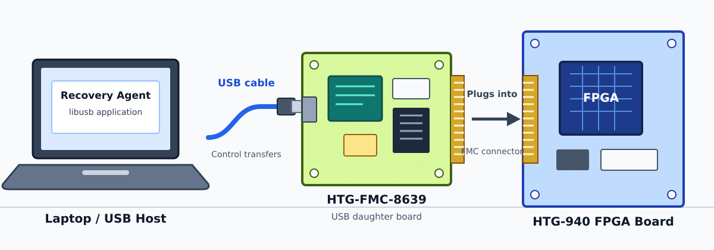

#### System Architecture

    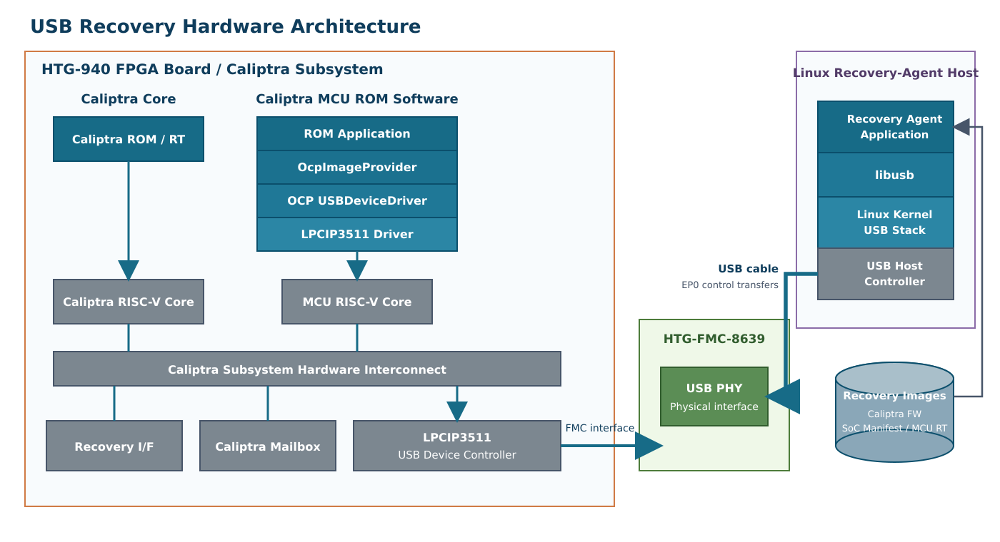

HTG-FMC-8639 : Board containing USB Phy NXP lpcip3511
HTG-940: FPGA Board with Caliptra SubsystemIP

### 6.3 Descriptors

The OCP v1.1 recovery function uses a composite-device descriptor at device level and identifies recovery at interface level.

| Descriptor field                   | Required value                                                                   |
| ---------------------------------- | -------------------------------------------------------------------------------- |
| Device class/subclass/protocol     | `0x00/0x00/0x00`                                                               |
| Recovery interface class           | `0xEF` (Miscellaneous)                                                         |
| Recovery interface subclass        | `0x08`                                                                         |
| Recovery interface protocol        | `0x01`                                                                         |
| Recovery interface number          | `0` recommended                                                                |
| Additional endpoints               | None; EP0 is used                                                                |
| Functional descriptor type/subtype | `0x24/0x01`                                                                    |
| Advertised maximum transfer sizes  | `wMaxWrTransferSize` and `wMaxRdTransferSize` must each be at least 64 bytes |

The class-specific functional descriptor advertises `wMaxWrTransferSize`, `wMaxRdTransferSize`, and the OCP Recovery version. The current reference driver advertises 1024-byte read and write transfers while packetizing each transfer into at most 64-byte EP0 packets.

The final VID, PID, strings, maximum transfer sizes, power attributes, and composite-interface layout are platform configuration, not emulator-only constants. The emulator and VCK190 firmware must derive them from one shared configuration or compare them in parity tests.

### 6.4 Command encapsulation

One OCP command maps to exactly one EP0 control transfer. The SETUP packet is:

| Field             | OCP read                                                       | OCP write                                                  |
| ----------------- | -------------------------------------------------------------- | ---------------------------------------------------------- |
| `bmRequestType` | `0xA1`: device-to-host, class, interface                     | `0x21`: host-to-device, class, interface                 |
| `bRequest`      | `0x00`                                                       | `0x00`                                                   |
| `wValue[0]`     | OCP command ID                                                 | OCP command ID                                             |
| `wValue[1]`     | `0x00`                                                       | `0x00`                                                   |
| `wIndex[0]`     | Recovery interface number                                      | Recovery interface number                                  |
| `wIndex[1]`     | `0x00`                                                       | `0x00`                                                   |
| `wLength`       | Exactly advertised`wMaxRdTransferSize` according to OCP v1.1 | Actual data length, not greater than`wMaxWrTransferSize` |

Fields and OCP payloads are little-endian. The USB driver removes USB framing and presents `(RecoveryCommand, RecoveryRequest)` to the OCP state machine.

### 6.5 Layering

The USB layer owns enumeration, packetization, NAK, STALL, and status stages. The OCP layer owns command legality, `PROT_CAP`, device and recovery status, CMS selection, image activation, and protocol error reporting. ROM/platform code owns the policy for consuming an activated image and advancing to the next boot stage.

### 6.6 Image transfer

After enumeration, the RA transfers three images in the order requested by
`RECOVERY_STATUS`: Caliptra FMC/runtime at index 0, the SoC manifest at index
1, and MCU runtime at index 2. Four actors participate in the physical
HTG-940 flow:

- the RA issues OCP reads and writes as USB EP0 control transfers;
- the dedicated USB/OCP hardware decodes those requests, stores the recovery
  registers, and implements the FIFO;
- MCU ROM initializes and enumerates USB, starts Caliptra's
  `RI_DOWNLOAD_FIRMWARE` mailbox command, and waits for MCU firmware readiness;
  and
- Caliptra ROM handles image 0, while Caliptra runtime handles images 1 and 2
  and ultimately authorizes and activates MCU runtime.

The enumeration exchange is omitted below because it is shown in Section 5.2.
The diagram shows the FIFO CMS used by the current host agent. An indirect CMS
has the same status and activation handshake, but buffers the complete image
before activation instead of streaming through the FIFO.

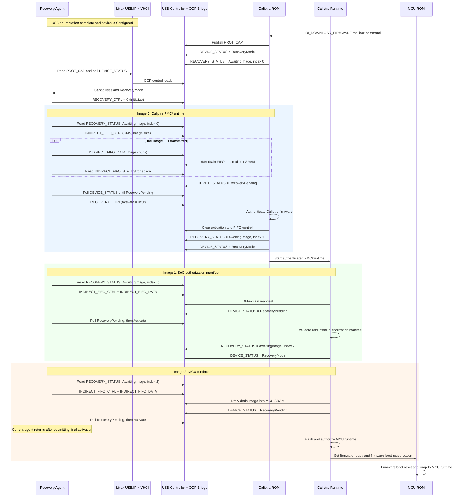

The register responsibilities and waits are:

| Actor            | Modifies                                                                                                                                         | Reads or waits for                                                                                                                                                       |
| ---------------- | ------------------------------------------------------------------------------------------------------------------------------------------------ | ------------------------------------------------------------------------------------------------------------------------------------------------------------------------ |
| RA               | Writes `RECOVERY_CTRL`, `INDIRECT_FIFO_CTRL`, and `INDIRECT_FIFO_DATA`                                                                     | Reads `PROT_CAP`; polls `DEVICE_STATUS`, `RECOVERY_STATUS`, and `INDIRECT_FIFO_STATUS`                                                                           |
| USB/OCP hardware | Decodes OCP commands, updates FIFO pointers and live FIFO status, records protocol errors, and exposes payload/activation indications            | Accepts host EP0 requests and firmware-side MMIO/DMA accesses                                                                                                            |
| MCU ROM          | Initializes the USB controller, performs standard enumeration, sends `RI_DOWNLOAD_FIRMWARE`, and later controls recovery shutdown/reset policy | Waits for the Caliptra mailbox operation, MCU firmware-ready, and Caliptra runtime-ready indications; it does not normally rewrite OCP status registers in this USB flow |
| Caliptra ROM     | Publishes capabilities and image-0 device/recovery status; clears activation/FIFO state after processing                                         | Waits for image-0 payload availability and host activation                                                                                                               |
| Caliptra runtime | Publishes image-1/image-2 status, clears stage controls, and signals MCU firmware readiness/reset                                                | Waits for the SoC manifest and MCU runtime payloads and their host activation requests                                                                                   |

In the transaction-level emulator, the dedicated OCP command decoder is
replaced by the MCU-side `RecoveryStateMachine`, CMS objects, and
`OcpImageProvider`. That software path must reproduce the same host-visible
register values, image indices, FIFO backpressure, and activation ordering.
This is an internal ownership difference, not a different RA protocol.

Each OCP request is one complete EP0 control transfer through `libusb`, USB/IP,
the emulated controller, and the MCU ROM USB stack. OCP transfer size and USB
packet size are independent. For example, a 1024-byte
`INDIRECT_FIFO_DATA` command is one OCP control transfer containing sixteen
64-byte USB packets.

### 6.7 Error hierarchy

Errors must be handled at the layer where they originate:

| Layer               | Examples                                                              | Expected behavior                                                            |
| ------------------- | --------------------------------------------------------------------- | ---------------------------------------------------------------------------- |
| USB link/controller | CRC, PID, bit stuffing, lost host, FIFO overflow                      | Set controller status/interrupt; discard or retry the packet as appropriate. |
| USB control pipe    | Unsupported standard request, invalid direction/recipient, bad length | STALL EP0 or complete the request according to USB chapter 9.                |
| OCP protocol        | Unsupported command or parameter, invalid CMS, wrong command length   | Record OCP`PROTOCOL_ERROR`; preserve a usable recovery interface.          |
| Image/boot policy   | Authentication failure, bad image order, activation failure           | Report recovery status and follow ROM image-provider policy.                 |

OCP v1.1 defines host escalation after a STALL: first clear endpoint halt, then perform a port or bus reset if recovery does not resume. The device must flush partial EP0 state and remain capable of re-enumeration without depending on mutable flash.

## 7. Existing repository implementation

### 7.1 Register contract

`hw/usbdev.rdl` defines the software-visible contract. Generated firmware and emulator register crates are built from this source. Important resources are:

- `USBCTRL` for enable and device address;
- endpoint IN/OUT and SETUP enable registers;
- available SETUP and OUT buffer FIFOs;
- `RXFIFO` entries containing buffer ID, packet size, SETUP indication, and endpoint;
- `CONFIGIN_0` and `IN_SENT` for IN packet ownership and completion;
- IN/OUT STALL and NAK controls;
- interrupt state, enable, and test registers; and
- packet buffer SRAM.

The peripheral is currently documented and modeled at `0x0900_0000`, with USB interrupt 26 in the MCU root bus. These values must be checked against the final FPGA address map and interrupt assignment rather than copied independently.

### 7.2 Emulator peripheral

`emulator/periph/src/usbdev.rs` implements `UsbDevPeriph` and shares `UsbDevState` with a cloneable `UsbHostController` through `Arc<Mutex<_>>`.

Firmware sees generated MMIO registers. The host side can inject SETUP, OUT, IN, SOF, and bus-reset events. The model currently provides:

- four-entry available SETUP FIFO;
- eight-entry available OUT FIFO;
- eight-entry receive FIFO;
- 64-byte packets backed by 16 32-bit words per buffer;
- endpoint enable, NAK, STALL, ready, and sent semantics;
- level-sensitive packet/FIFO interrupts plus latched event interrupts; and
- W1C handling for interrupt and sent state.

The standalone emulator connects the peripheral to interrupt 26. Some hardware-model construction paths instantiate it without an IRQ, and tests therefore rely on polling. IRQ-driven firmware needs a test configuration that wires the IRQ in all relevant models.

### 7.3 RISC-V driver and OCP stack

`platforms/common/usb/src/lib.rs` provides the reference `ExamplarUsbDriver`. It configures EP0, manages four packet buffers, performs minimal enumeration, assembles OUT packets into a 1024-byte transfer buffer, segments IN responses, and implements `UsbDeviceDriver`.

`common/ocp/src/usb` defines descriptors, SETUP parsing, and the driver trait. `RecoveryStateMachine` in `common/ocp/src/interface.rs` is independent of MMIO details. `OcpImageProvider` in `rom/src/recovery/ocp.rs` adapts recovery actions to the ROM image-provider interface.

This separation is the central portability requirement: the VCK190 integration may replace the MMIO driver if the RTL programming model changes, but it must not fork the OCP state machine or host protocol.

### 7.4 Host test controller

`hw/model/src/usb_ctrl.rs` drives control-transfer stages while stepping the CPU model. It includes descriptor enumeration and OCP read/write helpers. Integration tests in `tests/integration/src/test_usb_ocp_recovery.rs` validate capabilities, status, protocol errors, indirect image loading, FIFO image loading, and recovery after malformed commands.

This backend is deterministic and appropriate for CI, but it is an in-process Rust API. It does not currently appear as a USB device to an external application.

### 7.5 Current integration-test sequence

The current tests emulate a USB host at the transaction level. The Rust test
harness owns a `UsbHostController`, while MCU ROM accesses `UsbDevPeriph`
through the OpenTitan-derived `usbdev` MMIO register interface used by RTL.

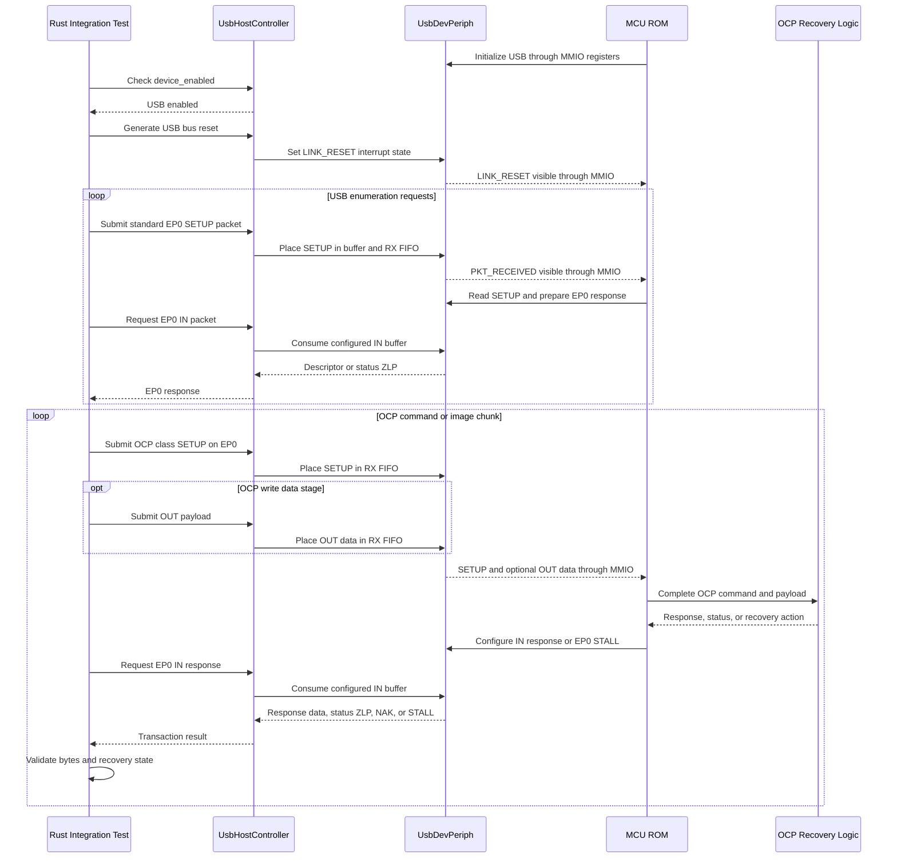

There are two related test levels:

- `hw/model/src/lib.rs::test_usb_ocp_recovery` loads the dedicated test firmware from `hw/model/test-fw/usb-ocp-recovery`. That firmware uses `ExamplarUsbDriver` and implements a small OCP responder for focused driver and EP0 testing.
- `tests/integration/src/test_usb_ocp_recovery.rs` boots the ROM recovery path and combines `ExamplarUsbDriver`, `RecoveryStateMachine`, `OcpImageProvider`, CMS storage, and the three-stage recovery-image flow.

This setup emulates host transactions, device-controller registers, and the RISC-V CPU, but it does not emulate a standard Linux USB host stack. It does not currently involve `libusb`, VHCI, USB/IP, xHCI/EHCI, or physical USB signaling. The proposed USB/IP server will translate Linux control URBs into the same `UsbHostController` operations, preserving the existing device-peripheral and firmware path.

## 8. Proposed emulator architecture

### 8.1 Architecture

    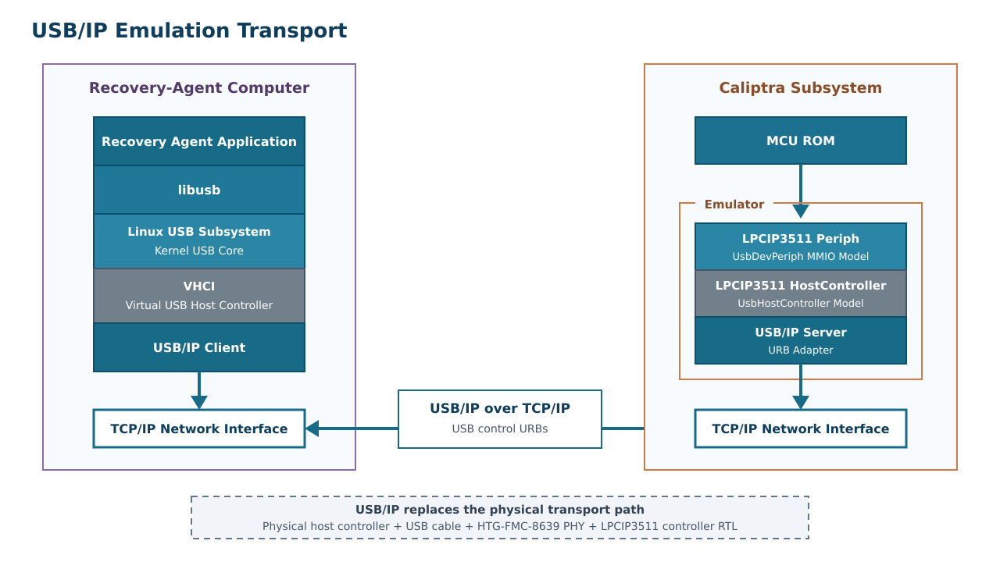

#### Simplified Presentation View

    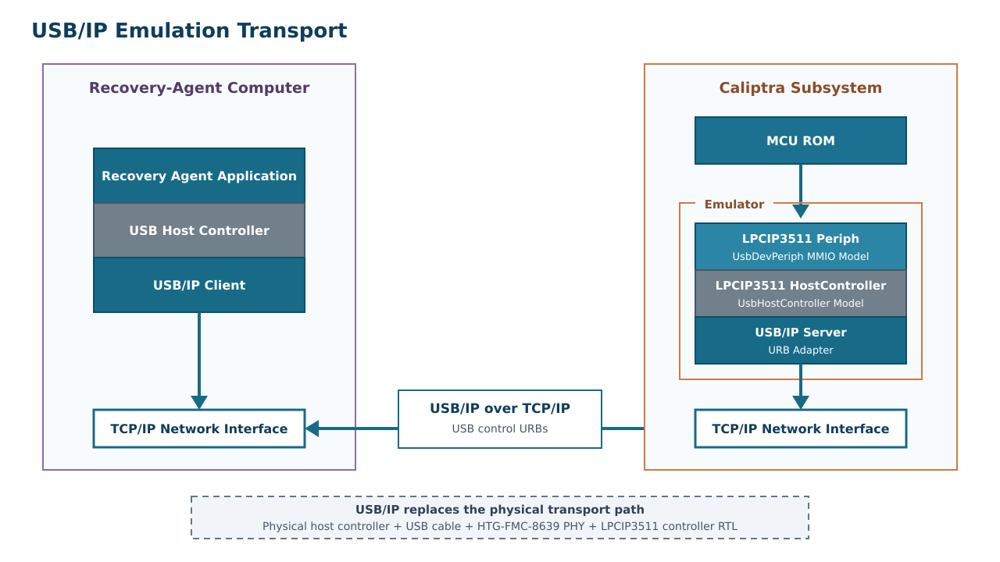

Unlike network boot, USB Recovery does not need a third RISC-V coprocessor. The Linux recovery agent is the USB host and pushes images through `libusb`, the Linux virtual host controller, and USB/IP. Inside the emulator, the USB/IP adapter converts URBs into host transactions for the emulated USB device peripheral. MCU firmware sees only the `usbdev` MMIO programming model and therefore follows the same driver path intended for RTL.

The host transaction engine converts each USB/IP control URB into SETUP, packetized data, and status stages. Existing in-process tests may continue using `UsbHostController` as test infrastructure, but they are not a proposed application-facing backend. The supported external architecture is USB/IP.

USB/IP replaces the physical USB transport, not the USB software stacks. The
Recovery Agent still uses `libusb` and the Linux USB subsystem. MCU ROM still
uses its `UsbDeviceDriver` implementation and accesses `UsbDevPeriph` through
the same MMIO contract used by RTL. VHCI and the USB/IP client serialize USB
requests as URBs over TCP/IP. The USB/IP server converts those URBs into
transactions for `UsbHostController`.

The USB/IP adapter should expose these operations to its internal transaction engine:

- attach and detach;
- bus reset;
- complete EP0 control transfer with SETUP fields, optional OUT data, requested IN length, and timeout;
- optional SOF/suspend/resume events;
- query connection/controller state for diagnostics; and
- inject a named controller fault for tests.

The result of a control transfer is success plus IN data, STALL, timeout/disconnect, or a USB/IP error. NAK and temporary lack of a device buffer are internal retry conditions until timeout. USB/IP sequence numbers prevent a timed-out or unlinked request from consuming a later response.

### 8.2 USB/IP implementation

USB/IP is the selected external application-development backend. A Linux USB/IP server presents the emulated device to the kernel's virtual host controller, allowing ordinary discovery and `libusb` control-transfer APIs to be exercised without changing the RA. The same high-level RA and `libusb` transport can therefore target the emulator now and the physical VCK190 later.

The adapter maps one EP0 URB to one host-engine control transfer:

- successful IN transfer returns collected data and actual length;
- successful OUT transfer returns the transmitted length;
- STALL maps to the host's pipe error;
- disconnect maps to no-device;
- NAK remains pending until completion or timeout; and
- unlink cancels the matching sequence number.

USB/IP does not validate PHY-level behavior and requires Linux USB/IP kernel setup to attach the virtual device. It is the application-facing emulation path and validates the real RA, `libusb`, Linux USB stack, enumeration, and recovery control transfers.

### 8.3 Concurrency and determinism

USB/IP server threads must never write firmware MMIO directly. They submit bounded host events to the model and wait for completion. The emulator main loop continues stepping the RISC-V CPU and polling the peripheral. Peripheral state changes remain serialized under the existing state lock or, preferably, through bounded request/response queues.

The USB/IP adapter must not block the emulator while holding the device-state lock. Retries occur after releasing the lock. Transaction processing uses emulator cycle deadlines and a wall-clock watchdog so a stopped emulator cannot retain a USB/IP client forever.

### 8.4 Configuration

Add an emulator option to enable or disable USB/IP export. Associated options select bind address/port, exported USB bus and device ID, VID/PID override for development, attach-on-start, transfer timeout, and fault-injection policy. USB/IP export remains disabled unless explicitly selected.

Defaults must be safe:

- no externally reachable TCP listener;
- loopback-only TCP by default;
- bounded transfer and queue sizes;
- no USB/IP kernel attachment performed automatically; and
- no host image accepted until firmware has enabled the device.

Descriptor values should come from firmware responses, with only the minimum metadata duplicated by a USB/IP export layer. Startup should reject incompatible configured and firmware VID/PID/speed values.

## 9. Firmware architecture

### 9.1 Controller driver

The FPGA driver and emulator driver must implement the same responsibilities:

1. reset and configure controller/PHY state;
2. supply EP0 SETUP and OUT buffers before enabling pull-up;
3. handle bus reset by clearing address, configuration, toggles, stalls, partial transfers, and stale FIFO entries;
4. serve standard requests required for enumeration and recovery;
5. enforce interface number, direction, reserved fields, and transfer-size limits;
6. assemble and segment multi-packet data stages;
7. return buffers to hardware without double ownership;
8. expose only complete OCP requests to the OCP state machine; and
9. map controller faults to driver errors and recovery behavior.

Polling is acceptable for early ROM bring-up. The long-term driver should support interrupts so runtime operation does not spin continuously. The protocol state machine must behave identically in either mode.

### 9.2 Minimum standard request support

Before FPGA parity, support and test at least:

- `GET_DESCRIPTOR` for device, configuration, and referenced strings;
- `SET_ADDRESS` with address applied after status completion;
- `SET_CONFIGURATION`, `GET_CONFIGURATION`;
- `GET_STATUS` for the appropriate recipient;
- `GET_INTERFACE` and `SET_INTERFACE` for alternate setting zero; and
- `CLEAR_FEATURE(ENDPOINT_HALT)` behavior needed by OCP error escalation.

Unsupported or malformed requests must STALL. A new SETUP or bus reset must safely abort any pending data/status stage.

### 9.3 Memory use

The current 1024-byte write buffer is convenient but costly in ROM and caps one OCP command. The platform must deliberately choose one of these designs:

- retain a fixed buffer and advertise that exact maximum;
- stream `INDIRECT_DATA`/`INDIRECT_FIFO_DATA` packets into a CMS while retaining small-command atomicity; or
- use controller DMA into staging SRAM.

The functional descriptor must never advertise more than the driver can receive atomically according to its chosen design. The initial parity target should retain the current 1024-byte limit; optimize only after behavior is stable.

### 9.4 Boot integration

USB OCP Recovery is an `ImageProvider`, not a replacement for ROM boot policy. `ImageProviderManager` determines whether USB is always available, attempted after flash/I3C failure, retried forever, or bounded by policy.

The recovery interface must remain independent of corrupt mutable flash. Static descriptors, the EP0 driver, minimum OCP commands, CMS staging, and reset handling must fit in the trusted boot environment needed to perform recovery.

### 9.5 Target: persistent USB service in the OCP recovery ROM

**Implemented FPGA recovery flow; RTL/FPGA validation is still required.**
The `test-lpcip-usb-ocp-recovery` ROM now provides persistent Device 0 standard
request service alongside hardware-owned OCP recovery traffic. The separate
compliance-test mode continues to service both devices with OCP hardware claims
disabled. Passing tests with that compliance-only image does not validate the
recovery image's behavior or establish production USB compliance.

ROM compliance testing covers the hub and Device 0, using the OCP recovery ROM.
Device 1 remains disabled; ROM does not enumerate, service or wait for it.
This scope applies to the recovery image, not the two-device compliance-only
test mode. Runtime compliance testing is separate; Device 1 behavior outside
ROM is out of scope for this design.

There is no "ordinary host versus recovery host" detection step. The host can
enumerate, issue standard requests, start recovery, reset a port, and issue
more standard requests in the same connection. During active streaming boot,
however, reset, disconnect and suspend terminate the boot attempt under the
meeting-agreed failure policy; they do not trigger transparent restart.
Dispatch follows request type,
recipient and current protocol state, not host identity or an assumption that
enumeration happens only once.

#### Initialization and cooperative service loop

Platform prerequisites: MCU access to the USB registers and packet SRAM,
working controller/PHY clocks and reset sequencing, and no concurrent firmware
access to Device 0 or shared hub/PHY controls. These are not a separate ROM
ownership handshake.

`LpcipUsbDriver::init_recovery` accepts integrator-provided Device 0 VID/PID.
The FPGA caller currently retains the bring-up identity `0424:0007`; integrators
must supply their assigned IDs. Other descriptor fields retain the existing
fixed OCP descriptor layout. These host-visible USB descriptors are distinct
from the EP0 transfer descriptors in SRAM.

**Phase boundary:** expected resets during initial enumeration must be handled
normally. The fatal reset/disconnect/suspend policy becomes active only after
MCU ROM has successfully submitted `RI_DOWNLOAD_FIRMWARE` **and** hardware has
then claimed an OCP recovery class request on Device 0 (the mirrored SETUP
matches the RTL claim envelope). OCP requests observed before RI submission do
not count. The policy remains latched until ROM exits. Until the recovery agent
starts OCP traffic, ROM keeps handling resets, suspend/resume and disconnects
normally, so USB compliance testing can run against the waiting ROM. This is a
ROM policy boundary, not a claim that a hardware bit proves payload streaming
has begun.

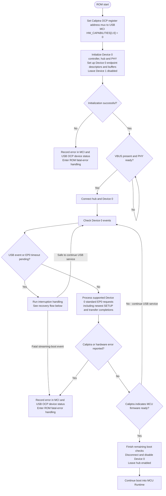

#### Register mapping for the service-loop actions

`R` means read, `W` means write, and `W1C` means write one to clear the
documented status bits. Device 0 register names below are relative to its CSR
block; `HUB_CONTROL`, `ULPIDEBUG`, and `CALIPTRA_*` belong to the compound
controller. Since USB Hub Release 2.6, `ULPIDEBUG` is in the hub block, not the
Device 0 CSR block.
Packet SRAM entries are memory, not CSR registers. This maps the implemented
service loop to the hardware interface. Recovery-register accesses must be assigned to
the actual image consumer, not duplicated by MCU ROM and Caliptra.
For the USB recovery flow here, Caliptra owns OCP image loading and status;
MCU ROM waits for Caliptra's MCU firmware-ready indication while servicing USB.

| Flowchart action / decision                                    | Register or memory                                                                                             | Access and ROM action                                                                                                                                                                                                                                                                                                                                                                                            |
| -------------------------------------------------------------- | -------------------------------------------------------------------------------------------------------------- | ---------------------------------------------------------------------------------------------------------------------------------------------------------------------------------------------------------------------------------------------------------------------------------------------------------------------------------------------------------------------------------------------------------------- |
| ROM start                                                      | No USB register                                                                                                | Enter ROM execution.                                                                                                                                                                                                                                                                                                                                                                                             |
| Initialize Device 0 controller                                 | `DEVCMDSTAT`, `INTEN`, `INTSTAT`                                                                         | W: clear `DEV_EN`/`DCON`, retain `FORCE_NEEDCLK`; disable interrupts with `INTEN = 0`. W1C: clear implemented pending interrupts in `INTSTAT`.                                                                                                                                                                                                                                                         |
| Initialize hub                                                 | `HUB_CONTROL`                                                                                                | W: set `ENABLE = 1` with `DCON = 0` during setup; request upstream connection later.                                                                                                                                                                                                                                                                                                                         |
| Set up Device 0 endpoint descriptors and buffers               | `EPLISTSTART`, `DATABUFSTART`; Device 0 packet SRAM                                                        | W: set both base registers to `0` for the current local-memory layout. Initialize EP0 OUT/IN transfer entries and the SETUP-buffer pointer in SRAM; disable unused endpoint entries. These are not the USB descriptors containing VID/PID.                                                                                                                                                                     |
| Initialize PHY / initialization successful?                    | `CONFIG.ULPI`, `ULPIDEBUG`; USB3320 ULPI registers                                                         | R: verify ULPI support. W: select `PHY_MODE`, program PHY read/write transactions and start `PHY_ACCESS`. R: poll access completion and read `PHY_RDATA`. Read PHY vendor/product IDs at ULPI `0x00`-`0x03`; write Function Control (`0x04`) and OTG Control (`0x0A`). Report identity/access failures.                                                                                            |
| Leave Device 1 disabled                                        | Device 1 `DEVCMDSTAT`, `INTEN`                                                                             | Keep `DEV_EN = 0`, `DCON = 0` and interrupts disabled; no Device 1 enumeration or service. Explicitly disable it if the entry state is not guaranteed by reset.                                                                                                                                                                                                                                              |
| VBUS present and PHY ready?                                    | `DEVCMDSTAT.VBUS_DEBOUNCED`; `ULPIDEBUG.PHY_ACCESS` and initialization result                              | R: wait for debounced VBUS after successful PHY initialization. There is no single combined "PHY ready" register bit implied by this decision.                                                                                                                                                                                                                                                                   |
| Connect hub and Device 0                                       | `HUB_CONTROL`, Device 0 `DEVCMDSTAT`, `INTEN`, `INTSTAT`                                               | W: enable EP0/device interrupts and clear stale pending indications before connection. Set hub `ENABLE = 1`, `DCON = 1`; set Device 0 `DEV_EN = 1`, `DCON = 1`, retaining `FORCE_NEEDCLK = 1`. Hardware performs attachment signaling.                                                                                                                                                                 |
| Check Device 0 events / USB event or EP0 timeout pending? | `INTSTAT`, `DEVCMDSTAT`; software EP0 deadline | R: inspect endpoint/device interrupts, `SETUP`, bus-reset change (`DRES_C`), VBUS and suspend status. Check the EP0 timeout budget. MCU ROM does not poll OCP image-transfer status here. |
| Process Device 0 standard EP0 requests and transfers           | SETUP/IN/OUT buffers and EP0 transfer entries in SRAM; `DEVCMDSTAT`, `INTSTAT`                             | R: decode SETUP bytes and completion state. W: prepare response bytes and transfer entries (buffer offset, byte count, `ACTIVE` or `STALL`). Use `DEV_ADDR` for address assignment with the required status-stage timing. Acknowledge handled SETUP/interrupt indications using their defined clear semantics. Configuration state and USB descriptor bytes are maintained by firmware, not a VID/PID CSR. |
| Run interruption handling | `EPSKIP`, `INTSTAT`, `DEVCMDSTAT`; streaming-boot phase state | During active streaming boot, reset/disconnect/suspend is fatal. Process superseding SETUP as normal EP0 work without assuming an unconditional `EPSKIP` requirement. For explicit cancellation/timeout, write the affected `EPSKIP` bits and wait for cancellation before buffer reuse. No runtime PHY-reinitialization or image-restart loop is implied. |
| Caliptra or hardware error reported?                           | Caliptra fatal-error and platform hardware-error status used by the existing boot flow                         | R: check errors while waiting, as the existing firmware-ready wait does. Report and escalate failures instead of continuing boot or waiting indefinitely.                                                                                                                                                                                                                                                        |
| Caliptra indicates MCU firmware ready?                         | Caliptra `ss_generic_fw_exec_ctrl[0]`, bit 2; MCI `NotifCptraMcuResetReqSts` notification                  | R: the current `fw_ready()` helper polls bit 2. The existing wait acknowledges the MCI reset-request notification after readiness. This is Caliptra's indication that MCU firmware is loaded and authorized for execution, not a USB FIFO completion bit.                                                                                                                                                      |
| Disconnect Device 0 | `INTEN`, `EPSKIP`, `DEVCMDSTAT` | Clear Device 0 `DEV_EN`/`DCON`, retain `FORCE_NEEDCLK`, disable interrupts and request EP0 cancellation. Wait for `EPSKIP[1:0] = 0` with a bounded poll budget; timeout is fatal. Stop the software service without reusing packet SRAM. Leave `HUB_CONTROL` unchanged: the hub stays enabled. No live Device 0 state is handed to runtime. |
| Record error / ROM fatal-error handling | MCI `mci_reg_fw_fatal_error`; USB `RECOVERY_DEVICE_STATUS_0` | Record the full MCU error in MCI. Publish OCP fatal health `DevStatus = 0x0f` and vendor-defined recovery reason `0x80` (MCU ROM failure), preserving `ProtError`. Vendor-status registers are read-only in this integration, so they do not carry the full MCU error. AXI register access may remain available even if failed enumeration prevents ordinary host access. |
| Continue boot into MCU Runtime | Existing ROM boot/reset interfaces | Perform the existing remaining boot checks and reset sequence after Caliptra indicates MCU firmware readiness. |

For **Set Caliptra OCP register address mux to USB**, ROM reads MCI
`mci_reg_hw_capabilities`, clears bits `[1:0]` to select USB (`0`, versus
I3C `1`), writes the result while preserving all other bits, and reads it back
to verify the selection. This must occur before asserting Caliptra boot-go,
as in the existing cold-boot sequence. This address-mux selection is distinct
from the USB EP0 OCP request-routing control below.

OCP routing remains enabled by reset default
(`CALIPTRA_CTRL.OCP_PATH_DISABLE = 0`); it is not an additional connection
write. Register offsets are intentionally omitted here: use the generated
register definitions matching the selected RTL, especially for the recovery
aperture.

This diagram covers MCU ROM's USB-service and firmware-ready wait, not
Caliptra's internal image-loading state machine. MCU ROM starts
`RI_DOWNLOAD_FIRMWARE` through the existing boot flow; Caliptra ROM/runtime
manage the recovery images, authentication/authorization and MCU firmware
loading. For this unencrypted USB recovery flow, the MCU firmware-ready
indication is the completion gate: ROM does not separately poll OCP status to
prove that each required image was received and authenticated. It still
performs the remaining MCU boot checks and reset sequence. Encrypted boot has
a separate decrypt/activation sequence and is not represented here.

PHY transactions use a bounded initialization poll budget and report failures.
Initial VBUS absence remains an attach wait. The FPGA development image retains
its disabled watchdog and does not add an overall attach or image-download
deadline; production watchdog/boot-timeout policy remains an integration task.
"Bounded work" means that waiting for
Caliptra mailbox completion, firmware readiness, or an EP0 status stage cannot
starve Device 0 service. The existing blocking boot waits must therefore be
integrated with USB servicing. The implementation polls Device 0 from Caliptra
mailbox delays and fuse/boot-FSM/firmware/runtime readiness waits. EP0 transfer
and cancellation budgets are each 10,000,000 service polls, not wall-clock
deadlines. Interrupts do not by themselves solve a blocking image-loading call.

ROM neither waits for nor services Device 1. Its service loop covers only
Device 0 and Caliptra boot indications, with hub protocol handling provided by
hardware.

The EP0 processing box is limited to supported standard requests:
`GET_DESCRIPTOR` (device, configuration, supported strings, qualifier and
other-speed descriptors), `SET_ADDRESS`, `GET/SET_CONFIGURATION`, recipient-
appropriate `GET_STATUS`, and the supported interface/feature requests.
Unsupported or malformed requests receive STALL. Review the request set and
validation in the [persistent handler](../../platforms/common/usb/src/lpcip/compliance.rs)
and [enumeration driver](../../platforms/common/usb/src/lpcip.rs) when integrating
the recovery image; the shared handler still requires hardware validation.

#### Request and hardware ownership

| Input                                                           | Owner and response                                                                                                                                                                 |
| --------------------------------------------------------------- | ---------------------------------------------------------------------------------------------------------------------------------------------------------------------------------- |
| Hub descriptors, hub class requests and downstream port changes | Hub hardware; ROM must not process them as Device 0 requests. Validate the hub path as part of the same system.                                                                    |
| Standard requests addressed to Device 0 during ROM              | ROM's persistent Device 0 EP0 state machine, including after initial configuration.                                                                                                |
| Supported Device 0 OCP requests                                 | OCP recovery hardware owns framing and FIFO ingress; Caliptra ROM/runtime consume images and manage recovery status. MCU ROM checks Caliptra error and firmware-ready indications. |
| Unsupported or invalid requests                                 | The owner returns the specified protocol error or STALL. "Handle all packets" does not mean accept every request.                                                                  |
| Link retries, CRC/PID errors and physical signaling             | Controller/PHY hardware performs protocol-level handling; ROM reacts to exposed fault/status events where required.                                                                |
| Reset, detach, suspend/resume or transfer cancellation          | Hardware and firmware coordinate the affected controller, EP0 transfer and recovery session state.                                                                                 |

Do not disable OCP claims merely to make standard requests responsive. Standard
requests and OCP commands must remain correctly routed while recovery is
enabled. Firmware must never overwrite a descriptor or buffer owned by DMA or
the OCP engine. A host may abandon or replace a transfer at any stage.

Claimed OCP SETUP packets are still mirrored into packet SRAM and raise the
firmware-visible `DEVCMDSTAT.SETUP` indication. Before the standard-request
cancellation/dispatch path, the persistent handler matches the RTL claim
envelope: Device 0, OCP routing enabled, `bmRequestType = 0x21/0xa1`,
`bRequest = 0`, and `wIndex = 0`. It discards superseded software-transfer state
and acknowledges SETUP without issuing `EPSKIP`, arming descriptors or STALLing.
Hardware owns subsequent OCP data/status stages, including command validation.
The compliance-only mode disables OCP routing, so those requests still take its
software rejection path.

### 9.6 Target: interruption, reset and error recovery

During active streaming boot, a bus/port reset, disconnect or suspend is an
unexpected interruption: record the failure and enter ROM fatal-error handling.
Do not reconnect and resume a partially loaded image. Hardware resetting USB
protocol state does not roll back Caliptra authentication or destination memory.
Before streaming boot, expected enumeration resets remain normal USB events.

This flow is specifically for MCU ROM. OCP protocol errors, FIFO handling and
image-loader recovery belong to the OCP hardware and Caliptra ROM/runtime.
MCU ROM does not decode those errors as a separate USB event type. It checks
Caliptra's fatal-error indication and the existing platform hardware-error
checks while waiting for MCU firmware readiness in the main service loop
in [section 9.5](#95-target-persistent-usb-service-in-the-ocp-recovery-rom).
The interruption flow below returns to that loop for recoverable EP0 handling
and does not duplicate its Caliptra error and firmware-ready decisions.
ULPI access/identity failures belong to initialization failure handling, not
a runtime "PHY reset detected" branch. A failed ULPI access alone does not
prove that a PHY reset occurred.

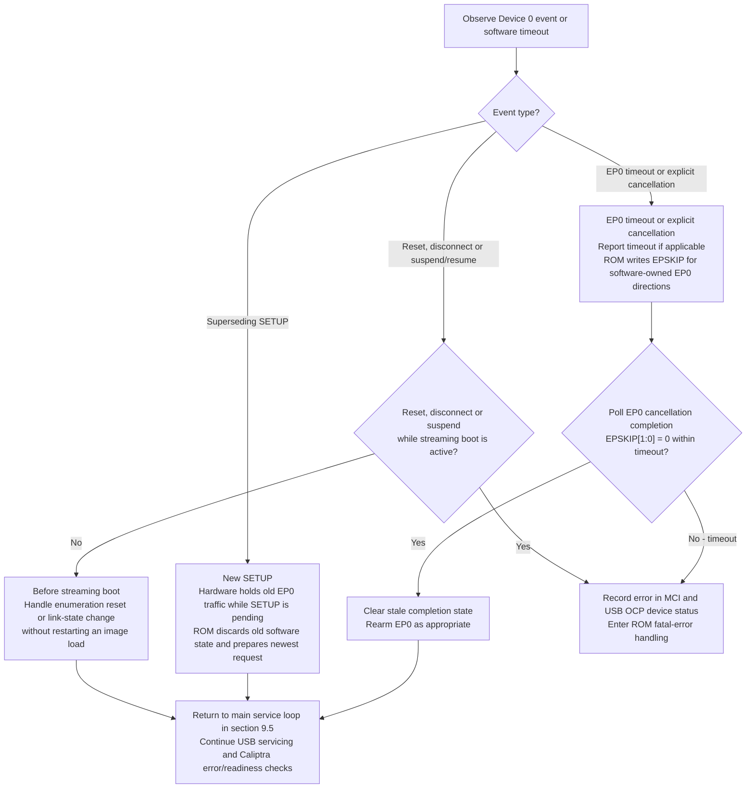

For superseding SETUP, the inspected RTL accepts the new SETUP, holds EP0
data/status traffic while `DEVCMDSTAT.SETUP` remains pending, and resets EP0
data toggles. ROM must discard superseded software state and prepare the new
transfer before acknowledging SETUP in the required order. Hardware does not
erase stale payloads or every old transfer entry. An unconditional `EPSKIP`
operation is not established as a requirement for this path.

The shared recovery/compliance handler still uses `EPSKIP` for new SETUP packets.
Removing that operation requires RTL/FPGA validation during IN/OUT data and
status stages; this diagram describes the target, not a validated driver change.
For explicit cancellation, ROM writes `EPSKIP`, polls completion across service
iterations and only then reuses buffers. Cancellation is not successful status
completion, image authentication or activation. The cancellation wait must
remain bounded and must not block Caliptra error checks.

Not every interrupted recovery produces a Caliptra fatal error. A disconnect
or a host that stops sending data can leave Caliptra waiting or retrying.
The selected streaming-boot policy terminates on detected disconnect even if
Caliptra has not flagged a fatal error. A recovery wait with neither firmware readiness
nor a fatal error needs an explicit timeout/watchdog policy; it must not be
treated as success or assumed to eventually generate a fatal error.

#### `EPSKIP` and SETUP hold semantics

The following behavior is taken from the USB Hub Release 2.6 RTL
(`usb2` `97aa961`, `usb_dma.m.vhdl` and `usb_reg_if.m.vhdl`). It has not yet
been validated on FPGA.

`EPSKIP` and the SETUP hold are independent mechanisms:

- **`EPSKIP` deactivates transfer entries.** Bit *n* selects physical endpoint
  *n*; for EP0, bit 0 is OUT and bit 1 is IN. When the DMA engine is idle and has
  no pending endpoint-information request, it scans the skip bits. For each set
  bit it reads that endpoint's transfer entry from packet SRAM, clears `ACTIVE`
  (bit 31) and writes the entry back. In the same step it clears the
  corresponding `EPSKIP` bit. Endpoints are processed one at a time, so bits can
  clear separately, and normal USB traffic is served before skip work.
- **Skip completion can raise an endpoint interrupt.** If the entry was still
  `ACTIVE`, hardware raises that endpoint's `INTSTAT` bit. A cancelled EP0
  transfer can therefore produce a late `EP0OUT`/`EP0IN` indication that does
  not mean successful completion.
- **`EPSKIP[n] = 0` means hardware has released that entry.** Hardware no
  longer uses that endpoint's transfer entry or its buffer, so firmware can
  safely rewrite them. It does not mean a SETUP packet was flushed: `EPSKIP`
  does not touch the SETUP entry, the SETUP buffer or `DEVCMDSTAT.SETUP`.
- **The SETUP hold is separate.** On SETUP reception, hardware writes the eight
  bytes to the SETUP buffer, sets `DEVCMDSTAT.SETUP` and resets the EP0 toggles.
  While `SETUP` is set, the DMA engine presents EP0 as inactive and not stalled,
  so the host receives NAK for EP0 data/status. It also skips data movement for
  EP0. The hold ends only when firmware writes 1 to `DEVCMDSTAT.SETUP`.
- **Old EP0 entries are inert only during the hold.** Clearing `SETUP` makes any
  EP0 entry still marked `ACTIVE` live again. Firmware must replace both EP0
  entries before acknowledging SETUP, whether or not it used `EPSKIP`.

The current shared handler sequence is:

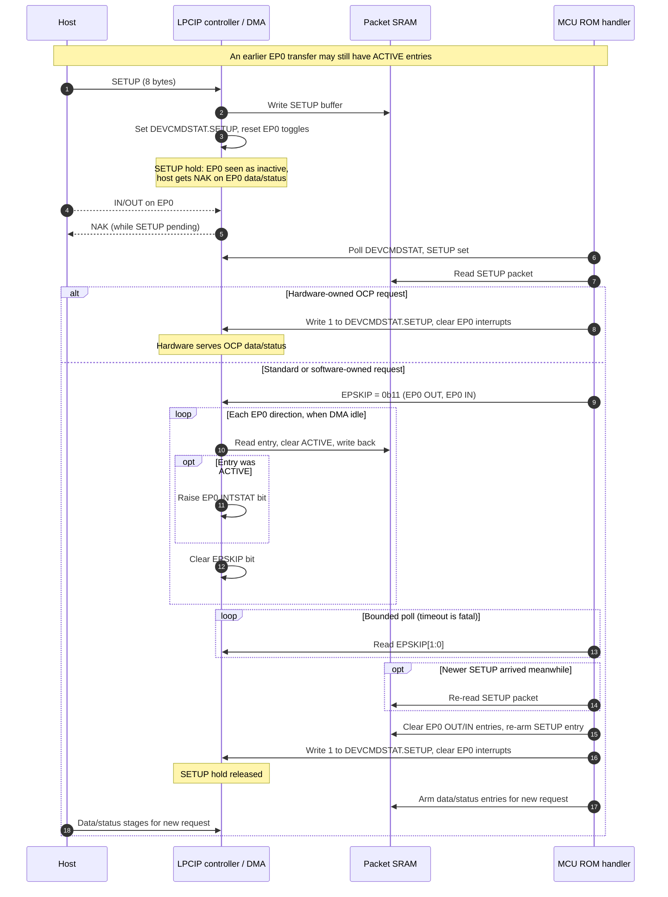

Writing `EPSKIP` for every SETUP is conservative. While the SETUP hold is
active, hardware already ignores the old EP0 entries. `EPSKIP` additionally
ensures that hardware has released an entry before firmware rewrites it.

#### Superseding SETUP without `EPSKIP` (unvalidated)

RTL inspection suggests that omitting `EPSKIP` is safe on this path only if
firmware still replaces both EP0 entries before acknowledging SETUP:

- **No DMA transfer is in flight when ROM sees `SETUP`.** The DMA engine
  serves one USB transaction at a time. Its sequence is IDLE, read entry,
  check entry, move data, write the entry back, then IDLE. The SETUP is itself
  a transaction, so the preceding EP0 transaction has written its entry back
  before SETUP is processed. No late DMA write-back targets the old entries or
  buffers.
- **Old entries are inert during the hold.** EP0 tokens still cause hardware
  to read the EP0 entry. While `SETUP` is set, hardware treats EP0 as inactive,
  NAKs, moves no data and does not write the entry back
  (`WAIT_ON_ENDTRANSFER_NO_UPDATE`). Firmware can rewrite the entries.
- **`clear_ep0()` replaces the entries before the hold is released.**
  Acknowledging SETUP therefore cannot reactivate stale entries.

Compared with the current handler, omitting `EPSKIP` changes the following:

| Aspect | With `EPSKIP = 0b11` (current) | Without `EPSKIP` |
| --- | --- | --- |
| Handler phases | Enters `Aborting` and polls `EPSKIP[1:0]` across service iterations | Clears entries, acknowledges SETUP and dispatches in one iteration |
| Fatal paths | `CancellationTimeout` if the skip does not complete | No cancellation timeout on this path |
| Interrupts | Skipping an `ACTIVE` entry can raise `EP0OUT`/`EP0IN` | Only previously pending EP0 interrupts; the handler clears both |
| Host-visible result | New request served | Same, if the assumptions below hold |

Omitting `EPSKIP` is unsafe in these cases:

- **Firmware skips rewriting the entries before clearing `SETUP`.** An old IN
  entry still marked `ACTIVE` becomes live when the hold is released. It can
  send stale data for the new request, or report a spurious completion.
  `EPSKIP` alone would not prevent this either, because it clears only `ACTIVE`
  and leaves the rest of the entry unchanged.
- **Timeout and disconnect cancellation.** No SETUP hold protects the entries,
  so hardware may still use them. `EPSKIP` and its bounded completion poll
  remain required.

Before removing `EPSKIP` from the superseding-SETUP path, FPGA validation must
confirm:

1. **The hold takes effect in time.** The DMA engine samples `SETUP` when it
   is idle. Confirm that an EP0 IN/OUT token arriving immediately after the
   SETUP handshake never reaches an old `ACTIVE` entry before the hold applies.
2. **Firmware entry writes do not race hardware entry reads.** Hardware reads
   EP0 entries during the hold. These reads are harmless, but the result
   depends on packet SRAM arbitration.
3. **Back-to-back SETUP packets keep the hold active.** A second SETUP must
   overwrite the SETUP buffer without releasing the hold before firmware
   acknowledges it.

Validate these with a protocol exerciser or another way to inject a new SETUP:

- during a multi-packet IN data stage;
- during an OUT data stage;
- during the status stage;
- with back-to-back SETUP packets.

Standard USB20CV Chapter 9 tests are not known to inject SETUP mid-transfer.

If validation passes, the minimal superseding-SETUP sequence is:

1. Read SETUP.
2. Call `clear_ep0()`.
3. Write 1 to `DEVCMDSTAT.SETUP` and clear the EP0 interrupts.
4. Dispatch.

`EPSKIP` remains in use only for timeout and disconnect cancellation.

#### Event-specific requirements

Register names below refer to Device 0 unless qualified. Detection sources
owned by OCP hardware/Caliptra are identified explicitly; they are not
additional status polls required of MCU ROM.

| Event | Detection register / message / condition | MCU ROM handling | Hardware / Caliptra responsibility |
| --- | --- | --- | --- |
| New SETUP during an existing standard transfer | `DEVCMDSTAT.SETUP`, EP0 OUT indication in `INTSTAT`, and the eight-byte SETUP packet in SRAM. | Discard superseded software state and uncommitted address/configuration changes. Safely replace stale transfer entries, prepare the newest request and acknowledge SETUP in the required order. Do not assume `EPSKIP` is mandatory; validate the sequence on RTL/FPGA before changing the driver. | Hardware accepts SETUP, resets EP0 toggles and holds old data/status traffic while SETUP is pending. It does not erase stale payloads. OCP-owned interruption semantics remain hardware/Caliptra responsibilities. |
| Bus reset or downstream port reset | `DEVCMDSTAT.DRES_C`, notified through the device interrupt in `INTSTAT`. A hub port reset reaches Device 0 as a USB reset, not a ROM hub-class message. | During active streaming boot, record the error and enter fatal-error handling. During initial enumeration, handle the expected reset and restore Default state normally. Device 1 remains disabled. | USB protocol reset does not roll back Caliptra authentication or partially written image memory. |
| Cable removal / VBUS loss | `DEVCMDSTAT.VBUS_DEBOUNCED = 0`; connection/session-change indications such as `DCON_C`/`OTG_C` where exposed by the integration. VBUS alone cannot detect every disconnect on a powered hub link. | During active streaming boot, record the error and enter fatal-error handling, not reconnect/resume. Initial absence of VBUS remains an attach wait, not a fatal event by itself. | Provide the applicable link-loss indication. Do not execute or resume an incomplete image based solely on later reconnection. |
| PHY initialization failure | `ULPIDEBUG.PHY_ACCESS` timeout, unexpected required ULPI readback or unsupported `CONFIG.ULPI`. | Record initialization failure and enter fatal-error handling. Do not infer a PHY reset from a timeout or add an unverified runtime PHY-reset/retry path. | Platform supplies working PHY clock/reset sequencing and ULPI access. |
| Suspend / resume | `DEVCMDSTAT.DSUS` and `DSUS_C`, with device-event notification in `INTSTAT`; `LPM_SUS` for LPM suspend where supported. | Suspend during active streaming boot is fatal. Before that phase, handle applicable link-state changes normally. A later resume does not revive a fatally interrupted boot attempt. | Host recovery software must keep the link active during streaming boot. Hardware still implements USB suspend/resume signaling. |
| Malformed or unsupported standard request | ROM validation of the SETUP packet in SRAM after `DEVCMDSTAT.SETUP`. No separate "unsupported request" CSR bit is needed. | Validate recipient, direction, fields, length and device state; STALL where required and recover on the next valid SETUP/reset. | Do not enter recovery merely because arbitrary class/vendor traffic is present. Preserve an unrelated valid recovery session. |
| EP0 transfer timeout | Software deadline/poll budget expires while the SRAM transfer entry remains `ACTIVE` or expected EP0 completion in `INTSTAT` has not arrived. No generic EP0 timeout interrupt is assumed. | Report timeout, write `EPSKIP` for the software-owned directions, poll those bits to zero with a bounded wait, clear stale state and return to normal service. Cancellation timeout is fatal. | Controller completes cancellation according to endpoint-skip semantics. Packet-level protocol timing is handled by hardware, not this ROM deadline. |
| OCP protocol error or abandoned FIFO batch | OCP hardware/Caliptra observe protocol status in `DEVICE_STATUS` and recovery `CALIPTRA_STATUS.BATCH_ABORTED`/`OVERFLOW` as applicable. These are not Device 0 `INTSTAT`/`DEVCMDSTAT` events or mandatory MCU ROM polls. | Keep standard EP0 service responsive and check Caliptra error/readiness indications. Do not independently consume/reset the recovery FIFO. | Handle OCP protocol status, abort/reset the relevant batch and restart only at an explicitly supported image/session boundary. Not every protocol error is fatal. |
| Caliptra fatal error or checked hardware error | `CPTRA_FW_ERROR_FATAL != 0`; the current hardware checks inspect `CPTRA_HW_ERROR_FATAL` for ICCM/DCCM uncorrectable ECC errors. A failed `RI_DOWNLOAD_FIRMWARE` mailbox response is also handled by the existing boot flow. | Report the failure and enter the existing ROM fatal-error path. Do not continue boot based on partial image progress. | Caliptra publishes firmware/hardware errors through their defined status and mailbox interfaces. |
| Recovery completes / ROM exits | Current `fw_ready()` polls Caliptra `ss_generic_fw_exec_ctrl[0]` bit 2. The existing wait acknowledges MCI `NotifCptraMcuResetReqSts`. This is not OCP FIFO `IMAGE_DONE`. | Continue servicing USB through the remaining boot checks. Disconnect and disable Device 0 before ROM stops servicing it; leave the hub enabled. Do not hand off an unmanaged connected Device 0. | Complete the required image verification and activation policy before signaling readiness. Runtime must not race ROM for registers or packet buffers. |

#### Remaining integration and validation work

- Validate the selected configuration-plus-command-submission boundary with
  Caliptra and the host, including resets before and after activation.
- Validate superseding SETUP handling and descriptor/SETUP-clear ordering on
  RTL/FPGA, including whether any additional cancellation is needed. Keep the
  current driver's `EPSKIP` behavior until that validation is complete.
- Validate host visibility of the MCU fatal-health/recovery-reason update and
  its ordering with Caliptra status writes. Full MCU error codes are in MCI.
- Define watchdog/time budgets for attach, PHY initialization, EP0 cancellation
  and recovery waits without blocking valid USB traffic. No transparent image
  restart is specified after a fatal streaming-boot interruption.
- Define the Device 0/shared hub/PHY handoff or disconnection policy.
- Review existing MCU ROM I3C services, DOT and fuse-programming interactions
  for any USB implications. The meeting identified this as follow-up work, not
  approval to add those services to the USB request handler.

Validation must use the **same recovery ROM image** for applicable
device-framework tests and OCP recovery tests. Inject disconnect, reset,
superseding SETUP and faults during standard SETUP/data/status stages and
during each image's FIFO/DMA/activation boundary. Assert normal initial
enumeration, continued service after recoverable EP0 interruptions, and fatal
error reporting without execution of partial images for active-streaming
reset/disconnect/suspend. Test PHY initialization failures and cancellation
timeouts separately. Repeat enumeration, configuration
changes and recovery attempts after initial enumeration. ROM compliance testing
covers the hub and Device 0, with Device 1 disabled. Run a separate compliance
pass on MCU Runtime. Verify the
boot-stage transition as well as each stage independently; hardware-dependent
or uncovered cases must be reported explicitly rather than inferred from
compliance-only results.

## 10. Network-emulation comparison

| Network boot pattern                 | USB Recovery equivalent                           |
| ------------------------------------ | ------------------------------------------------- |
| `Ethernet` MMIO model              | `UsbDevPeriph` MMIO model                       |
| Generated Ethernet register contract | Generated`usbdev` register contract             |
| `TapDevice` trait                  | USB/IP adapter/host-transaction boundary          |
| Linux TAP backend                    | USB/IP server and Linux VHCI                      |
| Dummy/injected frame backend         | Existing`UsbHostController` test infrastructure |
| Network CPU runs DHCP/TFTP client    | MCU CPU runs USB device and OCP responder         |
| Remote TFTP server supplies images   | Recovery Agent supplies images                    |
| Frame queue and IRQ                  | USB packet FIFOs and IRQ                          |

The analogy stops at the backend boundary. USB Recovery does not require a separate emulated network CPU, IP stack, filesystem, DHCP, or TFTP. It does require a USB device stack sufficient for chapter-9 enumeration and EP0 transfers.

## 11. Reset and fault model

The emulator needs explicit events for:

- attach/power and detach/disconnect;
- bus reset;
- suspend, resume, SOF, and host-lost timeout;
- RX CRC, PID, and bit-stuff error;
- IN ACK failure/link error;
- OUT drop/link error;
- available-buffer overflow and RX FIFO full; and
- host cancellation or timeout during SETUP, data, or status.

A bus reset must reset USB protocol state while preserving only registers documented as reset-retained. It must not reboot the RISC-V CPU unless the final hardware specification couples those resets. Warm MCU reset, update reset, USB bus reset, and USB detach are separate events and need separate tests.

Fault injection should occur at named transaction boundaries, for example "drop the next OUT packet" or "signal CRC error on the next SETUP". Tests should assert both the controller status bit and eventual recovery-interface availability.

## 12. Validation plan

### 12.1 Peripheral unit tests

- register reset values and read/write/W1C behavior;
- buffer SRAM access and buffer ownership;
- FIFO depth, empty/full, and overflow behavior;
- endpoint enable, NAK, STALL, and SETUP-clears-stall behavior;
- interrupt assertion/deassertion;
- packet size boundaries: 0, 1, 63, 64, and 65 bytes;
- reset during each transaction stage; and
- injected controller error status.

### 12.2 USB device-driver tests

- enumeration from power-on and after repeated bus reset;
- short descriptor probe followed by full descriptor read;
- all minimum standard requests;
- control IN and OUT at 0, 1, 64, 65, 1023, and 1024 bytes;
- ZLP termination when response length is a multiple of 64 but less than `wLength`;
- a new SETUP aborting an active transfer;
- CLEAR_FEATURE after STALL;
- transfer larger than advertised maximum; and
- disconnect/reconnect while firmware is waiting.

### 12.3 OCP tests

Retain existing tests and add:

- verify all descriptor bytes and advertised transfer sizes;
- require RA reads to use advertised `wMaxRdTransferSize`;
- invalid `bmRequestType`, `wIndex`, reserved fields, and direction;
- unsupported command and clear-on-read `PROTOCOL_ERROR`;
- invalid CMS, malformed lengths, and recovery after each error;
- indirect and FIFO images using multi-packet OCP transfers, not only one 64-byte command per transfer;
- reset between image chunks and between three-stage images; and
- image authentication/activation failure reporting.

### 12.4 USB/IP tests

The standalone [Linux USB-IP smoke workflow](../../.github/workflows/usbip-smoke.yml)
checks runner support without building firmware or initializing submodules.
It requires passwordless sudo, a working `usbip` utility and `vhci_hcd`, starts
the [test device](../../tools/usbip-smoke/device.rs) on localhost port 3240, and
imports it into Linux. The [libusb host](../../tools/usbip-smoke/host.c) verifies
configuration 1 and an exact vendor control OUT/IN payload round trip for
VID:PID `ca5e:0001`. Detachment and server shutdown are also checked.
Missing prerequisites fail the job; the existing integration-test helper
`linux_usbip_prerequisites_available()` instead skips tests when they are absent.
Passing this smoke test proves Linux USB/IP connectivity, not LPCIP, OCP or ROM
correctness.

Run the workflow manually in Actions, or push changes to its paths on
`mlvisaya/usb-recovery-emulator`. It uses a fresh GitHub-hosted Ubuntu runner and
uploads device, host and kernel logs on failure. Other workflows are temporarily
renamed to `.yml.disabled` on this branch to isolate the experiment; restore
their `.yml` extensions before merging. This does not disable workflows on
other branches or change repository settings.

- run the complete production-style RA command suite over USB/IP;
- compare USB/IP USB/OCP traces with existing integration-test golden vectors;
- test fragmented TCP reads, oversized USB/IP requests, disconnect, URB unlink, and stale sequence numbers;
- run `libusb` discovery and recovery flow over USB/IP on an enabled Linux test runner; and
- fuzz SETUP packets and USB/IP framing with bounded memory and time.

### 12.5 FPGA parity tests

Run the same logical suite against the VCK190 using the physical USB transport:

1. compare device, configuration, functional, and string descriptors;
2. compare command responses and OCP status transitions;
3. transfer identical images with identical chunking;
4. exercise STALL clear and USB port reset;
5. measure enumeration and recovery throughput/timeouts;
6. capture hardware traces for packet/toggle/ZLP verification; and
7. add PHY, cable, hub, disconnect, suspend/resume, and repeated-reset tests not represented by the emulator.

A test vector should be transport-neutral above the `libusb` control-transfer operation so the same RA suite can run against USB/IP in emulation and physical USB on VCK190.

## 13. Implementation phases

### Phase 0: preserve and document the current baseline

- Keep the existing MMIO model, reference driver, OCP stack, and integration tests.
- Record descriptor and register behavior as golden vectors.
- Wire USB IRQ in hardware-model paths used for IRQ tests.

### Phase 1: complete USB transaction semantics

- Add one reusable complete-control-transfer engine.
- Implement multi-packet IN collection and OUT segmentation.
- Correct bus-reset, abort, address, configuration, STALL-clear, and standard-request behavior.
- Add deterministic fault injection and the validation cases above.

### Phase 2: USB/IP external RA backend

- Add USB/IP export on Linux.
- Validate unmodified `libusb` discovery and control transfers.
- Run the complete OCP image flow from the real RA in a separate process.
- Add transaction trace logging below the USB/IP adapter.

### Phase 3: hardening and diagnostics

- Harden USB/IP request parsing, bounds checking, disconnect, and URB unlink handling.
- Add USB/OCP transaction capture and replay diagnostics.
- Run existing peripheral unit tests alongside the USB/IP end-to-end suite.

### Phase 4: RTL and VCK190 migration

- Confirm final register, IRQ, clock/reset, PHY, speed, and DMA contracts.
- Run register-conformance tests against RTL simulation.
- Port only the controller-specific driver layer if the MMIO contract differs.
- Execute the same RA vectors used with USB/IP on the board, followed by electrical and compliance tests.

## 14. Current gaps and decisions required

### 14.1 Known gaps

1. The current external emulator application retains the host handle but exposes no socket or OS USB backend.
2. Host helpers generally model individual packets; complete multi-packet control transfers need a shared engine.
3. The reference enumeration implementation is intentionally minimal and lacks some chapter-9/error-recovery requests.
4. Bus reset currently signals an interrupt but does not yet model all controller and USB-state reset effects.
5. Link-level CRC/PID/bit-stuff behavior is not modeled beyond status-bit capability.
6. USB interrupt wiring differs between emulator construction paths.
7. The model uses 64-byte EP0 packets, as used by USB 2.0 Full Speed and High Speed. OCP recommends High Speed or faster. If VCK190 instead uses USB 3.x SuperSpeed, EP0 uses 512-byte packets, requiring corresponding controller buffers, firmware packetization, descriptor handling, and emulator changes. The final VCK190 speed/PHY choice is unresolved.

### 14.2 Platform decisions

Before freezing the FPGA driver, decide:

- whether the final RTL follows this exact OpenTitan-derived `usbdev` register contract;
- the VCK190 PHY and connector path and whether it supports device mode at the chosen speed;
- clock, reset, interrupt, and DMA integration;
- production VID/PID and descriptor ownership;
- static composite descriptors versus a recovery-only configuration;
- ROM versus runtime ownership and handoff of the USB controller;
- advertised maximum transfer sizes and buffer/DMA strategy;
- when USB becomes an active `ImageProvider` relative to flash, I3C, and network recovery; and
- required Linux distributions and USB/IP kernel/tooling setup for RA development and CI.

## 15. Acceptance criteria

The emulation design is ready for application development when:

- the production-style RA can use `libusb` over USB/IP to enumerate the emulated recovery function and transfer all three recovery images;
- the same RISC-V binary used by the emulator is suitable for the VCK190 controller contract, subject only to documented controller-specific driver changes;
- 1024-byte control reads and writes work through 64-byte packetization;
- reset, STALL clear, timeout, and malformed-request tests leave recovery operational;
- descriptors and OCP responses have golden vectors reusable on VCK190; and
- all emulator-only assumptions are listed in the FPGA parity checklist.

The FPGA integration is behaviorally compatible when the same RA suite passes unchanged over USB/IP and physical USB and descriptor/register parity tests show no unexplained difference.

## Appendix A: Current FPGA provisioning and test setup

This appendix records the existing repository FPGA integration flow as a
reference for the HTG-940 USB recovery design. It describes the software path
currently identified as the VCK190/Versal platform in `hw/fpga`. These physical
addresses and processing-system assumptions are not requirements for HTG-940;
the HTG-940 integration must either provide equivalent host-visible windows or
adapt the hardware model to its actual host interface.

### A.1 Platform naming and host assumption

The current FPGA guide and implementation assume that Linux runs on an ARM
processing system with direct AXI access to the FPGA fabric. The ARM executes
the Rust integration tests and acts as the external SoC manager. It accesses
the Caliptra Subsystem through `/dev/uio0` and `/dev/uio1`.

This conflicts with the reported distinction that the current VCK190 target
has no ARM CPU while the HTG-940 environment runs Debian or PetaLinux on ARM.
The board names and deployed architectures must therefore be confirmed with
the hardware team before reusing the existing bootstrap or address map. For
this design, HTG-940 remains the target board; the existing FPGA flow below is
only the behavioral baseline that the HTG-940 environment must replace or
preserve.

The following diagram separates normal runtime interfaces from the host-only
provisioning memories used by the integration-test environment. The solid blue
path is ordinary AXI/UIO access into the FPGA fabric, orange blocks identify
ROM or OTP backing memories written while the subsystem is held in reset.

    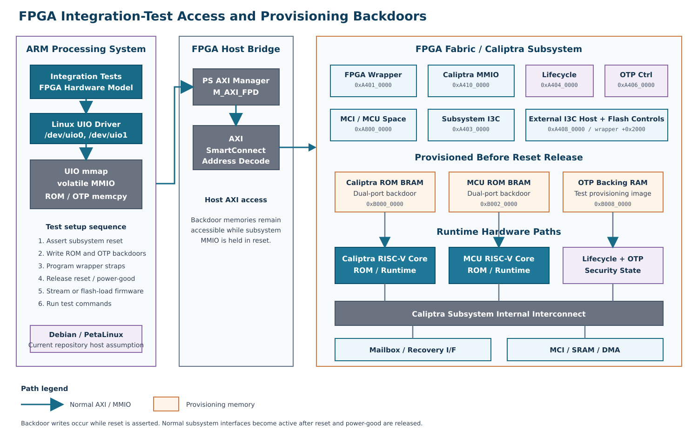

### A.2 Operations performed once per FPGA configuration

The `cargo xtask-fpga fpga bootstrap` path performs host and bitstream setup:

1. Connect to the target Linux host, normally over SSH.
2. Check required host tools and access.
3. Disable deep CPU idle on the two processing-system CPUs to avoid timing and
   AXI-access instability.
4. Build `hw/fpga/kernel-modules/io_module.ko` when it is not already supplied
   by the FPGA image.
5. Insert `io_module.ko` and make `/dev/uio0` and `/dev/uio1` accessible to the
   test process.
6. Load the segmented FPGA bitstream when supported by the target image.
7. Store the selected FPGA configuration in `/dev/shm/fpga-config`; the cache
   must be recreated after a power cycle.

The kernel-module Makefile also builds standalone Caliptra and MCU ROM
backdoor character-device modules. The current bootstrap path does not insert
or use those modules. ROM provisioning by the integration model uses UIO
memory mappings from `io_module.ko`.

Firmware and tests are staged separately. `cargo xtask-fpga fpga build`
creates the firmware bundle, `cargo xtask-fpga fpga build-test` cross-compiles
and archives tests with the `fpga_realtime` feature, and
`cargo xtask-fpga fpga test` runs the archive on the target Linux system.

### A.3 Host-visible UIO mappings

`hw/fpga/kernel-modules/io_module.c` registers the following physical windows:

| UIO mapping   | Physical address |    Size | Current use                                               |
| ------------- | ---------------: | ------: | --------------------------------------------------------- |
| `uio0/map0` |  `0xA401_0000` |  64 KiB | FPGA wrapper, reset, straps, log FIFOs, and test controls |
| `uio0/map1` |  `0xA410_0000` | 256 KiB | Caliptra MMIO                                             |
| `uio0/map2` |  `0xB000_0000` |  96 KiB | Caliptra ROM BRAM backdoor                                |
| `uio0/map3` |  `0xA408_0000` |  64 KiB | External I3C controller                                   |
| `uio0/map4` |  `0xB008_0000` | 512 KiB | OTP backing-memory window                                 |
| `uio1/map0` |  `0xA404_0000` |   8 KiB | Lifecycle controller                                      |
| `uio1/map1` |  `0xB002_0000` | 128 KiB | MCU ROM BRAM backdoor                                     |
| `uio1/map2` |  `0xA403_0000` |  64 KiB | Caliptra Subsystem I3C target                             |
| `uio1/map3` |  `0xA800_0000` |  16 MiB | MCI and MCU-visible subsystem space                       |
| `uio1/map4` |  `0xA406_0000` |   8 KiB | OTP controller registers                                  |

There are two important address-map qualifications:

- `uio0/map4` is named `mcu_sram` in `io_module.c`, but the FPGA Tcl and the
  resolved `caliptra-hw-model` implementation use this window as the OTP
  backing RAM. The label is stale and must not be used as evidence that the
  host directly preloads MCU execution SRAM.
- `0xB002_0000` is the host-accessible MCU ROM BRAM backdoor. The MCU's normal,
  reset-sensitive ROM AXI window is at `0xB004_0000`. Integration tests write
  the former before releasing the subsystem.

#### A.3.1 FPGA wrapper (`uio0/map0`)

Linux exposes `uio0/map0` as a 64 KiB mapping beginning at `0xA401_0000`.
Vivado assigns only the first 16 KiB (`0xA401_0000` through `0xA401_3FFF`) to
`S_AXI_WRAPPER`. The remaining 48 KiB is outside the FPGA wrapper's AXI address
segment even though it is inside the UIO mapping. Software must not access
offsets `0x4000` through `0xFFFF`; the interconnect can report an AXI error or
stall for an unassigned address.

The implemented portion contains four blocks on 4 KiB boundaries:

| Map offset | Physical address | Block                      | Implemented contents                                                              |
| ---------: | ---------------: | -------------------------- | --------------------------------------------------------------------------------- |
| `0x0000` |  `0xA401_0000` | Wrapper interface          | Control, status, straps, test keys, and OCP LOCK staging through offset `0x280` |
| `0x1000` |  `0xA401_1000` | FIFO interface             | Caliptra log, debug, message, and ITRNG FIFOs through offset `0x1024`           |
| `0x2000` |  `0xA401_2000` | Primary flash controller   | Control registers and a 256-byte page buffer                                      |
| `0x3000` |  `0xA401_3000` | Secondary flash controller | Control registers and a separate 256-byte page buffer                             |

##### Wrapper interface registers

|              Offset | Register or range                     | Access | Purpose                                                                                                                                                   |
| ------------------: | ------------------------------------- | ------ | --------------------------------------------------------------------------------------------------------------------------------------------------------- |
|           `0x000` | `fpga_magic`                        | RO     | ASCII `CPTR` (`0x52545043`) image-valid marker                                                                                                        |
|           `0x004` | `fpga_version`                      | RO     | Git revision used to build the FPGA image                                                                                                                 |
|           `0x008` | `control`                           | RW     | Power-good, subsystem reset, boot-FSM breakpoint, scan mode, debug intent, I3C AXI filtering, OCP lock, RMA/scrap policy, FIPS zeroization, and AXI reset |
|           `0x00C` | `status`                            | RO     | Fatal/nonfatal error, ready-for-fuses, mailbox readiness, runtime readiness, mailbox state, and MCU halt status                                           |
|           `0x010` | `arm_user`                          | RW     | AXI USER value applied to processing-system transactions                                                                                                  |
|           `0x014` | `itrng_divisor`                     | RW     | Internal-TRNG request throttling divisor                                                                                                                  |
|           `0x018` | `cycle_count`                       | RO     | Free-running FPGA cycle counter                                                                                                                           |
| `0x030`-`0x037` | `generic_input_wires[2]`            | RW     | Caliptra generic input straps                                                                                                                             |
| `0x038`-`0x03F` | `generic_output_wires[2]`           | RO     | Caliptra generic output-wire observation                                                                                                                  |
| `0x040`-`0x05F` | `cptra_obf_key[8]`                  | RW     | Test obfuscation key straps                                                                                                                               |
| `0x060`-`0x09F` | `cptra_csr_hmac_key[16]`            | RW     | Test CSR HMAC key straps                                                                                                                                  |
| `0x0A0`-`0x0DF` | `cptra_obf_uds_seed[16]`            | RW     | Test UDS seed straps                                                                                                                                      |
| `0x0E0`-`0x0FF` | `cptra_obf_field_entropy[8]`        | RW     | Test field-entropy straps                                                                                                                                 |
| `0x100`-`0x110` | AXI USER straps                       | RW     | LSU, IFU, DMA, SoC-configuration, and SRAM-configuration AXI identities                                                                                   |
|           `0x114` | `mcu_reset_vector`                  | RW     | MCU reset PC, normally `0xB004_0000`                                                                                                                    |
|           `0x118` | `ss_all_error`                      | RO     | Aggregated subsystem fatal and nonfatal errors                                                                                                            |
|           `0x11C` | `mcu_config`                        | RW     | MCU no-ROM, boot breakpoint, lifecycle, and scan-reset controls                                                                                           |
|           `0x120` | `uds_seed_base_addr`                | RW     | Test UDS seed location                                                                                                                                    |
| `0x124`-`0x128` | Production debug-unlock configuration | RW     | Public-key-hash register-bank offset and number of hashes                                                                                                 |
| `0x12C`-`0x133` | `mci_generic_input_wires[2]`        | RW     | MCU ROM boot handshakes and boot-mode straps                                                                                                              |
| `0x134`-`0x13B` | `mci_generic_output_wires[2]`       | RO     | MCU-generated status wires                                                                                                                                |
| `0x13C`-`0x144` | Key-release and staging outputs       | RO     | Key-release base/size and external staging-area base                                                                                                      |
|           `0x148` | `cptra_ss_mcu_ext_int`              | RW     | Host-driven MCU external interrupt bits                                                                                                                   |
| `0x14C`-`0x158` | `cptra_ss_raw_unlock_token_hash[4]` | RW     | Raw lifecycle unlock-token hash                                                                                                                           |
|           `0x15C` | `spare_i3c_control_sts`             | RW/RO  | Spare-I3C and external-host selection plus interrupt/recovery status                                                                                      |
| `0x1F0`-`0x1FC` | `ss_strap_generic[4]`               | RW     | Generic subsystem straps                                                                                                                                  |
| `0x200`-`0x23C` | `ocp_lock_key_release_reg[16]`      | RW     | OCP LOCK media-encryption-key staging                                                                                                                     |
| `0x240`-`0x250` | `ocp_lock_metadata_reg[5]`          | RW     | OCP LOCK metadata staging                                                                                                                                 |
| `0x260`-`0x27C` | `ocp_lock_auxiliary_data_reg[8]`    | RW     | OCP LOCK auxiliary-data staging                                                                                                                           |
|           `0x280` | `ocp_lock_control_reg`              | RW/RO  | OCP LOCK control and processed-key ready indication                                                                                                       |

These writable key and secret inputs are FPGA test/provisioning facilities;
they do not define the production secret-storage architecture.

##### FIFO interface registers

|     Offset | Register              | Direction     | Purpose                                                                 |
| ---------: | --------------------- | ------------- | ----------------------------------------------------------------------- |
| `0x1000` | `log_fifo_data`     | FPGA to host  | Reading pops the next Caliptra log byte and reports whether it is valid |
| `0x1004` | `log_fifo_status`   | FPGA to host  | Caliptra log FIFO empty/full status                                     |
| `0x1008` | `itrng_fifo_data`   | Host to FPGA  | Writes one 32-bit word containing eight 4-bit entropy samples           |
| `0x100C` | `itrng_fifo_status` | Bidirectional | Empty/full status and software FIFO reset                               |
| `0x1010` | `dbg_fifo_pop`      | FIFO to host  | Pops one 32-bit debug word                                              |
| `0x1014` | `dbg_fifo_push`     | Host to FIFO  | Pushes one 32-bit debug word                                            |
| `0x1018` | `dbg_fifo_status`   | FPGA to host  | Debug FIFO empty/full status                                            |
| `0x101C` | `msg_fifo_pop`      | FIFO to host  | Pops one 32-bit message word                                            |
| `0x1020` | `msg_fifo_push`     | Host to FIFO  | Pushes one 32-bit message word                                          |
| `0x1024` | `msg_fifo_status`   | FPGA to host  | Message FIFO empty/full status                                          |

The host-side entropy feeder writes `itrng_fifo_data` while the FPGA consumes
4-bit samples from the width-converting FIFO. This is a test entropy source,
not a production physical-noise source.

##### Primary and secondary flash-controller registers

The primary block uses map offsets `0x2000` through `0x21FF`; the secondary
block repeats the same relative layout at `0x3000` through `0x31FF`.

|     Relative offset | Register                | Purpose                                                                           |
| ------------------: | ----------------------- | --------------------------------------------------------------------------------- |
|            `0x00` | `FL_INTERRUPT_STATE`  | Error and completion-event interrupt state                                        |
|            `0x04` | `FL_INTERRUPT_ENABLE` | Error and completion-event interrupt enables                                      |
|            `0x08` | `PAGE_SIZE`           | Page size, normally 256 bytes                                                     |
|            `0x0C` | `PAGE_NUM`            | Selected physical page                                                            |
|            `0x10` | `PAGE_ADDR`           | Driver-provided page-buffer address field                                         |
|            `0x14` | `FL_CONTROL`          | Start and operation selection; the active model uses 1=read, 2=write, and 3=erase |
|            `0x18` | `OP_STATUS`           | Completion and operation-error status                                             |
|            `0x1C` | `CTRL_REGWEN`         | Control-register write enable                                                     |
|            `0x20` | `FLASH_SIZE`          | Advertised capacity, normally 16 MiB                                              |
| `0x100`-`0x1FF` | `FLASH_BUF[64]`       | 256-byte page-transfer buffer                                                     |

Only the controller registers and page buffers reside in `uio0/map0`. The
actual primary and secondary flash arrays are host-memory buffers maintained by
the FPGA hardware-model process. The process observes `FL_CONTROL`, copies data
between the selected host flash page and `FLASH_BUF`, and updates status and
interrupt state.

### A.4 Per-test image and fuse preparation

Each integration test normally calls `start_runtime_hw_model()`. The test
harness uses prebuilt artifacts when possible and otherwise builds:

- the Caliptra ROM;
- the MCU ROM;
- Caliptra firmware;
- the SoC manifest;
- MCU runtime firmware;
- optional primary-flash contents; and
- optional test-specific OTP contents.

The harness derives the vendor public-key hash from the selected firmware. It
may also construct an OTP overlay for DOT state or production debug-unlock key
hashes. Flash boot packages the mutable images into the primary-flash image;
recovery boot retains them as separate images.

### A.5 Per-test backdoor initialization sequence

Creating `ModelFpgaRealtime` performs the following ordered setup:

1. Convert the requested lifecycle into the Caliptra security state and build
   the Caliptra Subsystem initialization parameters.
2. Open `/dev/uio0` and `/dev/uio1` and map the wrapper, ROM backdoors, OTP
   backing RAM, Caliptra, MCI, lifecycle, OTP, and I3C regions.
3. Reset the FPGA AXI interface before using reset-sensitive subsystem MMIO.
4. Start the host entropy feeder after AXI reset.
5. Zero-pad and copy the Caliptra ROM into the `0xB000_0000` BRAM backdoor.
6. Zero-pad and copy the MCU ROM into the `0xB002_0000` BRAM backdoor.
7. Program wrapper inputs, deterministic test keys and secrets, entropy
   controls, AXI users, debug policy, OCP lock policy, and the MCU reset vector.
8. Assert subsystem reset and power-good low before changing OTP contents.
9. Clear the OTP backing RAM and construct the requested lifecycle and OTP
   partitions. Depending on the requested provisioning stage, this can include
   lifecycle transition tokens, manufacturing data, UDS test slots, field
   entropy, vendor and owner hashes, revocations, SVN values, and HEK seed.
10. Clear stale MCU and Caliptra log FIFOs.
11. Set the MCU reset vector to the normal MCU ROM address `0xB004_0000`.
12. Deassert subsystem reset and power-good, allowing MCU ROM execution.

If a test provides an additional `otp_memory` image, the MCU hardware model
then asserts reset again, copies the OTP backing RAM into a host buffer, clears
the overlay range, applies the test bytes, copies the complete buffer back, and
deasserts reset. Whole-buffer copies are required because byte writes to this
FPGA BRAM mapping can generate `SIGBUS` or corrupt words.

The host does not directly populate all Caliptra fuse registers. The backdoor
initializes OTP storage; MCU ROM subsequently reads OTP and forwards the
appropriate fuse values to Caliptra.

### A.6 Boot release and mutable image delivery

After unbooted initialization, the model programs MCI generic input wires used
as MCU ROM handshakes:

- bit 30 tells MCU ROM that it may load fuse registers and continue boot;
- bit 29 selects flash boot; and
- bit 28 selects encrypted boot when requested.

Mutable firmware then follows one of two paths:

**Recovery boot:** The host model sends Caliptra firmware, the SoC manifest,
and MCU runtime through the I3C recovery interface. MCU ROM and the recovery
logic place and authenticate the images; the host does not backdoor-copy MCU
runtime into MCU SRAM.

**Flash boot:** The integration model exposes a host-memory-backed primary
flash service. MCU ROM reads the packaged images and sends them through the
recovery interface using the subsystem's AXI bypass path.

The test constructor waits until MCI reports
`FIRMWARE_BOOT_FLOW_COMPLETE` unless the test requested ROM-only operation.
Only after this milestone does the integration test begin its test-specific
commands and assertions.

### A.7 Teardown

When the FPGA model is dropped, it stops the entropy worker, disables the I3C
controller, asserts subsystem reset, resets the AXI interface, and unmaps all
UIO regions. This makes provisioning a per-model-instance operation even when
the FPGA bitstream and Linux host remain active across many tests.

### A.8 HTG-940 integration requirements

The HTG-940 port must identify how its Linux environment provides each
function currently supplied by the VCK190/Versal processing-system path:

1. A host-accessible transport to wrapper and reset controls.
2. Writable Caliptra and MCU ROM memories while the subsystem is held in reset.
3. Writable OTP backing storage, or an equivalent provisioning mechanism.
4. Access to lifecycle, OTP, Caliptra, MCI, and I3C register windows.
5. A way to service or replace the host-modeled flash controller.
6. A physical USB device connection from the LPCIP3511 controller and PHY to
   the external recovery-agent host.
7. A replacement for UIO mappings if HTG-940 exposes the FPGA through PCIe or
   another host bridge rather than a processing-system AXI interconnect.

The HTG-940 address map must be treated as a new platform contract. Existing
physical addresses, UIO indices, reset semantics, and cache-coherency behavior
must be validated rather than copied from this appendix.

## Appendix B: USB initialization and recovery ownership

This appendix separates the work performed by the external USB PHY, the
LPCIP3511 device controller, the dedicated OCP recovery hardware, and MCU ROM.
The USB hardware handles link-level protocol mechanics, but reset does not
leave a configured or host-visible recovery device.

### B.1 State after reset

The LPCIP3511 device controller resets with `DEV_ADDR = 0`, `DEV_EN = 0`, and
`DCON = 0`. The device therefore starts at address zero but remains disabled
and disconnected from the host. Hardware can report VBUS presence, detect a
USB bus reset, negotiate link speed, and perform packet-level signaling once
the platform supplies the required clocks and releases reset.

Board-level integration must provide and sequence the external PHY clock,
controller clock, and reset. The current `LpcipUsbDriver` assumes that this has
already occurred before `init_and_enumerate()` is called; it does not configure
the board-level PHY clock or reset source itself. The HTG-940 integration must
define this sequence and cannot assume that MCU reset alone makes the USB
device ready.

### B.2 Controller initialization by MCU ROM

MCU ROM must initialize the device controller before enumeration can begin:

1. Disable and disconnect Device 0 while its state is initialized.
2. Disable and clear controller interrupts.
3. Initialize the endpoint-list and data-buffer base registers.
4. Clear endpoint descriptor memory, configure the SETUP descriptor, and arm
   EP0 OUT to receive an eight-byte SETUP packet.
5. Wait until hardware reports debounced VBUS.
6. Set `DEV_EN` and `DCON` to enable the device and connect it to the bus.
7. Enable EP0 and device-status interrupts.
8. Wait for the host's USB bus reset, acknowledge the reset indication, and
   re-arm EP0 OUT.

Hardware performs the electrical and packet-level portions of these
operations. It does not populate endpoint descriptors, connect the device, or
provide the USB descriptors without firmware initialization.

### B.3 Enumeration and `SET_ADDRESS`

Enumeration is divided between the controller and MCU ROM. The controller
receives SETUP packets, moves endpoint data, implements endpoint ACTIVE state,
generates link handshakes, and reports transfer completion. MCU ROM reads and
decodes each standard request and supplies the corresponding response.

The current ROM driver handles at least:

- `GET_DESCRIPTOR` for the device, configuration, language, and OCP interface
  string descriptors;
- `SET_ADDRESS`;
- `SET_CONFIGURATION`;
- `GET_CONFIGURATION`; and
- `GET_STATUS`.

For `SET_ADDRESS`, MCU ROM extracts the seven-bit address from `wValue`, writes
it to `DEVCMDSTAT.DEV_ADDR`, and arms the EP0 IN zero-length status response.
The controller treats the write as a pending address and commits it only after
the status stage completes. Thus MCU ROM interprets and initiates the request,
while hardware enforces the USB-required address-transition timing.

The `init_and_enumerate()` loop returns after acknowledging a valid non-zero
`SET_CONFIGURATION` request. String descriptors are served if requested before
configuration, but enumeration completion does not depend on a host issuing an
optional string request afterward. At that point the dedicated hardware path
can claim OCP class requests.

### B.4 OCP recovery hardware after enumeration

The post-synchronizer arbiter recognizes OCP Recovery class requests on EP0
for the recovery interface. When `CALIPTRA_CTRL.OCP_PATH_DISABLE` is clear, it
routes those transfers to the dedicated OCP command decoder instead of the
legacy firmware endpoint path. `OCP_PATH_DISABLE` resets to zero, so the OCP
hardware claim path is enabled by default.

The dedicated hardware then:

- validates OCP command direction and transfer length;
- serves capability and status reads from the recovery register aperture;
- accepts `DEVICE_RESET`, `RECOVERY_CTRL`, and FIFO-control writes;
- transfers `INDIRECT_FIFO_DATA` into the 64-DWORD recovery FIFO;
- reports protocol errors and live FIFO status; and
- asserts `payload_available` and `recovery_image_activated` sidebands.

Consequently, MCU ROM does not need to parse and respond to every OCP USB
class request when this hardware path is used. Static protocol capability
fields have useful reset defaults, and the hardware owns USB command framing
and FIFO ingress.

### B.5 Firmware responsibilities during recovery

The complete recovery flow is not autonomous. MCU ROM or equivalent platform
recovery logic must still:

1. Publish meaningful `DEVICE_STATUS`, recovery reason, `RECOVERY_STATUS`, and
   recovery image index values through the firmware-visible recovery aperture.
2. Observe `payload_available` and drain recovery data from
   `INDIRECT_FIFO_DATA` quickly enough to permit continued host streaming.
3. Observe `recovery_image_activated`, select the requested image, and clear or
   acknowledge the stored activation request after accepting it.
4. Forward each image through the Caliptra recovery interface and perform the
   required authentication and boot-policy actions.
5. Update recovery status for stage success, the next requested image, final
   completion, or failure so the Recovery Agent can make progress.
6. Handle supported reset requests and report firmware-detected protocol or
   hardware failures when required.

Therefore, the hardware can receive and buffer OCP commands without firmware
servicing each EP0 transfer, but the Recovery Agent cannot complete the image
sequence unless firmware or directly connected recovery logic consumes the
hardware state and advances recovery.

### B.6 Current repository integration status

This subsection records the original bring-up baseline; it is not the target
persistent recovery design. See [section 9.5](#95-target-persistent-usb-service-in-the-ocp-recovery-rom)
and [section 9.6](#96-target-interruption-reset-and-error-recovery) for the unified
service loop and fault-handling requirements.

The current LPCIP ROM implementation is enabled by the
`test-lpcip-usb-ocp-recovery` feature and calls `init_and_enumerate()` only on
cold boot. Its scope intentionally ends after enumeration because the
dedicated hardware is expected to claim subsequent OCP class requests.

The USB wrapper exposes `payload_available` and `ocp_firmware_activated`, and
provides an AHB aperture through which firmware can access recovery registers
and FIFO data. In the current source tree, however, the compound USB wrapper is
instantiated by the USB integration testbench and is not yet instantiated by
the production Caliptra Subsystem top level. The generic MCU ROM recovery code
also does not yet show a production path that consumes these USB hardware
sidebands and the FIFO aperture.

The final HTG-940 implementation must therefore verify all of the following
before treating USB recovery as autonomous after reset:

- board-level PHY clock and reset sequencing;
- LPCIP controller and endpoint-memory address integration;
- MCU interrupt routing and standard-request enumeration;
- recovery AHB aperture visibility from MCU ROM;
- routing of payload-available and image-activation indications; and
- connection of the recovery FIFO consumer to the Caliptra image-loading flow.
