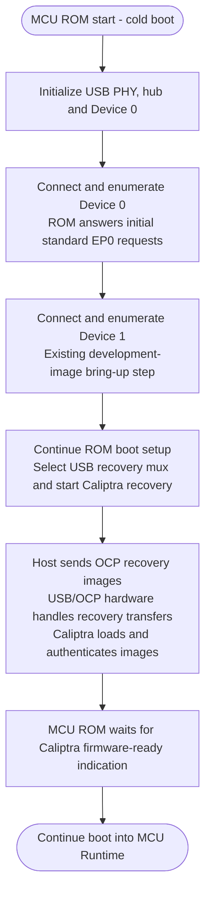
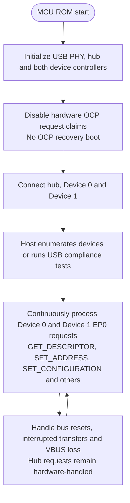

# USB Test Images: Current Demonstration Flows

## Status at a glance

We have created and tested **two separate MCU ROM images** on the HTG-940 FPGA:

| Test image | What we have demonstrated | What it does not demonstrate |
| --- | --- | --- |
| OCP recovery | USB enumeration followed by successful OCP firmware recovery and MCU runtime boot. | Continuous standard-request service during recovery or USB compliance with this image. |
| USB compliance | Passing USB compliance tests with a dedicated ROM that continuously services standard USB requests. | OCP recovery or MCU runtime boot with this image. |

These are development test images, not a single production-ready image.
Passing the compliance tests with the dedicated image does not establish that
the OCP recovery image passes those tests, nor constitute USB-IF certification.

## 1. OCP recovery test image

Build feature: `test-lpcip-usb-ocp-recovery`.

**Key limitation:** ROM's enumeration routine returns after configuration.
It does not continuously service Device 0 standard requests during subsequent
Device 1 enumeration or the recovery wait. This is why the separate compliance
image was created. In this development image, Device 1 must also configure
before ROM proceeds to recovery.

## 2. Dedicated USB compliance test image

Build feature: `test-lpcip-usb-compliance`.

**Key difference:** this image remains in ROM indefinitely, even after
configuration. Each device has an independent EP0 state machine, allowing the
test tool to issue requests after initial enumeration. It does not load
recovery images or boot MCU runtime.

## Next step, not yet demonstrated by these images

Combine persistent standard-request and USB-event handling with OCP recovery
in the **same recovery ROM image**, then validate both behaviors using that
image. The agreed production ROM scope is **hub and Device 0 only**, with
Device 1 disabled; the two-device flows above describe the existing
development images, not that target scope.

See the [detailed MCU ROM target flow](./usb_recovery_emulation.md#95-target-persistent-usb-service-in-the-ocp-recovery-rom)
and [interruption-handling design](./usb_recovery_emulation.md#96-target-interruption-reset-and-error-recovery)
for the proposed integration.
